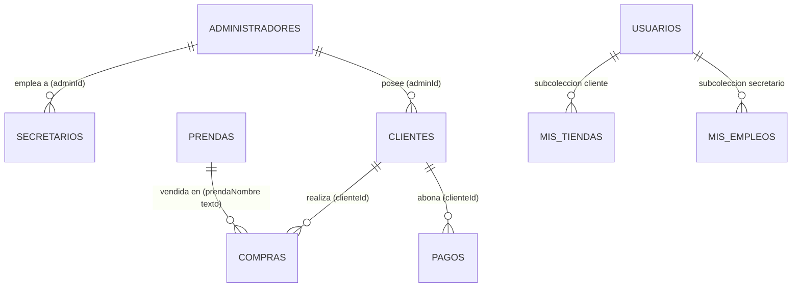
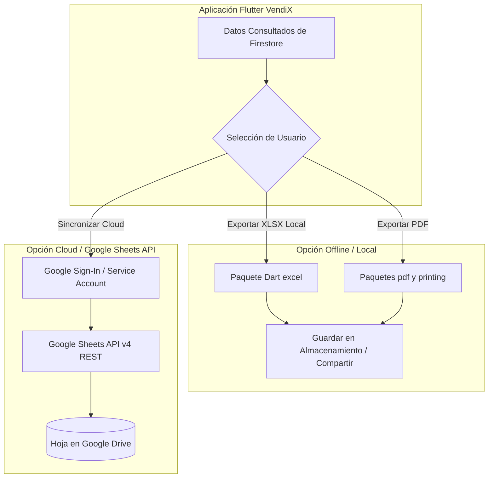

# ANÁLISIS TÉCNICO DE VENDIX PARA INTEGRACIÓN CON GOOGLE SHEETS API Y EXPORTACIÓN DE REPORTES

> **Documento Técnico de Referencia de Base de Datos, Relaciones, Funcionalidades y Catálogo de Reportes**  
> **Proyecto:** VENDIX (Computación Móvil)  
> **Framework:** Flutter 3.x / Dart | **Backend:** Firebase (Cloud Firestore & Firebase Auth)  
> **Fecha de Elaboración:** Noviembre 2026  
> **Autor:** Equipo de Arquitectura y Desarrollo VendiX  
> **Archivo generado:** `VENDIX_ANALISIS_REPORTES_GOOGLE_SHEETS.md`

---

## ÍNDICE GENERAL

1. [Descripción General y Arquitectura de VendiX](#1-descripción-general-y-arquitectura-de-vendix)
2. [Inventario Completo de Colecciones, Subcolecciones y Nodos Firebase](#2-inventario-completo-de-colecciones-subcolecciones-y-nodos-firebase)
3. [Diccionario Exhaustivo de Campos y Tipos de Datos](#3-diccionario-exhaustivo-de-campos-y-tipos-de-datos)
4. [Análisis de Relaciones entre Entidades y Roles](#4-análisis-de-relaciones-entre-entidades-y-roles)
5. [Funcionalidades Existentes que Generan y Procesan Información](#5-funcionalidades-existentes-que-generan-y-procesan-información)
6. [Catálogo Maestro de Reportes para Google Sheets](#6-catálogo-maestro-de-reportes-para-google-sheets)
7. [Reportes Exclusivos del Emprendedor / Administrador](#7-reportes-exclusivos-del-emprendedor--administrador)
8. [Reportes Disponibles para Secretarios / Operadores](#8-reportes-disponibles-para-secretarios--operadores)
9. [Análisis Especial: Reporte de Rendimiento del Equipo](#9-análisis-especial-reporte-de-rendimiento-del-equipo)
10. [Indicadores, Fórmulas Matemáticas y Métricas Calculables](#10-indicadores-fórmulas-matemáticas-y-métricas-calculables)
11. [Propuesta de Estructura de la Plantilla XLSX / Google Sheets](#11-propuesta-de-estructura-de-la-plantilla-xlsx--google-sheets)
12. [Arquitectura de Integración: Google Sheets API v4 y Exportación PDF](#12-arquitectura-de-integración-google-sheets-api-v4-y-exportación-pdf)
13. [Limitaciones, Inconsistencias Detectadas y Plan de Ajustes Necesarios](#13-limitaciones-inconsistencias-detectadas-y-plan-de-ajustes-necesarios)

---

## 1. DESCRIPCIÓN GENERAL Y ARQUITECTURA DE VENDIX

### 1.1. Propósito y Modelo de Negocio
**VendiX** es una plataforma móvil diseñada para resolver la gestión operativa, comercial y financiera de negocios de venta de ropa y prendas que operan principalmente a través de **transmisiones en vivo (Live Streaming en plataformas como TikTok, Instagram o Facebook)**.

En este modelo de venta:
- Las ventas ocurren de manera rápida, masiva y desordenada durante una transmisión en vivo.
- Los clientes "apartan" prendas en el chat en tiempo real.
- El personal operativo (secretarios/operadores) o el propio emprendedor deben registrar pedidos rápidamente en cuestión de segundos para evitar confusiones de stock o duplicidad de prendas.
- Los clientes acumulan saldo deudor a medida que apartan prendas a lo largo del live, y realizan pagos parciales (abonos) o totales antes del despacho físico.

### 1.2. Pila Tecnológica (Tech Stack) Verificada
A partir del análisis del archivo [`pubspec.yaml`](file:///c:/Users/crist/Desktop/VENDIX/flutter_application_1/pubspec.yaml) y el código fuente, la arquitectura se compone de:

* **Lenguaje y UI:** Flutter SDK `^3.13.0`, Dart 3.
* **Autenticación:** Firebase Authentication (`firebase_auth: ^7.0.0`) con soporte para correo/contraseña y Google Sign-In (`google_sign_in: ^7.2.0`).
* **Base de Datos Principal:** Cloud Firestore (`cloud_firestore: ^7.0.0`), base de datos NoSQL documental orientada a colecciones y documentos en tiempo real.
* **Base de Datos en Tiempo Real (RTDB):** **No se utiliza**. No existe dependencia ni referencias a `firebase_database`.
* **Almacenamiento Multimedia:** Cloudinary API vía HTTP (`cloudinary_service.dart`) para subida y hospedaje de fotografías de perfil y catálogo, respaldado opcionalmente por strings codificados en Base64.
* **Inteligencia Artificial:** SDK oficial de Google (`google_generative_ai: ^0.4.7`) conectando con modelos Gemini para asistencia y consulta conversacional del cliente (`gemini_service.dart`).
* **Geolocalización y Mapas:** `mapbox_maps_flutter: ^3.34.2` y `geolocator: ^14.1.2` para la fijación y renderizado de la tienda física del emprendedor en un mapa interactivo.

### 1.3. Definición de Roles del Sistema
El sistema implementa tres roles claramente segmentados:

```
                    ┌────────────────────────┐
                    │      EMPRENDEDOR       │
                    │    (Administrador)     │
                    └───────────┬────────────┘
                                │ Supervisa / Aprueba
                                ▼
                    ┌────────────────────────┐
                    │       SECRETARIO       │
                    │   (Operador de Live)   │
                    └───────────┬────────────┘
                                │ Registra ventas / Cobros
                                ▼
                    ┌────────────────────────┐
                    │        CLIENTE         │
                    │    (Comprador Live)    │
                    └────────────────────────┘
```

1. **Emprendedor (Administrador):**
   - Es el dueño de la tienda o negocio.
   - Administra el catálogo de prendas y precios oficiales.
   - Aprueba, suspende o da de alta a secretarios que solicitan trabajar en su negocio.
   - Puede operar directamente sin secretarios registrando ventas y abonos en vivo.
   - Supervisa métricas globales de ingresos, cartera por cobrar y rendimiento.
2. **Secretario (Operador de Ventas):**
   - Empleado operativo vinculado formalmente a un emprendimiento mediante una solicitud aprobada.
   - Abre y cierra "Jornadas Live".
   - Dispone de un código en vivo (`codigoLive`) para que los clientes se enlacen a la sesión de venta.
   - Registra ventas rápidas asignando prendas a clientes durante la transmisión.
   - Registra abonos y pagos parciales o totales.
   - Consulta estadísticas operativas de la jornada y del negocio.
3. **Cliente (Comprador):**
   - Comprador final que se asocia a la tienda introduciendo el código del live.
   - Puede estar asociado a múltiples tiendas mediante su subcolección `mis_tiendas`.
   - Consulta su saldo pendiente, historial de prendas compradas y comprobantes de abonos en tiempo real.
   - Puede postularse para trabajar como secretario con otros emprendedores desde su propia cuenta.

---

## 2. INVENTARIO COMPLETO DE COLECCIONES, SUBCOLECCIONES Y NODOS FIREBASE

Se realizó un escaneo exhaustivo sobre los 40 archivos Dart del proyecto. Todas las entidades residen en **Cloud Firestore**.

### 2.1. Mapa de Colecciones Raíz

| # | Nombre Exacto de Colección | Ruta Firestore | Finalidad en VendiX | Nivel de Verificación |
|---|---------------------------|----------------|---------------------|-----------------------|
| 1 | `Administradores` | `/Administradores/{adminId}` | Almacena los perfiles comerciales, datos fiscales/de contacto, nombre del emprendimiento y ubicación geográfica de la tienda de los emprendedores. | **100% Confirmada** en 12 archivos |
| 2 | `usuarios` | `/usuarios/{uid}` | Colección raíz unificada de autenticación. Mapea el UID de Firebase Auth con el rol activo, datos personales básicos y banderas de aprobación. | **100% Confirmada** en 18 archivos |
| 3 | `secretarios` | `/secretarios/{docId}` | Registra los puestos y vinculaciones laborales de secretarios con emprendedores. Administra el estado de aprobación y el `codigoLive`. | **100% Confirmada** en 16 archivos |
| 4 | `clientes` | `/clientes/{clienteDocId}` | Fichas comerciales de clientes. Contiene datos personales, saldo actual, último abono registrado y enlace con el emprendimiento. | **100% Confirmada** en 17 archivos |
| 5 | `compras` | `/compras/{compraId}` | Transacciones individuales de ventas de prendas realizadas durante los lives o en tienda. | **100% Confirmada** en 8 archivos |
| 6 | `pagos` | `/pagos/{pagoId}` | Registro histórico de abonos y transferencias de dinero entregadas por los clientes a cuenta de sus compras. | **100% Confirmada** en 7 archivos |
| 7 | `prendas` | `/prendas/{prendaId}` | Catálogo de productos y prendas con precios unitarios oficiales, stock y estado de activación comercial. | **100% Confirmada** en 4 archivos |
| 8 | `jornadas` | `/jornadas/{jornadaId}` | Registro de eventos o transmisiones en vivo (lives). Controla el estado ('pendiente', 'activa', 'cerrada') y marcas de tiempo de inicio/fin. | **100% Confirmada** en 2 archivos |
| 9 | `fotos_perfil` | `/fotos_perfil/{usuarioId}` | Almacén desacoplado de URLs multimedia y avatares de usuario sincronizados entre roles. | **100% Confirmada** en 2 archivos |

### 2.2. Mapa de Subcolecciones de Usuario

| # | Subcolección | Ruta Completa Firestore | Finalidad en VendiX | Nivel de Verificación |
|---|--------------|-------------------------|---------------------|-----------------------|
| 10 | `mis_tiendas` | `/usuarios/{uid}/mis_tiendas/{claveTienda}` | Permite la arquitectura multi-tienda del rol Cliente. Guarda el listado de todos los emprendimientos a los que el cliente se ha enlazado mediante código. | **100% Confirmada** en 3 archivos |
| 11 | `mis_empleos` | `/usuarios/{uid}/mis_empleos/{adminId}` | Permite el seguimiento laboral del usuario postulante. Guarda el estado de sus solicitudes de empleo con distintos emprendedores. | **100% Confirmada** en 3 archivos |

### 2.3. Estado de Firebase Realtime Database y Reglas de Seguridad
- **Firebase Realtime Database:** No implementada. Ausencia total de nodos o dependencias RTDB.
- **Reglas de Seguridad (`firestore.rules`):** No existe un archivo local `firestore.rules` en el repositorio Git. Toda la seguridad y el aislamiento multi-tenant se manejan por lógica de aplicación en los controladores Dart (`StreamBuilder`, `where(...)` y validaciones de estado).

---

## 3. DICCIONARIO EXHAUSTIVO DE CAMPOS Y TIPOS DE DATOS

A continuación se detalla cada campo verificado en el código fuente, indicando su tipo, modo de acceso y comportamiento.

### 3.1. Colección `compras` (Ventas de Prendas)
Ruta: `/compras/{compraId}`  
Archivos clave: `quick_sales_screen.dart`, `clients_screen.dart`, `client_service.dart`, `admin_home_screen.dart`, `statistics_screen.dart`.

| Campo | Tipo de Dato | Operación | Obligatorio | Significado Funcional / Descripción |
|---|---|---|---|---|
| `clienteId` | `String` | Write / Read | Sí | ID del documento del cliente comprador en la colección `clientes`. Clave foránea principal. |
| `clienteNombre` | `String` | Write / Read | Sí (en screens) | Nombre desnormalizado de la clienta al momento de la venta para renderizado rápido sin joins. |
| `prenda` | `String` | Write / Read | Sí (en screens) | Nombre de la prenda vendida (ej. "Vestido floreado", "Blusa seda"). |
| `prendaNombre` | `String` | Write / Read | Sí | Nombre estandarizado de la prenda. Se escribe duplicado junto con `prenda` para compatibilidad. |
| `precio` | `num` (double) | Write / Read | Sí (en screens) | Precio unitario al que se vendió la prenda en el live. |
| `precioUnitario`| `num` (double) | Write / Read | Condicional | Precio unitario escrito cuando la venta proviene de `client_service.dart`. |
| `cantidad` | `num` (int) | Write / Read | Sí | Número de unidades vendidas de esa misma prenda en la transacción. |
| `subtotal` | `num` (double) | Write / Read | Sí | Monto calculado de la línea: `precio * cantidad`. |
| `total` | `num` (double) | Write / Read | Sí (en screens) | Monto total de la compra (equivalente a `subtotal`). |
| `fecha` | `Timestamp` | Write / Read | Sí | Marca de tiempo generada mediante `FieldValue.serverTimestamp()`. |
| `adminId` | `String` | Read | **No se escribe** | Campo verificado en lecturas de `admin_home_screen.dart:315`, pero **no se graba** al momento de crear la compra. |

> [!WARNING] **ALERTA ARQUITECTÓNICA EN COMPRAS:**  
> 1. La colección `compras` **NO almacena el ID del usuario responsable que digitó la venta** (`secretarioId` o `adminId`).  
> 2. No almacena una clave foránea a `prendas` (`prendaId`); solo guarda el nombre en texto plano.  
> 3. No contiene un campo de estado (`estado: 'confirmada' | 'cancelada'`). Toda compra en la colección se asume activa y confirmada.

---

### 3.2. Colección `pagos` (Abonos y Cobranzas)
Ruta: `/pagos/{pagoId}`  
Archivos clave: `payments_screen.dart`, `clients_screen.dart`, `client_service.dart`, `admin_home_screen.dart`, `statistics_screen.dart`.

| Campo | Tipo de Dato | Operación | Obligatorio | Significado Funcional / Descripción |
|---|---|---|---|---|
| `clienteId` | `String` | Write / Read | Sí | ID del documento del cliente en `/clientes`. Relación foránea. |
| `clienteNombre` | `String` | Write / Read | Sí | Nombre desnormalizado del cliente que efectúa el abono. |
| `monto` | `num` (double) | Write / Read | Sí | Cantidad monetaria abonada/pagada en dólares. |
| `observacion` | `String` | Write / Read | Opcional | Nota descriptiva del pago (ej. "Transferencia Banco Pichincha #4582", "Efectivo entregado en local"). |
| `fecha` | `Timestamp` | Write / Read | Sí | Marca de tiempo del abono (`FieldValue.serverTimestamp()`). |
| `adminId` | `String` | Read | **No se escribe** | Leído en `admin_home_screen.dart:349` como fallback, pero no persistido en la inserción. |

---

### 3.3. Colección `prendas` (Catálogo de Productos)
Ruta: `/prendas/{prendaId}`  
Archivos clave: `prenda_service.dart`, `prenda_model.dart`, `clothing_prices_screen.dart`, `quick_sales_screen.dart`.

| Campo | Tipo de Dato | Operación | Obligatorio | Significado Funcional / Descripción |
|---|---|---|---|---|
| `nombre` | `String` | Write / Read | Sí | Nombre comercial de la prenda (ej. "Pantalón Jean", "Top encaje"). |
| `precio` | `num` (double) | Write / Read | Sí | Precio oficial de venta al público en dólares. |
| `activa` | `bool` | Write / Read | Sí | Flag comercial: `true` aparece en el catálogo del Live; `false` se oculta sin eliminarse. |
| `stock` | `num` (int) | Write / Read | Opcional | Cantidad de unidades físicas disponibles en bodega/tienda (por defecto 0). |
| `fecha_creacion`| `Timestamp` | Write / Read | Sí | Fecha de registro de la prenda en el sistema. |

---

### 3.4. Colección `clientes` (Fichas Comerciales de Clientes)
Ruta: `/clientes/{clienteDocId}`  
Archivos clave: `clients_screen.dart`, `register_client_screen.dart`, `client_profile_screen.dart`, `enter_code_screen.dart`.

| Campo | Tipo de Dato | Operación | Obligatorio | Significado Funcional / Descripción |
|---|---|---|---|---|
| `nombre` | `String` | Write / Read | Sí | Nombres y apellidos de la clienta. |
| `telefono` | `String` | Write / Read | Sí | Número de teléfono / WhatsApp para contacto y coordinación de entregas. |
| `direccion` | `String` | Write / Read | Opcional | Dirección física de residencia o envío del cliente. |
| `correo` | `String` | Write / Read | Opcional | Correo electrónico de la clienta. |
| `uid` | `String` | Write / Read | Opcional | UID de Firebase Auth si la clienta creó su propia cuenta en la aplicación móvil. |
| `adminId` | `String` | Write / Read | Opcional | UID del emprendedor al que está vinculada la clienta actualmente. |
| `secretarioId` | `String` | Write / Read | Opcional | ID del secretario con cuyo código se vinculó la clienta. |
| `codigoLive` | `String` | Write / Read | Opcional | Código del live activo que utilizó para vincularse (ej. "HCC-929"). |
| `saldo` | `num` (double) | Write / Read | Dinámico | Saldo deudor acumulado de la clienta. Se actualiza tras registrar pagos. |
| `ultimoPago` | `num` (double) | Write / Read | Dinámico | Monto del último abono recibido de esta clienta. |
| `fechaUltimoPago`| `Timestamp` | Write / Read | Dinámico | Fecha y hora en la que se registró el último pago. |
| `fecha` / `creadoEn`| `Timestamp` | Write / Read | Sí | Fecha de creación del registro de la clienta. |
| `fecha_desvinculacion`| `Timestamp` | Write / Read | Opcional | Registrado al momento de desvincularse de una tienda. |
| `fotoUrl` / `fotoBase64`| `String` | Write / Read | Opcional | Imagen de perfil de la clienta. |

---

### 3.5. Colección `secretarios` (Vinculaciones Laborales y Códigos)
Ruta: `/secretarios/{docId}`  
Archivos clave: `admin_more_screen.dart`, `solicitud_empleo_screen.dart`, `more_screen.dart`, `secretary_shell.dart`.

| Campo | Tipo de Dato | Operación | Obligatorio | Significado Funcional / Descripción |
|---|---|---|---|---|
| `uid` / `clienteId` | `String` | Write / Read | Sí | UID de Firebase Auth del usuario que actúa como secretario. |
| `adminId` | `String` | Write / Read | Sí | UID del emprendedor dueño del negocio donde labora el secretario. |
| `adminNombre` | `String` | Write / Read | Opcional | Nombre del emprendedor propietario. |
| `nombreEmprendimiento`| `String`| Write / Read | Opcional | Nombre comercial del emprendimiento. |
| `nombre` | `String` | Write / Read | Sí | Nombre completo del secretario. |
| `correo` | `String` | Write / Read | Sí | Correo electrónico de contacto del secretario. |
| `telefono` | `String` | Write / Read | Opcional | Teléfono celular del secretario. |
| `direccion` | `String` | Write / Read | Opcional | Dirección domiciliaria del secretario. |
| `codigoLive` | `String` | Write / Read | Opcional | Código alfanumérico generado para vincular a clientes a las ventas en vivo. |
| `aprobado` | `bool` | Write / Read | Sí | `true` si el emprendedor aceptó la solicitud; `false` si está pendiente o revocado. |
| `estado` | `bool` | Write / Read | Sí | `true` si la relación laboral está activa; `false` si está suspendida. |
| `estado_solicitud` | `String` | Write / Read | Sí | Valores verificados: `'pendiente'`, `'aprobado'`, `'rechazado'`, `'renunciado'`. |
| `fecha_solicitud` | `Timestamp` | Write / Read | Condicional | Fecha en que el usuario postuló al puesto. |
| `fecha_aprobacion`| `Timestamp` | Write / Read | Condicional | Fecha en que el administrador aprobó al secretario. |
| `fecha_renuncia` | `Timestamp` | Write / Read | Condicional | Fecha en que el secretario renunció a la tienda. |
| `metodo_registro` | `String` | Write / Read | Opcional | `'administrador'` (si lo creó el dueño) o `'solicitud'` (si postuló). |

---

### 3.6. Colección `Administradores` (Datos del Emprendimiento)
Ruta: `/Administradores/{adminId}`  
Archivos clave: `register_admin_screen.dart`, `admin_profile_screen.dart`, `admin_home_screen.dart`.

| Campo | Tipo de Dato | Operación | Obligatorio | Significado Funcional / Descripción |
|---|---|---|---|---|
| `uid` / ID Doc | `String` | Write / Read | Sí | UID de Firebase Auth del emprendedor (coincide con el doc ID). |
| `nombre` | `String` | Write / Read | Sí | Nombres del emprendedor. |
| `apellido` | `String` | Write / Read | Sí | Apellidos del emprendedor. |
| `nombreEmprendimiento`| `String`| Write / Read | Sí | Razón comercial o marca de la tienda (ej. "Ojo de Fantasma", "Moda Nicole"). |
| `correo` | `String` | Write / Read | Sí | Correo electrónico comercial. |
| `telefono` | `String` | Write / Read | Sí | Teléfono / WhatsApp oficial del negocio. |
| `direccionTienda` | `String` | Write / Read | Opcional | Dirección física del local comercial o bodega. |
| `latitudTienda` | `num` (double) | Write / Read | Opcional | Coordenada GPS latitud para el mapa Mapbox. |
| `longitudTienda`| `num` (double) | Write / Read | Opcional | Coordenada GPS longitud para el mapa Mapbox. |
| `ubicacion_tienda` | `Map<String, dynamic>`| Write / Read | Opcional | Objeto anidado con `latitud`, `longitud` y `direccion`. |
| `estado` | `bool` | Write / Read | Sí | `true` para negocio activo y operativo en la plataforma. |
| `creadoEn` | `Timestamp` | Write / Read | Sí | Fecha de registro del emprendedor en la plataforma. |

---

### 3.7. Colección `jornadas` (Sesiones Live)
Ruta: `/jornadas/{jornadaId}`  
Archivos clave: `jornadas_screen.dart`, `admin_home_screen.dart`.

| Campo | Tipo de Dato | Operación | Obligatorio | Significado Funcional / Descripción |
|---|---|---|---|---|
| `nombre` | `String` | Write / Read | Sí | Nombre descriptivo del live (ej. "Live TikTok 18 Nov - Ropa Invierno"). |
| `estado` | `String` | Write / Read | Sí | Estado del live: `'pendiente'`, `'activa'` o `'cerrada'`. |
| `fecha` | `Timestamp` | Write / Read | Sí | Fecha de creación del registro. |
| `horaInicio` | `Timestamp` | Write / Read | Condicional | Marca de tiempo exacta en que se inició la transmisión. |
| `horaFin` | `Timestamp` | Write / Read | Condicional | Marca de tiempo exacta en que se finalizó el live. |

---

### 3.8. Subcolección `mis_tiendas`
Ruta: `/usuarios/{uid}/mis_tiendas/{claveTienda}`  
Archivos clave: `enter_code_screen.dart`, `client_welcome_hub_screen.dart`, `client_profile_screen.dart`.

| Campo | Tipo de Dato | Operación | Significado Funcional |
|---|---|---|---|
| `adminId` | `String` | Write / Read | UID del emprendedor dueño de la tienda vinculada. |
| `nombreEmprendimiento`| `String` | Write / Read | Nombre comercial de la tienda vinculada. |
| `adminNombre` | `String` | Write / Read | Nombre completo del dueño de la tienda. |
| `codigoLive` | `String` | Write / Read | Código utilizado para el emparejamiento. |
| `secretarioId` | `String` | Write / Read | ID del secretario facilitador del código. |
| `fecha_asociacion` | `Timestamp` | Write / Read | Fecha en que el cliente se vinculó a la tienda. |

---

### 3.9. Subcolección `mis_empleos`
Ruta: `/usuarios/{uid}/mis_empleos/{adminId}`  
Archivos clave: `solicitud_empleo_screen.dart`, `client_welcome_hub_screen.dart`, `more_screen.dart`.

| Campo | Tipo de Dato | Operación | Significado Funcional |
|---|---|---|---|
| `adminId` | `String` | Write / Read | UID del emprendedor al que se envió la postulación. |
| `adminNombre` | `String` | Write / Read | Nombre del emprendedor. |
| `nombreEmprendimiento`| `String` | Write / Read | Nombre de la tienda postulada. |
| `estado` | `String` | Write / Read | `'pendiente'`, `'aprobado'`, `'renunciado'`, `'rechazado'`. |
| `aprobado` | `bool` | Write / Read | Flag booleano de aprobación. |
| `fecha_solicitud` | `Timestamp` | Write / Read | Fecha de postulación. |

---

## 4. ANÁLISIS DE RELACIONES ENTRE ENTIDADES Y ROLES

Se analizaron formalmente las seis interrogantes de vinculación y multi-tenancy planteadas en la solicitud:



### 1. ¿Cómo se identifica al emprendedor propietario de cada negocio?
* **Mecanismo:** El identificador unívoco de un negocio es el `UID` de Firebase Authentication del emprendedor.
* **Documento base:** Se almacena en la colección raíz `Administradores` donde `doc.id == uid`.
* **Sincronización:** A su vez, existe un documento idéntico en `usuarios/{uid}` con el campo `rol: 'administrador'`.

### 2. ¿Cómo se vinculan los secretarios con su emprendedor?
* **Mecanismo:** La vinculación se almacena en la colección `secretarios`.
* **Identificadores:** Cada documento en `secretarios` contiene:
  - `adminId`: UID del emprendedor propietario.
  - `clienteId` o `uid`: UID de la cuenta de usuario del secretario.
* **Regla de negocio:** Un secretario solo puede operar la tienda si `aprobado == true` y `estado == true`.

### 3. ¿Cómo se identifica al usuario que registró cada venta?
* **Hallazgo Crítico:** **Actualmente NO se identifica.**
* En [`lib/screens/secretary/quick_sales_screen.dart:230-240`](file:///c:/Users/crist/Desktop/VENDIX/flutter_application_1/lib/screens/secretary/quick_sales_screen.dart#L230-L240) y [`lib/screens/secretary/clients_screen.dart:819-829`](file:///c:/Users/crist/Desktop/VENDIX/flutter_application_1/lib/screens/secretary/clients_screen.dart#L819-L829), al llamar a `comprasRef.add()` o `batch.set()`, se guardan únicamente `clienteId`, `clienteNombre`, `prendaNombre`, `precio`, `cantidad`, `subtotal` y `fecha`.
* **No existe ningún campo `secretarioId`, `vendedorId`, `registradoPor` ni `adminId` en los documentos de la colección `compras`.**

### 4. ¿Es posible distinguir ventas realizadas por secretarios vs. emprendedor?
* **Respuesta técnica estricta:** **NO con los datos históricos existentes.**
* Debido a que el software omite el identificador del operador al insertar la compra, una compra realizada por el emprendedor desde su pestaña "Ventas Live" (`AdminHomeScreen -> QuickSalesScreen`) genera exactamente el mismo payload JSON que una realizada por un secretario desde `SecretaryShell -> QuickSalesScreen`.

### 5. ¿Cómo se vinculan las ventas con clientes y productos?
* **Vínculo con Clientes:** Es una relación foránea directa y funcional. Cada documento de `compras` guarda `clienteId`, que apunta a `/clientes/{clienteDocId}`. Adicionalmente, desnormaliza `clienteNombre`.
* **Vínculo con Productos:** Es una vinculación **débil por texto plano**. `compras` almacena los strings `prenda` y `prendaNombre` con el nombre de la prenda en el momento de la venta. **No almacena el ID del documento en `prendas` (`prendaId`).** Si el precio de la prenda cambia en el catálogo o la prenda se borra, el registro histórico en `compras` retiene el precio y nombre originales intactos (lo cual es contablemente correcto para no alterar transacciones pasadas).

### 6. ¿Cómo se restringe el acceso a los datos entre distintos emprendimientos?
* **En el Módulo de Administrador (`admin_home_screen.dart`):**  
  El código realiza un aislamiento en memoria:
  ```dart
  // 1. Obtiene los IDs de los clientes vinculados a este admin
  final misClientesIds = snapClientes.docs
      .where((d) => d['adminId'] == widget.admin.id)
      .map((d) => d.id).toSet();

  // 2. Filtra las compras verificando si el clienteId pertenece al set
  final pertenece = admId == widget.admin.id || misClientesIds.contains(cId);
  if (!pertenece) continue;
  ```
* **En el Módulo de Secretario (`statistics_screen.dart`):**  
  **Inconsistencia detectada:** En `statistics_screen.dart:129-136`, el secretario suscribe a `db.collection('compras').snapshots()` y `db.collection('pagos').snapshots()` de forma global **sin filtrar por `adminId` ni por los clientes del emprendedor**. Si hubiese múltiples tiendas en la misma base de datos, el secretario visualizaría compras de otros negocios.

---

## 5. FUNCIONALIDADES EXISTENTES QUE GENERAN INFORMACIÓN

A continuación se auditan las funcionalidades reales del código fuente, diferenciando entre lo que se almacena en Firestore, lo que se calcula en memoria en tiempo de ejecución y lo que es mera visualización:

| Funcionalidad | Pantalla / Archivo | Información Guardada en Firestore | Información Calculada en Memoria | Información Solo Mostrada en UI |
|---|---|---|---|---|
| **Venta Rápida (Quick Sales)** | `quick_sales_screen.dart` | Documento en `compras`: `clienteId`, `prendaNombre`, `precio`, `cantidad`, `subtotal`, `fecha`. | Subtotal por prenda (`precio * cantidad`), total por cliente en memoria temporal. | Nombres en chip, selector rápido de prendas con stock visual. |
| **Venta desde Ficha Clienta** | `clients_screen.dart` | Documento en `compras`. | Total acumulado de compras, saldo pendiente del cliente (`deuda`). | Insignia 'AL DÍA' o 'DEBE'. |
| **Registro de Abonos / Pagos** | `payments_screen.dart` y `clients_screen.dart` | Documento en `pagos`: `clienteId`, `monto`, `observacion`, `fecha`. Actualiza en `clientes`: `saldo`, `ultimoPago`, `fechaUltimoPago`. | Nuevo saldo (`deuda - monto`). Validación de que abono <= deuda. | Diálogo de confirmación, historial de recibos. |
| **Catálogo de Prendas** | `clothing_prices_screen.dart`, `prenda_service.dart` | Documento en `prendas`: `nombre`, `precio`, `activa`, `stock`, `fecha_creacion`. | Ninguna (CRUD directo). | Switch activo/inactivo, badges de precio unitario. |
| **Gestión de Jornadas Live** | `jornadas_screen.dart` | Documento en `jornadas`: `nombre`, `estado`, `fecha`, `horaInicio`, `horaFin`. | Estado activo/cerrado. | Indicador rojo de live activo. **No vincula compras a la jornada**. |
| **Estadísticas de Live** | `statistics_screen.dart` | Ninguna (solo lectura). | `totalVentas`, `totalCobrado`, `totalPendiente`, `totalPrendas`, ventas por hora (hora pico), ranking top clientes y top prendas. | Gráfico de barras de ventas por hora, lista ordenada de top clientas. |
| **Dashboard de Emprendedor** | `admin_home_screen.dart` | Ninguna (solo lectura). | `totalVendidoHoy`, `prendasVendidasHoy`, `totalVendidoHistorico`, `cobradoHoy`, `porCobrarHoy`. | Grid 2x2 de métricas, mapa con ubicación de tienda. |
| **Vinculación por Código** | `enter_code_screen.dart` | Modifica `usuarios/{uid}` y `clientes/{uid}`: `adminId`, `secretarioId`, `codigoLive`. Crea en `mis_tiendas`. | Resolución de `adminId` a partir de `secretarios.codigoLive`. | Pantalla de confirmación con datos de la tienda. |
| **Solicitud de Empleo** | `solicitud_empleo_screen.dart` | Documento en `secretarios` con `estado: false`, `aprobado: false`, `estado_solicitud: 'pendiente'`. Doc en `mis_empleos`. | Validación de perfil del cliente. | Listado de emprendimientos disponibles. |
| **Aprobación de Personal** | `admin_more_screen.dart` | Actualiza `secretarios`: `aprobado: true`, `estado: true`, `estado_solicitud: 'aprobado'`, `fecha_aprobacion`. | Conteo de secretarios activos vs pendientes. | Pestañas con contadores en tiempo real. |

---

## 6. CATÁLOGO MAESTRO DE REPORTES PARA GOOGLE SHEETS

A partir de los datos comprobados, se define el catálogo exhaustivo de reportes factibles. Para cada reporte se especifica su viabilidad técnica real con el esquema actual.

---

### REPORTE 1: Historial Detallado de Ventas (Libro de Ventas)
* **Objetivo:** Registrar cada línea de producto vendida cronológicamente, permitiendo auditar fecha, hora, cliente, prenda, cantidad y monto facturado.
* **Rol Autorizado:** Emprendedor (Administrador) y Secretario (con scope de tienda).
* **Colecciones Origen:** `compras` (cruzado con `clientes` para teléfono/correo).
* **Campos Requeridos:** `compras.fecha`, `compras.clienteId`, `compras.clienteNombre`, `compras.prendaNombre`, `compras.precio`, `compras.cantidad`, `compras.subtotal`.
* **Indicadores y Cálculos en Sheets:**
  - Total Facturado: `=SUM(G2:G)`
  - Total Prendas Vendidas: `=SUM(F2:F)`
  - Ticket Promedio por Ítem: `=AVERAGE(G2:G)`
* **Filtros Recomendados en Sheets:** Fecha (Año/Mes/Día), Rango de Fechas, Cliente, Nombre de Prenda.
* **Gráficos Recomendados:** Línea de tendencia de ventas diarias, Gráfico de barras apiladas de volumen por día.
* **Viabilidad Técnica:** **100% IMPLEMENTABLE ACTUALMENTE.** Todos los campos existen en `compras`.
* **Justificación de Utilidad:** Es la base contable del negocio para contrastar pedidos con entregas físicas.

---

### REPORTE 2: Historial de Cobranzas e Ingresos (Flujo de Caja)
* **Objetivo:** Detallar todos los ingresos de dinero efectivamente percibidos por abonos de clientes.
* **Rol Autorizado:** Emprendedor y Secretario.
* **Colecciones Origen:** `pagos` (cruzado con `clientes`).
* **Campos Requeridos:** `pagos.fecha`, `pagos.clienteId`, `pagos.clienteNombre`, `pagos.monto`, `pagos.observacion`.
* **Indicadores y Cálculos en Sheets:**
  - Total Recaudado / Cobrado: `=SUM(D2:D)`
  - Abono Promedio: `=AVERAGE(D2:D)`
  - Conteo de Operaciones de Pago: `=COUNTA(A2:A)`
* **Filtros Recomendados en Sheets:** Rango de Fechas, Cliente, Términos de búsqueda en Observación (ej. banco, efectivo).
* **Gráficos Recomendados:** Gráfico de área acumulativa de flujo de efectivo.
* **Viabilidad Técnica:** **100% IMPLEMENTABLE ACTUALMENTE.**
* **Justificación de Utilidad:** Permite cuadrar caja al final de cada jornada y conciliar pagos bancarios.

---

### REPORTE 3: Estado de Cuentas por Cobrar y Antigüedad de Deuda
* **Objetivo:** Conocer con exactitud la cartera pendiente de cobro de cada cliente, identificando morosidad y saldo pendiente total.
* **Rol Autorizado:** Emprendedor y Secretario.
* **Colecciones Origen:** `clientes`, calculable también agregando `compras` vs `pagos`.
* **Campos Requeridos:** `clientes.nombre`, `clientes.telefono`, `clientes.saldo`, `clientes.ultimoPago`, `clientes.fechaUltimoPago`.
* **Indicadores y Cálculos en Sheets:**
  - Cartera Total por Cobrar: `=SUM(C2:C)`
  - Número de Clientes con Deuda: `=COUNTIF(C2:C, ">0")`
  - Deuda Promedio por Cliente Deudor: `=AVERAGEIF(C2:C, ">0")`
* **Filtros Recomendados en Sheets:** Estado de Cuenta (Con Deuda / Al Día), Rango de Saldo Deudor.
* **Gráficos Recomendados:** Gráfico de pastel (Porcentaje de cartera al día vs. en deuda), Histograma de distribución de deuda.
* **Viabilidad Técnica:** **100% IMPLEMENTABLE ACTUALMENTE.**
* **Justificación de Utilidad:** Esencial en ventas por live, donde los clientes suelen acumular pedidos de varios días antes de que se les envíe la encomienda.

---

### REPORTE 4: Ventas y Rotación por Prenda / Producto
* **Objetivo:** Analizar cuáles prendas tienen mayor demanda comercial, volumen de salida y generación de ingresos brutos.
* **Rol Autorizado:** Emprendedor y Secretario.
* **Colecciones Origen:** `compras` (agrupada) y `prendas` (catálogo).
* **Campos Requeridos:** `compras.prendaNombre`, `compras.cantidad`, `compras.subtotal`.
* **Indicadores y Cálculos en Sheets:**
  - Unidades Vendidas por Producto: `=SUMIFS(compras!F:F, compras!D:D, A2)`
  - Recaudación Bruta por Producto: `=SUMIFS(compras!G:G, compras!D:D, A2)`
  - Participación porcentual sobre ventas: `=C2/SUM(C$2:C)`
* **Filtros Recomendados en Sheets:** Top 10 prendas, Categoría/Nombre.
* **Gráficos Recomendados:** Gráfico de barras horizontales (Ranking Top Productos), Diagrama de Pareto (80/20 de facturación por prenda).
* **Viabilidad Técnica:** **100% IMPLEMENTABLE ACTUALMENTE.**
* **Justificación de Utilidad:** Informa al emprendedor qué mercadería volver a surtir para el siguiente live.

---

### REPORTE 5: Ranking de Clientes VIP y Fidelización (Top Compradores)
* **Objetivo:** Categorizar a las clientas según su volumen total de compra histórica y frecuencia de compra.
* **Rol Autorizado:** Emprendedor.
* **Colecciones Origen:** `clientes`, `compras`.
* **Campos Requeridos:** `clientes.nombre`, `clientes.telefono`, `compras.total`.
* **Indicadores y Cálculos en Sheets:**
  - Total Invertido por Cliente: `=SUMIF(compras!B:B, A2, compras!G:G)`
  - Cantidad de Pedidos Realizados: `=COUNTIF(compras!B:B, A2)`
  - Ticket Promedio por Cliente: `=B2/C2`
  - Clasificación de Cliente: `=IFS(B2>500, "Diamante", B2>200, "Oro", B2>50, "Plata", TRUE, "Bronce")`
* **Filtros Recomendados en Sheets:** Categoría VIP, Rango de Compras.
* **Gráficos Recomendados:** Gráfico de dispersión (Volumen comprado vs. Deuda actual).
* **Viabilidad Técnica:** **100% IMPLEMENTABLE ACTUALMENTE.**
* **Justificación de Utilidad:** Permite al emprendedor otorgar descuentos exclusivos o regalos en el live a clientas leales.

---

### REPORTE 6: Rendimiento de Jornadas de Transmisión (Lives)
* **Objetivo:** Evaluar la rentabilidad y duración de cada live transmitido.
* **Rol Autorizado:** Emprendedor.
* **Colecciones Origen:** `jornadas`, `compras` (filtradas por ventana de tiempo `horaInicio` y `horaFin`).
* **Campos Requeridos:** `jornadas.nombre`, `jornadas.horaInicio`, `jornadas.horaFin`, `jornadas.estado`, `compras.subtotal`, `compras.fecha`.
* **Indicadores y Cálculos en Sheets:**
  - Duración del Live en Horas: `=(D2-C2)*24`
  - Total Vendido en el Live: `=SUMIFS(compras!G:G, compras!A:A, ">="&C2, compras!A:A, "<="&D2)`
  - Ventas por Hora de Transmisión: `=E2/E3`
* **Filtros Recomendados en Sheets:** Fecha del Live, Estado de Jornada ('cerrada').
* **Gráficos Recomendados:** Comparativo de barras de ingresos generados por cada Live.
* **Viabilidad Técnica:** **IMPLEMENTABLE CON CRUCE TEMPORAL.** Debido a que `compras` no tiene `jornadaId`, el cálculo debe efectuarse por rango de Timestamp entre `horaInicio` y `horaFin`.
* **Justificación de Utilidad:** Determina qué días y horarios de transmisión son más rentables para el negocio.

---

### REPORTE 7: Rendimiento Individual de Secretarios / Operadores
* **Objetivo:** Medir el desempeño en ventas de cada secretario vinculado al negocio.
* **Rol Autorizado:** Emprendedor (Administrador).
* **Colecciones Origen:** `secretarios`, `compras`.
* **Campos Requeridos:** `secretarios.nombre`, `secretarios.adminId`, `compras.secretarioId` (o `registradoPor`).
* **Viabilidad Técnica:** ⚠️ **REQUIERE AJUSTE EN BASE DE DATOS.**  
  * **Motivo:** Como se demostró en la Sección 4, `compras` **no graba** quién registró la venta.  
  * **Solución requerida:** Agregar `'secretarioId': idOperador` en `quick_sales_screen.dart` y `clients_screen.dart`.
* **Justificación de Utilidad:** Permite al emprendedor pagar comisiones sobre ventas a sus secretarios y evaluar su productividad.

---

### REPORTE 8: Comparativa Emprendedor vs. Equipo de Secretarios
* **Objetivo:** Comparar el volumen de ventas generadas personalmente por el dueño versus las generadas por sus secretarios.
* **Rol Autorizado:** Emprendedor.
* **Colecciones Origen:** `compras`, `secretarios`, `Administradores`.
* **Campos Requeridos:** `compras.rolResponsable` o `compras.responsableId`.
* **Viabilidad Técnica:** ⚠️ **REQUIERE AJUSTE EN BASE DE DATOS.** Requiere el mismo ajuste del Reporte 7 para diferenciar ventas directas del dueño de ventas delegadas.

---

### REPORTE 9: Inventario y Disponibilidad de Catálogo
* **Objetivo:** Supervisar el inventario físico de prendas, precios unitarios y valorización del stock disponible.
* **Rol Autorizado:** Emprendedor y Secretario.
* **Colecciones Origen:** `prendas`.
* **Campos Requeridos:** `prendas.nombre`, `prendas.precio`, `prendas.stock`, `prendas.activa`.
* **Indicadores y Cálculos en Sheets:**
  - Valorización Total de Stock: `=SUMPRODUCT(B2:B, C2:C)`
  - Total Unidades en Bodega: `=SUM(C2:C)`
  - Alerta de Stock Bajo: `=IF(C2<=2, "REABASTECER", "OK")`
* **Filtros Recomendados en Sheets:** Activa/Inactiva, Nivel de Stock (Bajo stock / En stock).
* **Gráficos Recomendados:** Gráfico de columnas con unidades en stock por producto.
* **Viabilidad Técnica:** **100% IMPLEMENTABLE ACTUALMENTE.**
* **Justificación de Utilidad:** Evita ofrecer prendas agotadas durante transmisiones en vivo.

---

### REPORTE 10: Auditoría de Horarios Pico de Venta
* **Objetivo:** Analizar la distribución horaria de las transacciones para identificar los momentos de mayor actividad comercial en el live.
* **Rol Autorizado:** Emprendedor y Secretario.
* **Colecciones Origen:** `compras`.
* **Campos Requeridos:** `compras.fecha`.
* **Indicadores y Cálculos en Sheets:**
  - Extracción de Hora: `=HOUR(A2)`
  - Transacciones por Hora: `=COUNTIF(horas_col, hora_especifica)`
  - Monto Facturado por Hora: `=SUMIF(horas_col, hora_especifica, subtotales)`
* **Filtros Recomendados en Sheets:** Día de la semana, Jornada Live.
* **Gráficos Recomendados:** Gráfico de campana o radar con las 24 horas del día.
* **Viabilidad Técnica:** **100% IMPLEMENTABLE ACTUALMENTE.**
* **Justificación de Utilidad:** Optimiza el lanzamiento de las mejores prendas en el momento de mayor audiencia y compra.

---

## 7. REPORTES EXCLUSIVOS DEL EMPRENDEDOR / ADMINISTRADOR

Por políticas de seguridad, gobernanza de datos y privacidad comercial, los siguientes reportes deben reservarse **exclusivamente al Emprendedor (Administrador)**:

1. **Reporte Consolidado de Utilidad Bruta y Flujo Total:**  
   Contiene el cruce integral entre el 100% de lo vendido históricamente contra lo cobrado y los saldos pendientes globales de la empresa.
2. **Reporte de Rendimiento y Auditoría de Secretarios:**  
   Métricas de desempeño laboral, horas trabajadas en jornadas y ventas generadas por cada operador para cálculo de nómina o comisiones.
3. **Reporte de Clientes VIP y Cartera Total:**  
   Listado de clientes clasificados por poder adquisitivo, con datos personales completos (teléfonos y correos).
4. **Reporte de Configuración y Métricas de Tienda Física:**  
   Datos de visitas, geolocalización y conversiones de clientes locales.

---

## 8. REPORTES DISPONIBLES PARA SECRETARIOS / OPERADORES

El rol de Secretario u Operador debe tener acceso a reportes operativos enfocados exclusivamente en la ejecución de la venta del live:

1. **Libro de Ventas de la Jornada Actual (Live Activo):**  
   Listado en tiempo real de prendas vendidas durante el turno para empaque, etiquetado y separación física.
2. **Reporte de Control de Abonos y Cobranzas del Turno:**  
   Detalle de los pagos recibidos durante su jornada laboral para entrega y cuadre de caja con el dueño.
3. **Consulta de Catálogo de Precios y Stock Oficial:**  
   Listado de prendas activas y precios unitarios para resolver dudas de clientes en el chat del live.
4. **Listado Operativo de Saldos de Clientas del Live:**  
   Para informar a las clientas durante el live cuánto deben antes de cerrar el pedido.

---

## 9. ANÁLISIS ESPECIAL: REPORTE DE RENDIMIENTO DEL EQUIPO

El requerimiento solicita evaluar la viabilidad de medir el rendimiento comparativo entre secretarios y el propio emprendedor.

### 9.1. Matriz de Viabilidad de Métricas del Equipo

| Métrica Solicitada | ¿Es Calculable Hoy? | Estado Técnico Actual | Ajuste Requerido en Base de Datos / Código |
|---|---|---|---|
| **Número de ventas por responsable** | ❌ No | El campo de responsable no se graba en `compras`. | Agregar campo `responsableId` y `rolResponsable` al escribir en `compras`. |
| **Ingresos asociados a cada responsable** | ❌ No | `pagos` tampoco guarda quién recibió el abono. | Agregar `cobradoPorId` en `pagos`. |
| **Unidades vendidas por responsable** | ❌ No | Imposible asociar la cantidad de la compra a un usuario. | Se deriva automáticamente al agregar `responsableId` en `compras`. |
| **Ticket promedio por responsable** | ❌ No | Sin ventas por responsable, no hay cociente de ticket. | Se calculará como `MontoTotal / CantidadVentas` una vez agregado el campo. |
| **Porcentaje de participación (% ventas)** | ❌ No | Falta el dato de origen por empleado. | Se calculará como `VentasResponsable / VentasTotalesNegocio`. |
| **Comparación directa Emprendedor vs. Secretarios** | ❌ No | Ambos roles usan la misma pantalla `QuickSalesScreen` sin estampar autoría. | Guardar en la compra el `rol` de quien inició sesión ('admin' vs 'secretario'). |
| **Evolución de ventas por fecha** | ✅ Sí | `compras.fecha` existe con precisión de milisegundos (`Timestamp`). | Funciona al 100% actualmente. |
| **Distinción entre Ventas vs. Ingresos Cobrados** | ✅ Sí | `compras` representa el compromiso; `pagos` representa el dinero cobrado. | Funciona al 100% actualmente. |
| **Distinción de ventas confirmadas vs. canceladas** | ❌ No | No existe campo `estado` en `compras`. Una venta registrada nunca cambia de estado. | Agregar campo `estado: 'confirmada' \| 'cancelada'` en `compras`. |

### 9.2. Diferenciación Crítica: Ventas Registradas vs. Ingresos Efectivamente Cobrados
Un principio contable crucial en VendiX:
- **Venta Registrada (`compras`):** Representa una orden o apartado de prendas en el Live. Genera una cuenta por cobrar. **No implica que el dinero esté en caja**.
- **Ingreso Cobrado (`pagos`):** Representa dinero líquido verificado.
- **Modelo de Saldo:** En VendiX, los pagos no se aplican a una factura individual específica; **amortizan la deuda global del cliente** (`clientes.saldo = comprasTotales - pagosTotales`).

---

## 10. INDICADORES, FÓRMULAS MATEMÁTICAS Y MÉTRICAS CALCULABLES

A continuación se formalizan las fórmulas estándar que deberán implementarse tanto en las celdas de Google Sheets como en los reportes PDF:

### 10.1. Indicadores Comerciales
$$\text{Venta Bruta Total} = \sum_{i=1}^{n} (\text{precio}_i \times \text{cantidad}_i)$$

$$\text{Ticket Promedio General} = \frac{\text{Venta Bruta Total}}{\text{Cantidad Total de Transacciones}}$$

$$\text{Precio Promedio de Prenda} = \frac{\text{Venta Bruta Total}}{\sum_{i=1}^{n} \text{cantidad}_i}$$

### 10.2. Indicadores Financieros y de Cobranza
$$\text{Total Cobrado (Efectivo)} = \sum_{j=1}^{m} \text{monto}_j$$

$$\text{Cartera Total por Cobrar} = \max\left(0, \text{Venta Bruta Total} - \text{Total Cobrado}\right)$$

$$\text{Índice de Efectividad de Cobro (Recovery Rate)} = \left(\frac{\text{Total Cobrado}}{\text{Venta Bruta Total}}\right) \times 100\%$$

### 10.3. Indicadores de Rendimiento del Equipo (Post-Ajuste)
$$\text{Participación de Ventas de Operador } k = \left(\frac{\text{Ventas Registradas por Operador } k}{\text{Venta Bruta Total del Negocio}}\right) \times 100\%$$

$$\text{Ticket Promedio del Operador } k = \frac{\text{Venta Total del Operador } k}{\text{N° Transacciones del Operador } k}$$

---

## 11. PROPUESTA DE ESTRUCTURA DE LA PLANTILLA XLSX / GOOGLE SHEETS

Para una exportación profesional mediante Google Sheets API o archivo `.xlsx`, se propone un libro de cálculo estructurado en **5 pestañas temáticas optimizadas para tablas dinámicas y gráficos**:

```
┌────────────────────────────────────────────────────────────────────────┐
│               LIBRO DE CONTROL Y GESTIÓN VENDIX.XLSX                   │
├──────────────┬──────────────┬──────────────┬─────────────┬─────────────┤
│ 1. DASHBOARD │  2. VENTAS   │  3. COBROS   │ 4. CLIENTES │ 5. CATÁLOGO │
│   RESUMEN    │  DETALLADAS  │  Y ABONOS    │  Y CARTERA  │ DE PRENDAS  │
└──────────────┴──────────────┴──────────────┴─────────────┴─────────────┘
```

### Pestaña 1: `DASHBOARD_RESUMEN` (Pestaña Ejecutiva)
* **Encabezado:** Nombre del Emprendimiento, Nombre del Dueño, Fecha de Generación, Rango de fechas exportado.
* **KPI Cards (Celdas Destacadas con Formato Grande):**
  - Total Facturado (\$)
  - Total Cobrado (\$)
  - Saldo en Cartera Pendiente (\$)
  - Total Prendas Despachadas (Unidades)
  - Ratio de Cobranza (%)
* **Gráficos Incrustados:**
  - Gráfico de Columnas: Ventas vs. Cobros por Semana/Mes.
  - Gráfico Circular: Top 5 Prendas Más Vendidas.

### Pestaña 2: `VENTAS_DETALLADAS` (Datos Planos para Filtros)
Estructura tabular de datos puros (ideal para Tablas Dinámicas):

| Columna A | Columna B | Columna C | Columna D | Columna E | Columna F | Columna G | Columna H | Columna I |
|---|---|---|---|---|---|---|---|---|
| ID Compra | Fecha | Hora | ID Cliente | Nombre Cliente | Prenda | Precio Unit. | Cantidad | Total ($) |

### Pestaña 3: `COBROS_Y_ABONOS` (Control de Caja)
| Columna A | Columna B | Columna C | Columna D | Columna E | Columna F |
|---|---|---|---|---|---|
| ID Pago | Fecha | Hora | ID Cliente | Nombre Cliente | Monto Abonado ($) | Observación / Comprobante |

### Pestaña 4: `CLIENTES_Y_CARTERA` (Gestión de Crédito)
| Columna A | Columna B | Columna C | Columna D | Columna E | Columna F | Columna G |
|---|---|---|---|---|---|---|
| ID Cliente | Nombre | Teléfono | Dirección | Total Comprado | Total Abonado | Saldo Deudor ($) | Estado Deuda |

### Pestaña 5: `CATALOGO_PRENDAS` (Control de Stock)
| Columna A | Columna B | Columna C | Columna D | Columna E |
|---|---|---|---|---|
| ID Prenda | Nombre Prenda | Precio Oficial ($) | Stock Físico | Estado Comercial |

---

## 12. ARQUITECTURA DE INTEGRACIÓN: GOOGLE SHEETS API V4 Y EXPORTACIÓN PDF

Para implementar esta funcionalidad sin fricción técnica, se debe distinguir entre dos mecanismos con propósitos y complejidades diferentes:



### 12.1. Diferenciación: Google Sheets API vs. Exportación Local XLSX

| Criterio | Integración con Google Sheets API v4 | Generación Local de Archivo XLSX |
|---|---|---|
| **Conexión a Internet** | Obligatoria en todo momento. | Opcional (funciona offline con caché local). |
| **Autenticación requerida** | Requiere credenciales OAuth 2.0 con scope `spreadsheets` o Service Account JSON. | Ninguna. Se genera directamente en la memoria del teléfono. |
| **Consumo de Cuota / Costos** | Sujeto a cuotas por minuto de Google Cloud Console. | Cero costo, consumo 100% de CPU local. |
| **Experiencia de Usuario** | Abre la hoja directamente en la app de Google Sheets en la nube. | Genera un archivo `.xlsx` descargable para compartir por WhatsApp o Drive. |
| **Paquetes Dart Recomendados** | `googleapis: ^13.0.0`, `google_sign_in: ^7.2.0` | `excel: ^4.0.6`, `path_provider: ^2.1.5`, `share_plus: ^10.0.0` |

### 12.2. Exportación de Archivos PDF
* **Librerías recomendadas:** `pdf: ^3.11.1` y `printing: ^5.13.2`.
* **Diseño del Documento PDF:**
  - Formato A4 Vertical.
  - Membrete formal con logotipo oficial de VendiX, datos del negocio y RUC/cédula.
  - Tabla estilizada de compras y pagos con colores corporativos (paleta violeta `#7950C2` y `#221B2D`).
  - Resumen financiero al pie de página con firmas de responsabilidad.

### 12.3. Seguridad y Aislamiento Multi-Tenant durante la Exportación
1. **Filtro Estricto por `adminId`:** Al momento de generar la consulta para la exportación, el servicio debe asegurar que solo se recuperen documentos que pertenezcan al negocio autenticado:
   ```dart
   final clientesAdmin = await db.collection('clientes')
       .where('adminId', isEqualTo: currentAdminId).get();
   ```
2. **Validación de Roles:**
   - La opción de "Exportar a Google Sheets" debe estar restringida al Emprendedor en `AdminMoreScreen`.
   - Si un secretario genera un reporte PDF de su jornada, únicamente debe incluir las transacciones de las clientas atendidas en su live.

---

## 13. LIMITACIONES, INCONSISTENCIAS DETECTADAS Y PLAN DE AJUSTES NECESARIOS

Durante la auditoría del código se detectaron las siguientes inconsistencias que impactan directamente en la generación de reportes avanzados:

### 13.1. Inconsistencias de Esquema en Código

1. **Ausencia de Identificador de Responsable en `compras`:**  
   * *Diagnóstico:* Ni `quick_sales_screen.dart:230` ni `clients_screen.dart:819` graban qué usuario efectuó la venta.  
   * *Impacto:* No se puede emitir el Reporte de Rendimiento de Secretarios ni el Comparativo Emprendedor vs. Secretario sin este campo.
2. **Duplicidad de Campos en `compras`:**  
   * *Diagnóstico:* En la misma colección coexisten `prenda` y `prendaNombre`, así como `total` y `subtotal`, además de `precio` y `precioUnitario`.  
   * *Impacto:* Al procesar reportes, el código de extracción debe usar operadores de coalescencia nula: `d['total'] ?? d['subtotal'] ?? 0`.
3. **Ausencia de Estado de Venta:**  
   * *Diagnóstico:* `compras` no tiene campo `estado`.  
   * *Impacto:* Si un cliente cancela una prenda apartada en el live, no hay mecanismo formal para anular la venta sin borrar físicamente el documento.
4. **Desconexión entre `jornadas` y `compras`:**  
   * *Diagnóstico:* La creación de una compra no referencia a qué `jornadaId` pertenece.  
   * *Impacto:* Los reportes por Live dependen de filtrar fechas por timestamp de inicio y fin, lo cual puede incluir ventas presenciales fuera de live.
5. **Inconsistencia en `gemini_service.dart` sobre `prendas`:**  
   * *Diagnóstico:* En `gemini_service.dart:243` se hace `collection('prendas').where('adminId', isEqualTo: adminId)`, pero la colección `prendas` **no almacena `adminId`** según `prenda_service.dart`.

### 13.2. Plan de Ajustes Mínimos Sugeridos (Previo a Implementar la API)

Para habilitar el 100% de los reportes previstos en las mejores condiciones técnicas, se recomienda implementar los siguientes ajustes no disruptivos (manteniendo retrocompatibilidad):

1. **Ajuste en `quick_sales_screen.dart` y `clients_screen.dart`:**
   Al escribir en `compras`, añadir:
   ```dart
   'adminId': adminIdActivo,
   'registradoPorId': usuarioActual.uid,
   'registradoPorNombre': nombreUsuarioActual,
   'rolResponsable': esAdmin ? 'administrador' : 'secretario',
   'estado': 'confirmada',
   'jornadaId': jornadaActivaId ?? '',
   ```
2. **Ajuste en `payments_screen.dart`:**
   Al escribir en `pagos`, añadir:
   ```dart
   'adminId': adminIdActivo,
   'recibidoPorId': usuarioActual.uid,
   'formaPago': formaPagoSeleccionada, // 'Efectivo', 'Transferencia'
   ```

Con estas dos adiciones menores, el modelo de datos de VendiX alcanzará el 100% de compatibilidad con todos los reportes de rendimiento y exportación a Google Sheets propuestos en este informe.

---

*Fin del documento técnico.*
