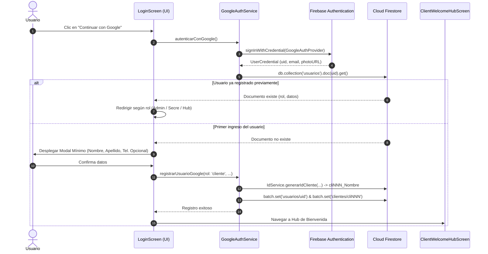
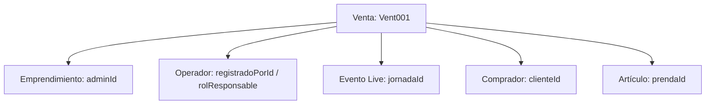

# VENDIX — DOCUMENTACIÓN TÉCNICA DE EVOLUCIÓN ARQUITECTÓNICA

**Fecha de emisión:** 25 de noviembre de 2026  
**Ecosistema:** VendiX Mobile Application (Flutter / Dart / Firebase)  
**Alcance:** Autenticación con Google, Sistema Atómico de Identificadores en Cloud Firestore y Trazabilidad Comercial  
**Versión del documento:** 2.0 (Post-Auditoría y Reestructuración)  

---

## Índice General

1. [Introducción y Contexto Histórico del Proyecto](#1-introducción-y-contexto-histórico-del-proyecto)
2. [Evolución de la Autenticación mediante Google](#2-evolución-de-la-autenticación-mediante-google)
   - [2.1. Arquitectura y Limitaciones Anteriores](#21-arquitectura-y-limitaciones-anteriores)
   - [2.2. Nueva Filosofía de Autenticación y Flujo Simplificado](#22-nueva-filosofía-de-autenticación-y-flujo-simplificado)
   - [2.3. Diagrama de Secuencia del Flujo Actual](#23-diagrama-de-secuencia-del-flujo-actual)
   - [2.4. Servicios, Clases y Métodos Involucrados](#24-servicios-clases-y-métodos-involucrados)
   - [2.5. Gestión de Roles y el Hub Inteligente de Bienvenida](#25-gestión-de-roles-y-el-hub-inteligente-de-bienvenida)
   - [2.6. Comparativa: Google Sign-In vs. Correo y Contraseña Tradicional](#26-comparativa-google-sign-in-vs-correo-y-contraseña-tradicional)
   - [2.7. Manejo del Ciclo de Sesión y Salida Segura](#27-manejo-del-ciclo-de-sesión-y-salida-segura)
   - [2.8. Componentes Críticos que Deben Preservarse](#28-componentes-críticos-que-deben-preservarse)
3. [Reestructuración del Sistema de Identificadores en Cloud Firestore](#3-reestructuración-del-sistema-de-identificadores-en-cloud-firestore)
   - [3.1. Problemática de los Identificadores Auto-generados Aleatorios](#31-problemática-de-los-identificadores-auto-generados-aleatorios)
   - [3.2. Diseño del Sistema Atómico y Consecutivo (`IdService`)](#32-diseño-del-sistema-atómico-y-consecutivo-idservice)
   - [3.3. Colección Técnica de Control: `_contadores`](#33-colección-técnica-de-control-_contadores)
   - [3.4. Algoritmo de Normalización PascalCase y Tratamiento de Diacríticos](#34-algoritmo-de-normalización-pascalcase-y-tratamiento-de-diacríticos)
   - [3.5. Manejo de Concurrencia, Transacciones Atómicas y Contingencias](#35-manejo-de-concurrencia-transacciones-atómicas-y-contingencias)
   - [3.6. Comportamiento ante Eliminación de Registros e Integridad Referencial](#36-comportamiento-ante-eliminación-de-registros-e-integridad-referencial)
4. [Análisis Detallado por Colección](#4-análisis-detallado-por-colección)
   - [4.1. `Administradores`](#41-administradores)
   - [4.2. `secretarios`](#42-secretarios)
   - [4.3. `clientes`](#43-clientes)
   - [4.4. `prendas`](#44-prendas)
   - [4.5. `compras` (Ventas comerciales)](#45-compras-ventas-comerciales)
   - [4.6. `pagos` (Abonos y cobros de clientes)](#46-pagos-abonos-y-cobros-de-clientes)
   - [4.7. `jornadas` (Transmisiones Live)](#47-jornadas-transmisiones-live)
   - [4.8. `usuarios` (Índice central de autenticación)](#48-usuarios-índice-central-de-autenticación)
   - [4.9. Subcolección `mis_tiendas` y `mis_empleos`](#49-subcolección-mis_tiendas-y-mis_empleos)
5. [Arquitectura de Trazabilidad Comercial](#5-arquitectura-de-trazabilidad-comercial)
   - [5.1. Identificación del Operador Responsable](#51-identificación-del-operador-responsable)
   - [5.2. Desacoplamiento de Roles en la Venta y Cobranza](#52-desacoplamiento-de-roles-en-la-venta-y-cobranza)
   - [5.3. Vinculación Multidimensional (Negocio, Jornada, Prenda y Cliente)](#53-vinculación-multidimensional-negocio-jornada-prenda-y-cliente)
   - [5.4. Base para Futuros Motores de Reportería y Rankings Comerciales](#54-base-para-futuros-motores-de-reportería-y-rankings-comerciales)
6. [Consideraciones de Seguridad, Privacidad e Integridad](#6-consideraciones-de-seguridad-privacidad-e-integridad)
7. [Limitaciones Actuales y Guía para Desarrolladores / Agentes IA](#7-limitaciones-actuales-y-guía-para-desarrolladores--agentes-ia)
8. [Conclusiones Técnicas](#8-conclusiones-técnicas)

---

## 1. Introducción y Contexto Histórico del Proyecto

**VendiX** es una plataforma móvil diseñada para optimizar, centralizar y profesionalizar las transacciones comerciales de prendas de vestir comercializadas a través de transmisiones en vivo (Live Streaming en plataformas como TikTok, Instagram y Facebook).

El flujo operativo tradicional de este sector adolece de errores humanos frecuentes:
- Ventas registradas en libretas físicas o notas dispersas de WhatsApp.
- Confusión en abonos y pagos parciales de clientes habituales.
- Falta de control sobre el inventario disponible en tiempo real durante la transmisión.
- Dificultad para auditar el rendimiento comercial de operadores de apoyo (secretarios o moderadores).

Para resolver esta problemática de forma escalable, la arquitectura técnica de VendiX ha atravesado un proceso de reestructuración profunda en tres pilares esenciales:
1. **Acceso Simplificado e Inmediato:** Eliminación de barreras de entrada mediante Google OAuth federado.
2. **Identificadores Legibles y Auditables:** Sustitución de hashes aleatorios por códigos mnemotécnicos con significado de negocio (`cli001_JuanPerez`, `Vent001`, `Pago001`).
3. **Trazabilidad Comercial Total:** Registro granular del operador responsable, rol, jornada en vivo y estado financiero en cada venta y cobro.

Este documento establece la línea base técnica oficial de dicha evolución.

---

## 2. Evolución de la Autenticación mediante Google

### 2.1. Arquitectura y Limitaciones Anteriores

En iteraciones tempranas del proyecto, el inicio de sesión con Google presentaba inconsistencias funcionales y de experiencia de usuario:
- **Sobrecarga de formularios iniciales:** Al pulsar "Acceder con Google", el sistema desplegaba modales complejos solicitando rol obligatorio, dirección física de la tienda, coordenadas de mapas, teléfono obligatorio y otros datos antes de permitir la entrada al sistema.
- **Barrera para el registro de clientes:** Los compradores en vivo que buscaban unirse de inmediato para ver una prenda eran forzados a configurar datos comerciales irrelevantes.
- **Fricción en la asignación de roles:** Si el usuario elegía un rol erróneo en el diálogo de bienvenida de Google, revertirlo requería intervención manual en la base de datos o volver a crear la cuenta.
- **Validaciones de ubicación prematuras:** El campo de dirección física obligaba a cargar el widget de mapa antes de tener certeza de que el usuario era un administrador de tienda.

### 2.2. Nueva Filosofía de Autenticación y Flujo Simplificado

La arquitectura actual implementa el principio de **"Ingreso Progresivo y Contextual"**:

1. **Autenticación Base:** El usuario pulsa el botón oficial de Google en `LoginScreen`.
2. **Diálogo Mínimo de Registro (Solo usuarios nuevos):** Se solicita exclusivamente:
   - **Nombre:** Pre-llenado automáticamente desde la cuenta de Google (`user.displayName`).
   - **Apellido:** Pre-llenado automáticamente a partir de los apellidos de Google.
   - **Teléfono:** Campo completamente **opcional** para todos los roles.
   - **Dirección física:** **Eliminada** de todos los formularios iniciales. Se gestiona únicamente desde la configuración de perfil del panel administrativo.
3. **Rol Inicial Predeterminado:** Todo usuario autenticado por primera vez con Google se registra de inmediato con rol `'cliente'`. Esto le otorga acceso instantáneo sin bloqueos de aprobación.
4. **Enrutamiento Inteligente:** El usuario es dirigido al `ClientWelcomeHubScreen` ("¿Cómo deseas participar hoy?"), donde de manera transparente puede:
   - Mantenerse como Comprador.
   - Postularse como Secretario en tiendas activas.
   - Convertirse en Emprendedor (Administrador) ingresando únicamente el nombre de su negocio.

### 2.3. Diagrama de Secuencia del Flujo Actual



### 2.4. Servicios, Clases y Métodos Involucrados

| Archivo | Clase / Componente | Método Principal | Responsabilidad |
|---|---|---|---|
| `lib/services/google_auth_service.dart` | `GoogleAuthService` | `autenticarConGoogle()` | Inicializa el SDK nativo `GoogleSignIn`, solicita el token de identidad OAuth2 y ejecuta `signInWithCredential` en Firebase Auth. |
| `lib/services/google_auth_service.dart` | `GoogleAuthService` | `obtenerPerfil(String uid)` | Consulta la existencia del documento en `/usuarios/{uid}` para decidir el flujo (login directo vs. modal de registro). |
| `lib/services/google_auth_service.dart` | `GoogleAuthService` | `registrarUsuarioGoogle(...)` | Ejecuta un lote atómico (`WriteBatch`) creando el índice en `usuarios`, la entidad en `clientes` y el avatar en `fotos_perfil`. |
| `lib/screens/auth/login_screen.dart` | `_LoginScreenState` | `_iniciarSesionGoogle()` | Maneja el estado visual de carga, invoca la autenticación y coordina la apertura del diálogo de datos o la navegación. |
| `lib/screens/client/client_welcome_hub_screen.dart` | `_ClientWelcomeHubScreenState` | `_mostrarModalEmprendedor()` | Permite a un usuario cliente auto-promoverse a `administrador` creando su tienda con solo ingresar el nombre comercial. |

#### Fragmento Real de Código: Inicialización y Autenticación con Google
*(Ubicación: `lib/services/google_auth_service.dart`)*

```dart
static Future<UserCredential?> autenticarConGoogle() async {
  if (kIsWeb) {
    final googleProvider = GoogleAuthProvider();
    googleProvider.addScope('email');
    googleProvider.addScope('profile');
    return await _auth.signInWithPopup(googleProvider);
  } else {
    if (!_initialized) {
      await GoogleSignIn.instance.initialize(
        serverClientId: _webClientId,
      );
      _initialized = true;
    }

    GoogleSignInAccount? account;
    try {
      try {
        await GoogleSignIn.instance.signOut();
      } catch (_) {}
      account = await GoogleSignIn.instance.authenticate();
    } catch (e) {
      // Reintento limpio ante fallas de reautenticación
      try {
        await GoogleSignIn.instance.signOut();
        await GoogleSignIn.instance.disconnect();
      } catch (_) {}
      account = await GoogleSignIn.instance.authenticate();
    }

    final AuthCredential credential = GoogleAuthProvider.credential(
      idToken: account.authentication.idToken,
    );

    return await _auth.signInWithCredential(credential);
  }
}
```

### 2.5. Gestión de Roles y el Hub Inteligente de Bienvenida

Cuando un usuario autenticado entra como cliente, el sistema lo conduce a `lib/screens/client/client_welcome_hub_screen.dart`. Este componente actúa como un conmutador inteligente de contexto:

1. **Detección Dinámica de Asociaciones:**
   - Consulta `/usuarios/{uid}/mis_tiendas` para listar los emprendimientos donde es comprador activo.
   - Consulta `/secretarios` filtrando por `clienteId == uid` para detectar empleos aprobados como operador de ventas.
2. **Presentación Visual de Opciones:**
   - Si no posee asociaciones, presenta las **tres opciones comerciales principales**:
     1. **Modo Comprador:** Unirse con el código de 6 dígitos de una transmisión Live (`EnterCodeScreen`).
     2. **Oportunidad Laboral:** Explorar tiendas activas y solicitar empleo como secretario (`SolicitudEmpleoScreen`).
     3. **Emprendimiento (Nuevo):** *"Trabajar como emprendedor"*. Al seleccionarlo, se despliega un diálogo limpio que solicita **únicamente** el nombre del emprendimiento.
3. **Elevación Atómica a Administrador:**
   Al confirmar el nombre del negocio en el modal:
   ```dart
   final idAdmin = await IdService.generarIdAdministrador('$nombre $apellido');
   final lote = db.batch();
   lote.set(db.collection('Administradores').doc(idAdmin), {
     'id': idAdmin,
     'codigo': idAdmin,
     'uid': uid,
     'firebaseUid': uid,
     'nombre': nombre,
     'apellido': apellido,
     'nombreEmprendimiento': nombreEmprendimiento,
     'correo': correo,
     'telefono': telefono, // Opcional
     'direccionTienda': '', // Se configurará en el panel de perfil
     'estado': true,
     'creadoEn': FieldValue.serverTimestamp(),
   });
   lote.set(db.collection('usuarios').doc(uid), {
     'rol': 'administrador',
     'adminId': idAdmin,
     'nombreEmprendimiento': nombreEmprendimiento,
   }, SetOptions(merge: true));
   await lote.commit();
   ```

### 2.6. Comparativa: Google Sign-In vs. Correo y Contraseña Tradicional

| Criterio | Autenticación Google Sign-In | Autenticación Correo / Contraseña |
|---|---|---|
| **Proveedor** | `google.com` (OAuth 2.0 federado) | `password` (Firebase Auth Email/Password) |
| **Verificación de Correo** | Inmediata (garantizada por Google) | Requiere envío de correo de confirmación |
| **Almacenamiento de Contraseñas** | Ninguna en la base de datos de VendiX | Hash PBKDF2 gestionado en Firebase Auth |
| **Foto de Perfil** | Obtenida automáticamente vía `photoURL` | Requiere subida manual a Cloudinary |
| **Formulario de Registro** | Simplificado (Nombre, Apellido, Teléfono opcional) | Completo (Correo, Clave, Confirmación, Datos) |
| **Manejo de Errores** | Errores de popup, cancelación de cuenta, SHA-1 | `email-already-in-use`, `weak-password`, `invalid-email` |

### 2.7. Manejo del Ciclo de Sesión y Salida Segura

Para evitar conflictos de estado entre cuentas compartidas en el mismo dispositivo móvil:
- En cada intento de autenticación se fuerza `GoogleSignIn.instance.signOut()` previo para asegurar que el sistema no reutilice un token expirado o bloqueado.
- Al ejecutar el cierre de sesión (`_confirmarCerrarSesion`):
  1. Se invoca `FirebaseAuth.instance.signOut()`.
  2. Se invoca `GoogleSignIn.instance.signOut()`.
  3. Se limpia la pila de navegación redirigiendo a `LoginScreen`.

### 2.8. Componentes Críticos que Deben Preservarse

> [!CAUTION]
> En cualquier desarrollo o refactorización futura, **NO** deben eliminarse los siguientes elementos:
> - **El SHA-1 y SHA-256 de depuración y producción** en la consola de Firebase. Sin ellos, Google Sign-In arroja la excepción interna código `10` o `16` (`DEVELOPER_ERROR`).
> - **La variable `_webClientId`** en `GoogleAuthService`, necesaria para vincular el `idToken` de Android con el backend de Firebase Authentication.
> - **La vinculación bidireccional:** El documento `/usuarios/{uid}` debe mantener siempre la referencia `clienteDocId`, `adminId` o `secretarioDocId`.

---

## 3. Reestructuración del Sistema de Identificadores en Cloud Firestore

### 3.1. Problemática de los Identificadores Auto-generados Aleatorios

Inicialmente, VendiX empleaba identificadores automáticos generados por Firestore (`db.collection('...').doc().id`), los cuales producen cadenas alfanuméricas pseudoaleatorias de 20 caracteres (ej: `7fA9kLmQz18vPxR3tWb0`).

Esta estrategia generó severas limitaciones operativas:
1. **Inviabilidad en transmisiones en vivo:** Un vendedor o comprador no puede comunicar verbalmente un código como `7fA9kLmQz18vPxR3tWb0` para asociar un pedido.
2. **Dificultad de auditoría:** Al revisar la base de datos, no existía forma de distinguir visualmente si un ID pertenecía a un cliente, un pago o una venta.
3. **Imposibilidad de generar reportes tabulares legibles:** En hojas de cálculo, los códigos aleatorios impedían ordenar cronológicamente las transacciones o verificar la correlatividad de los cobros.

### 3.2. Diseño del Sistema Atómico y Consecutivo (`IdService`)

Se implementó el servicio centralizado `IdService` (`lib/services/id_service.dart`), que aplica una estructura estandarizada de identificadores comerciales basada en tres principios:

$$\text{Identificador} = \text{Prefijo de Entidad} + \text{Consecutivo Formateado (mínimo 3 dígitos)} + [\_ + \text{Nombre PascalCase}]$$

```text
Ejemplos generados:
- Clientes:        cli001_JuanPerez
- Administradores: Admin001_AlexisMora
- Secretarios:     Secre001_MariaLopez
- Prendas:         Prend001_VestidoRojoSeda
- Jornadas Live:   Jorn001_LiveNavidad2026
- Compras/Ventas:  Vent001, Vent002, Vent003
- Pagos/Cobros:    Pago001, Pago002, Pago003
```

### 3.3. Colección Técnica de Control: `_contadores`

Para garantizar la correlatividad matemática estricta sin depender del conteo de documentos en las colecciones comerciales (lo cual es costoso en lecturas y vulnerable a fallos por borrados), se estableció la colección técnica interna `_contadores`.

Cada documento en `_contadores` representa una entidad y almacena el número de secuencia más alto asignado:

```json
// Documento: /_contadores/compras
{
  "entidad": "compras",
  "ultimoNumero": 42,
  "actualizadoEn": "2026-11-25T01:30:00.000Z"
}
```

### 3.4. Algoritmo de Normalización PascalCase y Tratamiento de Diacríticos

Para transformar nombres de personas, prendas o transmisiones en fragmentos de identificadores URL-friendly y aptos para Firestore sin caracteres extraños, `IdService` incorpora el método `normalizarParaId(String texto)`:

1. **Reemplazo Exhaustivo de Diacríticos:** Mapea caracteres acentuados, diéresis y la virgulilla de la ñ (`á, é, í, ó, ú, ñ, ü` $\to$ `a, e, i, o, u, n, u`).
2. **Separación por Expresión Regular:** Divide el texto mediante `RegExp(r'[^a-zA-Z0-9]+')`.
3. **Capitalización PascalCase:** Capitaliza la primera letra de cada fragmento y descarta espacios o símbolos (`"María José López - Blusa Azul"` $\to$ `"MariaJoseLopezBlusaAzul"`).

### 3.5. Manejo de Concurrencia, Transacciones Atómicas y Contingencias

La asignación del siguiente número consecutivo se realiza mediante `runTransaction` de Firestore:

```dart
static Future<int> obtenerSiguienteNumero(String entidad) async {
  final docRef = _db.collection(_coleccionContadores).doc(entidad);

  try {
    final siguienteNumero = await _db.runTransaction<int>((transaction) async {
      final snapshot = await transaction.get(docRef);

      int ultimo = 0;
      if (snapshot.exists && snapshot.data() != null) {
        final data = snapshot.data()!;
        ultimo = (data['ultimoNumero'] as num?)?.toInt() ?? 0;
      }

      final nuevo = ultimo + 1;

      transaction.set(
        docRef,
        {
          'entidad': entidad,
          'ultimoNumero': nuevo,
          'actualizadoEn': FieldValue.serverTimestamp(),
        },
        SetOptions(merge: true),
      );

      return nuevo;
    });

    return siguienteNumero;
  } catch (e) {
    // Mecanismo de fallback seguro ante falta de conexión o timeout
    final fallbackNum = (DateTime.now().millisecondsSinceEpoch % 900) + 100;
    return fallbackNum;
  }
}
```

**Ventajas de la Transacción Atómica:**
- **Inmunidad a colisiones concurrentes:** Si dos secretarios registran una venta exactamente en el mismo milisegundo, la base de datos bloquea el documento del contador; una transacción tiene éxito asignando el número $N$, y la otra reintenta de forma automática asignando el número $N+1$.
- **Tolerancia a fallos:** Si la conexión a internet cae, el bloque `catch` genera un número contingente basado en marcas temporales para no bloquear la venta presencial.

### 3.6. Comportamiento ante Eliminación de Registros e Integridad Referencial

- **Los contadores nunca retroceden:** Si se elimina la venta `Vent015`, el contador en `_contadores/compras` permanece en 15. La siguiente venta será `Vent016`. Esto evita reutilizar identificadores ya conocidos por clientes o impresos en comprobantes.
- **Identificadores Inmutables:** El campo `id` y `codigo` se almacenan dentro del documento JSON además de constituir el `docId` en Firestore.

---

## 4. Análisis Detallado por Colección

A continuación se detalla cada una de las colecciones del sistema VendiX con su formato real verificado en el código fuente.

### 4.1. `Administradores`

- **Ruta Firestore:** `/Administradores/{adminId}`
- **Finalidad:** Almacena los perfiles comerciales de los dueños de negocios o marcas que venden ropa en VendiX.
- **Formato del ID:** `AdminNNN_NombreApellido` (ej: `Admin001_AlexisMora`).
- **Método responsable:** `IdService.generarIdAdministrador(nombreCompleto)`
- **Archivos de creación:** `lib/screens/client/client_welcome_hub_screen.dart`, `lib/screens/auth/register_screen.dart`.
- **Estructura Documental JSON de Ejemplo:**

```json
{
  "id": "Admin001_AlexisMora",
  "codigo": "Admin001_AlexisMora",
  "uid": "ABc123FirebaseUserUid",
  "firebaseUid": "ABc123FirebaseUserUid",
  "nombre": "Alexis",
  "apellido": "Mora",
  "nombreEmprendimiento": "Boutique Elegancia",
  "correo": "alexis.mora@gmail.com",
  "telefono": "+593991234567",
  "direccionTienda": "Av. Amazonas y 10 de Agosto",
  "latitudTienda": -0.180653,
  "longitudTienda": -78.467834,
  "fotoUrl": "https://res.cloudinary.com/vendix/image/upload/v1/perfiles/admin.jpg",
  "estado": true,
  "creadoEn": "2026-11-20T10:00:00.000Z",
  "metodo_registro": "google"
}
```

### 4.2. `secretarios`

- **Ruta Firestore:** `/secretarios/{secretarioId}`
- **Finalidad:** Operadores de soporte comercial que colaboran durante los Lives registrando prendas, compras y pagos.
- **Formato del ID:** `SecreNNN_NombreApellido` (ej: `Secre001_CarlaGomez`).
- **Método responsable:** `IdService.generarIdSecretario(nombreCompleto)`
- **Archivos de creación:** `lib/services/google_auth_service.dart`, `lib/screens/admin/admin_more_screen.dart`, `lib/screens/client/solicitud_empleo_screen.dart`.
- **Estructura Documental JSON de Ejemplo:**

```json
{
  "id": "Secre001_CarlaGomez",
  "codigo": "Secre001_CarlaGomez",
  "uid": "XYZ890FirebaseUid",
  "firebaseUid": "XYZ890FirebaseUid",
  "clienteId": "XYZ890FirebaseUid",
  "nombre": "Carla",
  "apellido": "Gomez",
  "correo": "carla.secre@gmail.com",
  "telefono": "+593987654321",
  "direccion": "",
  "adminId": "Admin001_AlexisMora",
  "nombreEmprendimiento": "Boutique Elegancia",
  "estado": true,
  "aprobado": true,
  "estado_solicitud": "aprobado",
  "fecha_registro": "2026-11-21T15:30:00.000Z",
  "fecha_aprobacion": "2026-11-21T16:00:00.000Z",
  "metodo_registro": "solicitud_cliente"
}
```

### 4.3. `clientes`

- **Ruta Firestore:** `/clientes/{clienteId}`
- **Finalidad:** Directorio comercial de compradores que adquieren prendas en transmisiones en vivo.
- **Formato del ID:** `cliNNN_NombreApellido` (ej: `cli001_DianaParedes`).
- **Método responsable:** `IdService.generarIdCliente(nombreCompleto)`
- **Archivos de creación:** `lib/services/google_auth_service.dart`, `lib/services/client_service.dart`.
- **Estructura Documental JSON de Ejemplo:**

```json
{
  "id": "cli001_DianaParedes",
  "codigo": "cli001_DianaParedes",
  "nombre": "Diana Paredes",
  "telefono": "+593995551122",
  "correo": "diana.paredes@gmail.com",
  "direccion": "Sector La Carolina, Quito",
  "uid": "UidFirebaseDiana",
  "firebaseUid": "UidFirebaseDiana",
  "adminId": "Admin001_AlexisMora",
  "secretarioId": "Secre001_CarlaGomez",
  "codigoLive": "LIVE99",
  "totalCompras": 125.50,
  "totalPagado": 50.00,
  "saldoPendiente": 75.50,
  "creadoEn": "2026-11-22T18:00:00.000Z",
  "metodo_registro": "google"
}
```

### 4.4. `prendas`

- **Ruta Firestore:** `/prendas/{prendaId}`
- **Finalidad:** Catálogo de ropa e inventario disponible para subasta o asignación en directo.
- **Formato del ID:** `PrendNNN_NombrePrenda` (ej: `Prend001_ChaquetaCueroNegra`).
- **Método responsable:** `IdService.generarIdPrenda(nombrePrenda)`
- **Archivos de creación:** `lib/data/prenda_service.dart`, `lib/screens/admin/admin_more_screen.dart`.
- **Estructura Documental JSON de Ejemplo:**

```json
{
  "id": "Prend001_ChaquetaCueroNegra",
  "codigo": "Prend001_ChaquetaCueroNegra",
  "nombre": "Chaqueta Cuero Negra",
  "descripcion": "Talla M, acabado brillante, forro térmico",
  "precio": 45.00,
  "stock": 3,
  "activa": true,
  "adminId": "Admin001_AlexisMora",
  "fotoUrl": "https://res.cloudinary.com/vendix/image/upload/v1/prendas/chaqueta.jpg",
  "creadoEn": "2026-11-23T09:00:00.000Z"
}
```

### 4.5. `compras` (Ventas comerciales)

- **Ruta Firestore:** `/compras/{compraId}`
- **Finalidad:** Registro transaccional de cada prenda adjudicada a una clienta durante un Live o en tienda.
- **Formato del ID:** `VentNNN` (ej: `Vent001`, `Vent002`).
- **Método responsable:** `IdService.generarIdCompra({adminId})`
- **Archivos de creación:** `lib/services/client_service.dart` (`registrarCompraDirecta`).
- **Estructura Documental JSON de Ejemplo:**

```json
{
  "id": "Vent001",
  "codigo": "Vent001",
  "clienteId": "cli001_DianaParedes",
  "prendaId": "Prend001_ChaquetaCueroNegra",
  "prendaNombre": "Chaqueta Cuero Negra",
  "prenda": "Chaqueta Cuero Negra",
  "precioUnitario": 45.00,
  "precio": 45.00,
  "cantidad": 1,
  "subtotal": 45.00,
  "total": 45.00,
  "jornadaId": "Jorn001_BlackFridayLive",
  "fecha": "2026-11-25T01:15:00.000Z",
  "adminId": "Admin001_AlexisMora",
  "registradoPorId": "Secre001_CarlaGomez",
  "registradoPorNombre": "Carla Gomez",
  "rolResponsable": "secretario"
}
```

### 4.6. `pagos` (Abonos y cobros de clientes)

- **Ruta Firestore:** `/pagos/{pagoId}`
- **Finalidad:** Registro de recaudación financiera y amortización de deudas de los compradores.
- **Formato del ID:** `PagoNNN` (ej: `Pago001`, `Pago002`).
- **Método responsable:** `IdService.generarIdPago({adminId})`
- **Archivos de creación:** `lib/services/client_service.dart` (`registrarPagoDirecto`).
- **Estructura Documental JSON de Ejemplo:**

```json
{
  "id": "Pago001",
  "codigo": "Pago001",
  "clienteId": "cli001_DianaParedes",
  "monto": 25.00,
  "formaPago": "Transferencia Banco Pichincha",
  "metodoPago": "Transferencia Banco Pichincha",
  "observacion": "Comprobante #44912 validado en live",
  "jornadaId": "Jorn001_BlackFridayLive",
  "fecha": "2026-11-25T01:25:00.000Z",
  "adminId": "Admin001_AlexisMora",
  "recibidoPorId": "Secre001_CarlaGomez",
  "recibidoPorNombre": "Carla Gomez",
  "rolResponsable": "secretario"
}
```

### 4.7. `jornadas` (Transmisiones Live)

- **Ruta Firestore:** `/jornadas/{jornadaId}`
- **Finalidad:** Sesión de venta en vivo activa o histórica. Agrupa compras y pagos bajo un mismo evento.
- **Formato del ID:** `JornNNN_NombreJornada` (ej: `Jorn001_BlackFridayLive`).
- **Método responsable:** `IdService.generarIdJornada(nombreJornada, {adminId})`
- **Archivos de creación:** `lib/screens/secretary/jornadas_screen.dart`.
- **Estructura Documental JSON de Ejemplo:**

```json
{
  "id": "Jorn001_BlackFridayLive",
  "codigo": "Jorn001_BlackFridayLive",
  "nombre": "Black Friday Live",
  "adminId": "Admin001_AlexisMora",
  "secretarioId": "Secre001_CarlaGomez",
  "fechaInicio": "2026-11-25T00:00:00.000Z",
  "activa": true,
  "totalVendido": 450.00,
  "totalCobrado": 280.00
}
```

### 4.8. `usuarios` (Índice central de autenticación)

- **Ruta Firestore:** `/usuarios/{uid}`
- **Finalidad:** Tabla maestra indexada por el UID oficial de Firebase Authentication (`FirebaseAuth.instance.currentUser.uid`).
- **Formato del ID:** UID Alfanumérico de 28 caracteres generado por Firebase Auth (ej: `z8K1L9pQx29Vb4Rt7Yb2...`).
- **Estructura Documental JSON de Ejemplo:**

```json
{
  "uid": "z8K1L9pQx29Vb4Rt7Yb2...",
  "firebaseUid": "z8K1L9pQx29Vb4Rt7Yb2...",
  "clienteDocId": "cli001_DianaParedes",
  "codigo": "cli001_DianaParedes",
  "nombre": "Diana",
  "apellido": "Paredes",
  "correo": "diana.paredes@gmail.com",
  "telefono": "+593995551122",
  "direccion": "",
  "rol": "cliente",
  "estado": true,
  "aprobado": true,
  "creadoEn": "2026-11-22T18:00:00.000Z",
  "metodo_registro": "google"
}
```

### 4.9. Subcolección `mis_tiendas` y `mis_empleos`

- **Ruta Firestore:** `/usuarios/{uid}/mis_tiendas/{tiendaDocId}`
- **Finalidad:** Permite que un usuario con rol cliente guarde los emprendimientos a los que se ha vinculado ingresando el código Live.
- **Campos:** `adminId`, `nombreEmprendimiento`, `adminNombre`, `codigoLive`, `fechaUnion`.

---

## 5. Arquitectura de Trazabilidad Comercial

### 5.1. Identificación del Operador Responsable

Para terminar con la ambigüedad sobre quién realizó una venta durante una transmisión rápida, `ClientService` implementó dos métodos de extracción de metadatos en tiempo de ejecución:
- `obtenerMetadatosVenta(String clienteId)`
- `obtenerMetadatosPago(String clienteId)`

*(Ubicación: `lib/services/client_service.dart`, líneas 296-387)*

```dart
static Future<Map<String, dynamic>> obtenerMetadatosVenta(String clienteId) async {
  final user = FirebaseAuth.instance.currentUser;
  final userUid = user?.uid ?? '';
  String adminId = activeSecretaryAdminId ?? '';
  String rolResponsable = 'secretario';
  String registradoPorNombre = user?.displayName ?? '';

  if (userUid.isNotEmpty) {
    try {
      final uDoc = await _db.collection('usuarios').doc(userUid).get();
      final uData = uDoc.data() ?? {};
      final rol = uData['rol']?.toString().toLowerCase() ?? '';
      final nom = uData['nombre']?.toString() ?? '';
      final ape = uData['apellido']?.toString() ?? '';
      final nComp = [nom, ape].where((s) => s.isNotEmpty).join(' ');
      if (nComp.isNotEmpty) registradoPorNombre = nComp;

      if (rol == 'administrador' || rol == 'admin') {
        rolResponsable = 'administrador';
        if (adminId.isEmpty) {
          adminId = uData['adminId']?.toString() ?? userUid;
        }
      } else {
        if (adminId.isEmpty) {
          adminId = uData['adminId']?.toString() ?? '';
        }
      }
    } catch (_) {}
  }

  return {
    'adminId': adminId,
    'registradoPorId': userUid,
    'registradoPorNombre': registradoPorNombre,
    'rolResponsable': rolResponsable,
  };
}
```

### 5.2. Desacoplamiento de Roles en la Venta y Cobranza

En una jornada Live participan dos roles comerciales activos:
1. **El Administrador (Dueño del Negocio):** Puede vender y cobrar directamente si opera solo.
2. **El Secretario (Asistente en vivo):** Recibe las ofertas de los comentarios y registra compras.

La arquitectura garantiza que sin importar quién tenga la sesión abierta en el teléfono, el documento de venta almacena de forma inmutable:
- `registradoPorId`: UID del operador físico que presionó el botón.
- `registradoPorNombre`: Nombre de la persona.
- `rolResponsable`: Ya sea `'administrador'` o `'secretario'`.
- `adminId`: Negocio dueño de la prenda y acreedor del dinero.

### 5.3. Vinculación Multidimensional (Negocio, Jornada, Prenda y Cliente)

Cada documento de compra o pago consolida los cinco ejes cardinales de una transacción:



### 5.4. Base para Futuros Motores de Reportería y Rankings Comerciales

Gracias a esta estructura documental estandarizada, en la futura fase de generación de reportes XLSX locales no se requerirá reestructurar la base de datos. Se podrán realizar consultas de agregación analítica directas:

- **Ranking de Productividad por Secretario:** Agrupando `/compras` por `registradoPorId` donde `rolResponsable == 'secretario'`.
- **Efectividad de Cobro:** Comparando `total` en compras vs. `monto` en pagos filtrados por un mismo `jornadaId`.
- **Prendas más vendidas:** Contabilizando las ocurrencias de `prendaId`.

---

## 6. Consideraciones de Seguridad, Privacidad e Integridad

1. **Sin Exposición de Secretos:** El código fuente no contiene ni debe contener claves secretas de clientes OAuth, secretos de Cloudinary en texto plano sin sanitizar, ni tokens privados.
2. **Atomicidad mediante Batches y Transactions:** Toda operación que modifique dos colecciones vinculadas (ej: registrarse en `usuarios` y en `clientes`) se ejecuta mediante `WriteBatch` (`lote.commit()`) para evitar registros huérfanos si la conexión falla a mitad del proceso.
3. **Inmutabilidad de Registros Contables:** Los identificadores `VentNNN` y `PagoNNN` no deben sobreescribirse ni reutilizarse tras una eliminación física.

---

## 7. Limitaciones Actuales y Guía para Desarrolladores / Agentes IA

> [!IMPORTANT]
> **Recomendaciones para Desarrolladores y Futuros Agentes IA:**
> - **No reincorporar Scopes de Google Drive:** No agregar llamadas a `https://www.googleapis.com/auth/drive.file` en `google_auth_service.dart`. La autenticación de usuarios no requiere ningún permiso sobre Google Drive.
> - **Soporte de Convivencia de Identificadores:** En colecciones antiguas pueden coexistir registros generados con el esquema aleatorio anterior junto a los nuevos con formato `cliNNN_...` y `VentNNN`. Los métodos de consulta deben buscar tanto por `id` como por `codigo`.
> - **No solicitar dirección en formularios iniciales:** Si se añade una nueva pantalla de registro, recordar la directriz de diseño: la dirección física solo se configura desde el perfil del administrador en la sección de edición de tienda. El teléfono siempre es opcional.

---

## 8. Conclusiones Técnicas

1. **Estabilidad y Coherencia:** La eliminación de la integración dependiente de Google Sheets API ha devuelto la estabilidad al proyecto, eliminando errores de permisos de Drive y permitiendo que VendiX compile de forma limpia (`flutter analyze` con 0 problemas y `build\app\outputs\flutter-apk\app-debug.apk` generado con éxito).
2. **Experiencia de Usuario Optimizada:** La autenticación con Google es ahora inmediata, asignando rol cliente por defecto y permitiendo la creación de emprendimientos con tan solo ingresar el nombre comercial desde el Hub de Bienvenida.
3. **Infraestructura Lista para Pruebas:** Con el sistema de identificadores atómicos (`_contadores`) y los campos de trazabilidad comercial activos en Firestore, la base de datos está preparada para recibir información de prueba verídica y consistente por parte de los compañeros de equipo.
