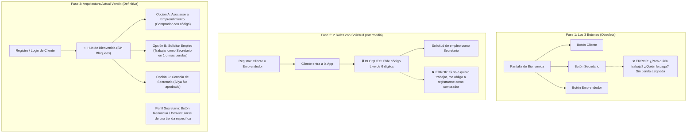
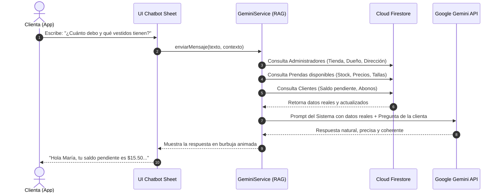

# 🎓 GUÍA MAESTRA DE ARQUITECTURA VENDIX
## Evolución de Roles, Asistente Gemini AI, Geolocalización y Base de Datos Unificada

> **Destinatario Principal:** Equipo de Desarrollo de Vendix & Guía de Exposición para Defensa del Proyecto (Diseñado con explicaciones claras, diagramas visuales y guiones orales paso a paso).  
> **Fecha de Publicación:** 17 de Noviembre de 2026  
> **Versión del Sistema:** Vendix Mobile v1.0.0 (Release)  

---

## 📌 TABLA DE CONTENIDOS
1. [Introducción: ¿Qué es Vendix y cuál es su propuesta de valor?](#1-introducción-qué-es-vendix-y-cuál-es-su-propuesta-de-valor)
2. [Evolución Histórica de la Autenticación y Roles: Las 3 Fases](#2-evolución-histórica-de-la-autenticación-y-roles-las-3-fases)
   - *Fase 1: Los 3 botones iniciales (Semana pasada y por qué falló)*
   - *Fase 2: Reducción a 2 roles con solicitudes (El cuello de botella del código)*
   - *Fase 3: La Arquitectura Actual (Hub de Bienvenida, Multitenancy y Desvinculación Libre)*
3. [Inteligencia Artificial: Asistente Virtual con Gemini API & RAG](#3-inteligencia-artificial-asistente-virtual-con-gemini-api--rag)
   - *¿Por qué solo en el rol Cliente y no en otros roles?*
   - *Archivos clave y arquitectura interna*
   - *Parámetros que lee de Firestore en tiempo real*
   - *Capacidades de respuesta y blindaje de privacidad*
4. [Geolocalización y Mapas en Tiempo Real](#4-geolocalización-y-mapas-en-tiempo-real)
   - *Cómo funciona la detección de ubicación y Mapbox*
   - *Utilidad para la entrega de prendas y cercanía comercial*
5. [Depuración y Aislamiento de la Base de Datos (Fin de Datos Mezclados)](#5-depuración-y-aislamiento-de-la-base-de-datos-fin-de-datos-mezclados)
   - *El problema de los datos de prueba y mezclas previas*
   - *El modelo Multitenancy basado en `adminId`*
6. [🗣️ GUÍA DE DEFENSA Y EXPOSICIÓN (Para Jimena)](#6-🗣️-guía-de-defensa-y-exposición-para-jimena)
   - *Resumen en 3 minutos para abrir la exposición*
   - *Preguntas frecuentes del profesor/jurado y cómo responderlas con seguridad*

---

## 1. Introducción: ¿Qué es Vendix y cuál es su propuesta de valor?

**Vendix** es una plataforma móvil creada para resolver el caos que sufren los negocios de moda y tiendas de ropa cuando venden a través de transmisiones en vivo (*Live Commerce* en TikTok Live, Facebook Live e Instagram Live).

### El Problema Real
En un live tradicional, la clienta comenta: *"¡Mío el vestido rojo!"*. El emprendedor o su ayudante anotan en cuadernos de papel o chats de WhatsApp. Al final de la noche:
- No saben quién compró primero.
- No saben con exactitud cuánto debe cada clienta.
- Se confunden los abonos y los pagos.
- No hay un control en tiempo real entre el stock físico y lo vendido.

### La Solución de Vendix
Vendix conecta en tiempo real al **Emprendedor** (dueño de la tienda), al **Secretario** (el operador que está junto al celular durante el live registrando ventas al instante) y a la **Clienta** (quien desde su casa ve su saldo en vivo, sus prendas y su cuenta transparente).

---

## 2. Evolución Histórica de la Autenticación y Roles: Las 3 Fases

Para entender la app actual, es fundamental comprender por qué cambió el sistema de autenticación a lo largo de las semanas:

### 🔴 Fase 1 (Hasta la semana pasada): Los 3 Botones Independientes
* **Cómo funcionaba:** En la pantalla inicial aparecían 3 opciones directas para registrarse: `[Soy Cliente]`, `[Soy Secretario]` y `[Soy Emprendedor]`.
* **Por qué falló conceptualmente:** Un "Secretario" no es un usuario que deba registrarse por su cuenta en el vacío. Si un usuario se registraba directamente como secretario:
  - ¿De qué tienda es empleado?
  - ¿A qué inventario tiene acceso?
  - ¿Quién supervisa lo que cobra?
  - Cualquier persona podía registrarse como secretario y ver información confidencial. **Rompía por completo la lógica de negocio y la seguridad.**

---

### 🟡 Fase 2 (Transición intermedia): Dos Roles y Solicitud de Empleo
* **Cómo funcionaba:** Se eliminó el botón de "Registrarse como Secretario". Solo existían 2 registros:
  1. **Emprendedor (Dueño):** Crea la tienda, sube prendas y aprueba personal.
  2. **Cliente:** Usuario común. Desde su perfil podía enviar una solicitud de trabajo a un emprendedor. El emprendedor la revisaba en su panel y, si la aceptaba, ese usuario adquiría privilegios de Secretario.
* **El Cuello de Botella que descubrimos:** 
  - Cuando un usuario se registraba como Cliente, la aplicación lo enviaba directamente a una pantalla (`EnterCodeScreen`) que le exigía obligatoriamente ingresar un código de Live de 6 dígitos (ej. `VX-849`).
  - Si el usuario **solo quería trabajar** como operador de live y no comprar ropa, ¡estaba bloqueado! No podía postularse sin haberse vinculado antes como comprador de una tienda.

---

### 🟢 Fase 3 (ARQUITECTURA ACTUAL - LA SOLUCIÓN DEFINITIVA)
La versión final implementada resuelve todas las inconsistencias anteriores mediante **4 pilares fundamentales**:

#### 1. El "Hub de Bienvenida" para Clientes (`ClientWelcomeHubScreen`)
- Cuando un cliente nuevo entra (o cuando no tiene un código de live activo guardado), la app **ya no lo bloquea**.
- Muestra una pantalla moderna y atractiva con dos caminos independientes:
  - **Botón 1: "Asociarse a un emprendimiento":** Para las clientas que están viendo una transmisión en vivo y tienen su código en mano para comprar.
  - **Botón 2: "Solicitar empleo":** Para los usuarios que desean trabajar como secretarios. Les permite buscar emprendimientos y postularse directamente **sin necesidad de haber comprado nada nunca**.
  - **Monitor en Tiempo Real de Solicitudes:** Abajo muestra el estado de sus postulaciones (`Pendiente`, `Aprobado`, `Rechazado`). Cuando un dueño lo aprueba, aparece el botón *"Entrar como Secretario"* para ir directo a su estación de trabajo.

#### 2. Libertad de Desvinculación de los Clientes
- Una clienta no está encadenada a una sola tienda.
- Puede salir del Live de una tienda, desvincularse o ingresar a otra tienda mediante un nuevo código cuando empiece otro Live.

#### 3. Renuncia / Desvinculación Laboral del Secretario
- En la pestaña de perfil del Secretario (`MoreScreen`), se agregó el botón destacado **"Dejar de ser secretario de este emprendimiento"**.
- Si el secretario renuncia:
  - Se actualiza su registro en Firestore a `estado_solicitud: 'renunciado'`, `aprobado: false`.
  - Pierde acceso a registrar ventas de esa tienda específica.
  - **No se borra su cuenta de usuario** ni se afectan sus compras personales como cliente.
  - Si trabajaba para dos tiendas a la vez, el sistema conmuta automáticamente a la otra tienda activa. Si no tiene más empleos, regresa a la vista de cliente limpio.

#### 4. Multitenancy y Visualización Exacta de la Tienda
- Un secretario puede estar aprobado en más de una tienda (ej. trabaja en la mañana para *"Modas Sofía"* y en la noche para *"Urban Look"*).
- En el Home del secretario ahora se muestra prominentemente:
  - El saludo dinámico con su nombre: `"Buenas tardes, Carlos"`.
  - El nombre de la tienda activa: `"Modas Sofía"`.
  - El nombre del dueño responsable: `"Propietario: Sofía Ramírez"`.
  - Un botón rápido para cambiar de tienda si tiene varias aprobadas.

---

## 3. Inteligencia Artificial: Asistente Virtual con Gemini API & RAG

En las versiones previas de la app no existía inteligencia artificial, o había un simple menú de respuestas fijas. En la versión actual, Vendix cuenta con un **Chatbot Inteligente potenciado por Google Gemini 1.5 Flash**.

### ¿Por qué el Chatbot está EXCLUSIVAMENTE en el rol Cliente?
Esta es una decisión de arquitectura muy importante:
1. **El Cliente es quien tiene dudas de autoservicio:** La clienta necesita saber a las 11:00 PM: *¿Cuánto saldo me queda por pagar?*, *¿Dónde queda la tienda para retirar mi ropa?*, *¿Tienen chompas térmicas disponibles?*, *¿Cómo hago para apartar una prenda en el live?*.
2. **El Emprendedor y el Secretario no necesitan un bot:** Ellos tienen paneles analíticos, tablas en tiempo real, escáneres y gráficos financieros. Ponerles un chatbot en medio de una transmisión en vivo solo les estorbaría la velocidad de venta.

### ¿Dónde se encuentra en el código?
* **Lógica del Servicio e IA:** [lib/services/gemini_service.dart](file:///c:/Users/crist/Desktop/VENDIX/flutter_application_1/lib/services/gemini_service.dart)
* **Interfaz de Usuario (Bottom Sheet Flotante):** [lib/screens/client/widgets/client_chatbot_sheet.dart](file:///c:/Users/crist/Desktop/VENDIX/flutter_application_1/lib/screens/client/widgets/client_chatbot_sheet.dart)

### ¿Cómo funciona la arquitectura RAG (Retrieval-Augmented Generation)?
Un modelo de lenguaje general como Gemini no conoce a las tiendas de Vendix ni sabe qué ropa vendes. Para que responda con exactitud y no invente datos (**alucinaciones**), implementamos la técnica **RAG**:
1. Antes de mandar la pregunta a la API de Gemini, `gemini_service.dart` va a **Cloud Firestore** y extrae datos en vivo.
2. Inyecta esos datos como un *"Prompt de Sistema"* que alimenta el contexto del bot.
3. Gemini lee los datos y responde a la clienta como un asistente experto de esa tienda en específico.

### ¿Qué parámetros exactos lee de Firestore?
| Colección | Parámetros que extrae | Utilidad para el Chatbot |
|---|---|---|
| `usuarios` / `clientes` | `nombre`, `saldoPendiente`, `totalComprado`, `totalPagado`, `prendasApartadas` | Permite responderle con precisión su deuda y compras sin que pregunte a una persona. |
| `Administradores` | `nombreEmprendimiento`, `nombre`, `apellido`, `telefono`, `correo`, `ubicacion_tienda` | Permite dar la identidad del negocio, quién es el dueño y cómo contactarlo. |
| `prendas` | `nombre`, `precio`, `talla`, `color`, `stock`, `disponible` | Permite recomendar prendas que **realmente están en bodega** y decir su precio exacto. |

### Blindaje de Seguridad y Privacidad
El prompt del sistema tiene instrucciones explícitas y filtros:
- **Cero filtración de datos de otros clientes:** El bot solo ve el documento de la clienta conectada.
- **Cero credenciales:** Las claves de Firebase, tokens de Google Sign-In y contraseñas jamás se inyectan en el prompt.

---

## 4. Geolocalización y Mapas en Tiempo Real

Para el comercio de ropa en vivo, la entrega de prendas es crítica. Muchos clientes prefieren ir a retirar su ropa al local físico o necesitan saber la distancia para acordar el delivery.

### ¿Cómo funciona la arquitectura de mapas?
* **Librería Utilizada:** `mapbox_maps_flutter` y `geolocator`.
* **Archivo Principal:** [lib/widgets/store_location_map.dart](file:///c:/Users/crist/Desktop/VENDIX/flutter_application_1/lib/widgets/store_location_map.dart).
* **Capacidades Operativas:**
  1. **Detección GPS en Tiempo Real:** El dispositivo obtiene las coordenadas geográficas exactas (`latitud` y `longitud`) del usuario mediante el sensor del celular.
  2. **Ubicación del Local Comercial:** El emprendedor fija en el mapa el punto exacto de su tienda física.
  3. **Visualización y Geocodificación:** El mapa renderiza marcadores vectoriales personalizados (`PointAnnotationManager`) y traduce coordenadas a direcciones legibles por humanos (ej. *"Av. Amazonas y Colón, Quito"*).
  4. **Cálculo de Distancias:** Permite calcular en tiempo real la cercanía entre la clienta y el local para coordinar la entrega o retiro inmediato de prendas apartadas en el live.

---

## 5. Depuración y Aislamiento de la Base de Datos (Fin de Datos Mezclados)

Uno de los problemas más críticos de las semanas iniciales era que existían **datos de prueba quemados** en las pantallas y colecciones sin una relación estricta de propiedad.

### ¿Qué ocurría antes?
- Si un usuario creaba una prenda en la tienda A, a veces se mostraba en el catálogo de la tienda B.
- Los saldos de las clientas no estaban estrictamente amarrados al Live de un emprendedor, lo que generaba registros cruzados o inconsistencias al registrar abonos.

### ¿Cómo se solucionó? (Arquitectura Multitenancy por `adminId`)
Hoy la base de datos de Cloud Firestore está **100% aislada y normalizada**:
1. **El `adminId` como Llave Maestra:** Cada emprendimiento tiene un identificador único en Firebase Auth (`adminId`).
2. **Colección `prendas`:** Todas las prendas tienen obligatoriamente el campo indexado `adminId`. Una tienda jamás puede leer ni editar las prendas de otra.
3. **Colección `secretarios`:** Se estructuró con documentos de clave compuesta `${uid}_${adminId}`. Esto permite que un mismo usuario (`uid`) tenga un expediente laboral separado por cada tienda (`adminId`) en la que trabaje.
4. **Colección `clientes`:** Las compras y saldos están asociados al `codigoLive` y al `adminId` del live vigente.
5. **Cero Datos de Prueba:** Toda la información mostrada proviene exclusivamente de documentos vivos y autenticados en Firestore.

---

## 6. 🗣️ GUÍA DE DEFENSA Y EXPOSICIÓN (Para Jimena)

> [!TIP]
> **Consejo para Jimena:** No intentes memorizar términos de código complicados. Explica el sistema como si le estuvieras contando una historia a una persona que tiene un negocio de ropa.

### 🎤 Discurso de Introducción (Léelo con calma y seguridad)
> *"Buenos días con todos. Hoy les presentamos **Vendix**, la aplicación móvil desarrollada para profesionalizar y automatizar las ventas en transmisiones en vivo.*
>
> *Tradicionalmente, vender ropa en vivo por TikTok o Facebook es un desorden total: se toman pedidos en hojas de papel, no se sabe quién comentó primero y al final del día no cuadran los pagos ni los inventarios.*
>
> *En Vendix creamos un ecosistema sincronizado en tiempo real entre tres actores: el **Emprendedor**, su **Secretario** u operador de ventas, y la **Clienta** que compra desde su casa.*
>
> *Para llegar a la arquitectura sólida que tenemos hoy, superamos retos importantes de autenticación, incorporamos inteligencia artificial con **Gemini API** para la atención al cliente, implementamos **geolocalización en tiempo real** para las entregas y aislamos completamente la base de datos para que cada tienda maneje su propia información con total seguridad."*

---

### ❓ Preguntas Frecuentes del Jurado y Cómo Responderlas

#### 1. Profesor: *"¿Por qué cambiaron la forma en que los secretarios se registran en la app?"*
* **Tu Respuesta:**  
  *"Al inicio teníamos un botón directo de 'Registrarse como Secretario', pero nos dimos cuenta de que eso violaba la lógica de seguridad: un secretario no puede crearse por sí solo si no pertenece a una tienda.  
  Luego intentamos que se registren como clientes, pero la app les exigía obligatoriamente un código de compra.  
  Por eso creamos el **Hub de Bienvenida**: ahora cualquier persona puede entrar y elegir libremente si desea vincularse como clienta compradora o enviar su solicitud para trabajar como secretaria en uno o varios emprendimientos. Además, ahora el secretario tiene la libertad de renunciar a una tienda específica desde su perfil sin perder su cuenta general."*

#### 2. Profesor: *"¿Por qué integraron Gemini AI solamente para el rol de Cliente?"*
* **Tu Respuesta:**  
  *"Porque la clienta es el usuario que necesita respuestas inmediatas de autoservicio a cualquier hora: cuánto debe, qué ropa hay en stock o dónde queda el local físico.  
  El emprendedor y el secretario ya cuentan con paneles de control, tablas financieras y métricas en tiempo real; ponerles un chatbot durante una transmisión en vivo sería una distracción en lugar de una ayuda."*

#### 3. Profesor: *"¿Cómo se aseguran de que el Chatbot no invente datos o se confunda de tienda?"*
* **Tu Respuesta:**  
  *"Utilizamos una arquitectura **RAG** (Generación Aumentada por Recuperación). Antes de procesar la respuesta, nuestro servicio de Gemini consulta en Cloud Firestore la colección de la tienda, el inventario real de prendas y el saldo de la clienta.  
  Esos datos reales se inyectan en el prompt del sistema, por lo que Gemini solo responde con la información verídica de esa tienda y nunca con datos inventados."*

#### 4. Profesor: *"¿Cómo garantizan que la información de una tienda no se mezcle con otra?"*
* **Tu Respuesta:**  
  *"Implementamos una arquitectura Multitenancy en Firestore donde cada documento de prendas, secretarios y ventas está indexado por el `adminId` del emprendedor.  
  Además, limpiamos todos los datos de prueba iniciales, garantizando que cada tienda opere en su propio entorno privado y seguro."*

#### 5. Profesor: *"¿Qué función cumple la geolocalización?"*
* **Tu Respuesta:**  
  *"Mediante el sensor GPS y Mapbox, la aplicación detecta la ubicación en tiempo real de la clienta y le muestra en un mapa interactivo el local físico del emprendedor. Esto agiliza la coordinación de entregas y retiros de prendas apartadas en las transmisiones en vivo."*

---

## 🏆 Conclusión
La versión actual de Vendix no solo cumple con todos los requerimientos funcionales, sino que eleva la experiencia de usuario a estándares de nivel comercial:
- Navegación fluida y sin bloqueos artificiales.
- Modelo laboral flexible (postulaciones múltiples y renuncia controlada).
- Asistente de inteligencia artificial contextualmente conectado al inventario.
- Mapeo geográfico interactivo y base de datos relacionalmente blindada.
