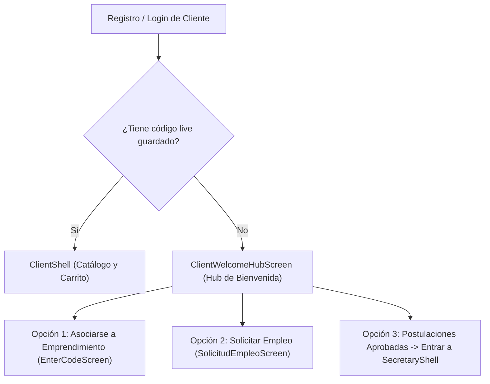

# 📋 Informe Técnico de Cambios: Reestructuración de Roles y Contexto RAG en Vendix

**Fecha:** 17 de Noviembre de 2026  
**Proyecto:** Vendix (Flutter / Firebase / Gemini AI)  
**Versión:** 1.0.0+1  

---

## 📌 Resumen Ejecutivo

En este ciclo de desarrollo se resolvieron 5 necesidades clave de arquitectura, experiencia de usuario (UX) e inteligencia artificial (RAG) en la plataforma **Vendix**:
1. Eliminación del bloqueo de código de acceso post-registro para clientes y creación de un Hub de Bienvenida dual.
2. Incorporación de desvinculación laboral ("Renunciar / Dejar de ser secretario") por emprendimiento.
3. Corrección y persistencia de visualización del emprendimiento y emprendedor en la sesión activa del secretario.
4. Homogeneización del saludo dinámico y cabecera en el inicio de todos los roles.
5. Ampliación del contexto de datos de tienda y catálogo de prendas para el Chatbot de Gemini AI con estricta privacidad.

A continuación se detalla el estado previo (**Antes**), la problemática identificada y la solución técnica implementada (**Solución**).

---

## 1. Rediseño Post-Registro de Cliente (Hub de Selección y Bienvenida)

### ❌ Estado Previo
- Al completar el registro como cliente en `RegisterClientScreen`, o al iniciar sesión en `LoginScreen` con una cuenta de rol `cliente` que no tuviera `codigoLive` guardado en SharedPreferences, la aplicación redirigía de forma forzada a `EnterCodeScreen`.
- Esta pantalla bloqueaba el flujo exigiendo ingresar obligatoriamente un código de 6 dígitos emitido en un Live. Las únicas opciones eran reintentar o cerrar sesión.
- **Consecuencia:** Usuarios cuyo único propósito era postularse a trabajar como **secretarios/operadores** no podían acceder a la pantalla de solicitudes sin asociarse primero como compradores de una tienda.

### ✅ Solución Implementada
- **Nuevo Módulo:** Se construyó [client_welcome_hub_screen.dart](file:///c:/Users/crist/Desktop/VENDIX/flutter_application_1/lib/screens/client/client_welcome_hub_screen.dart).
  - Diseñado con la paleta visual moderna de Vendix (gradientes, tarjetas elevadas, badges dinámicos).
  - Ofrece **dos caminos claros e independientes**:
    1. **"Asociarse a un emprendimiento"**: Navega a `EnterCodeScreen` para clientes compradores.
    2. **"Solicitar empleo"**: Navega directamente a `SolicitudEmpleoScreen` sin exigir ningún código previo.
  - Integra una sección en tiempo real con `StreamBuilder` sobre la subcolección `mis_empleos` del usuario, mostrando el estado de sus postulaciones (`pendiente`, `aprobado`, `rechazado`). Si fue aprobado, incluye un botón directo para entrar a operar en `SecretaryShell`.
- **Navegación Flexible:** En [enter_code_screen.dart](file:///c:/Users/crist/Desktop/VENDIX/flutter_application_1/lib/screens/client/enter_code_screen.dart) se habilitó `canPop: true` y un botón de retorno en el AppBar para volver al Hub en cualquier momento.
- **Enrutamiento Actualizado:** [register_client_screen.dart](file:///c:/Users/crist/Desktop/VENDIX/flutter_application_1/lib/screens/auth/register_client_screen.dart) y [login_screen.dart](file:///c:/Users/crist/Desktop/VENDIX/flutter_application_1/lib/screens/auth/login_screen.dart) ahora dirigen a `ClientWelcomeHubScreen` cuando no existe un código activo.

---

## 2. Gestión de Desvinculación del Secretario ("Renunciar")

### ❌ Estado Previo
- Cuando un cliente era aprobado como secretario, podía ingresar a `SecretaryShell`. Sin embargo, no existía ninguna opción en su interfaz para desvincularse de una tienda en la que ya no trabajase.
- La única alternativa era que el emprendedor lo eliminara manualmente desde su panel de administración.

### ✅ Solución Implementada
- **Módulo Modificado:** [more_screen.dart](file:///c:/Users/crist/Desktop/VENDIX/flutter_application_1/lib/screens/secretary/more_screen.dart).
- Se agregó el botón destacado **"Dejar de ser secretario de este emprendimiento"** con estilo de advertencia (`Colors.redAccent`).
- **Flujo de Renuncia:**
  1. Muestra un diálogo modal de confirmación advirtiendo que perderá acceso a la gestión de ventas en vivo de esa tienda específica.
  2. Al confirmar, actualiza en Firestore el documento `secretarios/${uid}_${adminId}`:
     - `estado_solicitud: 'renunciado'`
     - `aprobado: false`
     - `estado: false`
     - `fecha_renuncia: FieldValue.serverTimestamp()`
  3. Actualiza el documento homólogo en `usuarios/${uid}/mis_empleos/${adminId}`.
  4. Verifica si el usuario tiene otros empleos aprobados:
     - Si tiene otro empleo activo, cambia automáticamente de contexto hacia ese emprendimiento.
     - Si ya no tiene más empleos, actualiza su rol local a `'cliente'` y navega limpiamente a `ClientShell` o `ClientWelcomeHubScreen`, conservando intacta su cuenta general de cliente y sus compras.

---

## 3. Corrección de Visualización de Datos en el Rol Secretario

### ❌ Estado Previo
- Al ingresar como secretario, en muchas vistas la aplicación no mostraba el nombre del emprendimiento ni el nombre del dueño del negocio, o mostraba textos genéricos/vacíos (`"Tu tienda"` o `'null'`).
- En la consulta a Firestore, no se pasaban los parámetros de sesión activa del emprendimiento seleccionado.

### ✅ Solución Implementada
- **Servicio Centralizado:** En [client_service.dart](file:///c:/Users/crist/Desktop/VENDIX/flutter_application_1/lib/services/client_service.dart) se crearon las propiedades y métodos de sesión de secretario:
  - `activeSecretaryAdminId`
  - `activeSecretaryNombreEmprendimiento`
  - `activeSecretaryAdminNombre`
  - `setActiveSecretarySession(adminId, nombreEmprendimiento, adminNombre)`
- **Inicialización Robusta:** En [secretary_shell.dart](file:///c:/Users/crist/Desktop/VENDIX/flutter_application_1/lib/screens/secretary/secretary_shell.dart), se agregaron constructores con parámetros opcionales (`adminIdInicial`, `nombreEmprendimientoInicial`, `adminNombreInicial`) y una rutina de auto-descubrimiento en Firestore que carga el primer empleo aprobado si no viene especificado.
- **Componentes Visuales:**
  - En [home_screen.dart](file:///c:/Users/crist/Desktop/VENDIX/flutter_application_1/lib/screens/secretary/home_screen.dart) y [more_screen.dart](file:///c:/Users/crist/Desktop/VENDIX/flutter_application_1/lib/screens/secretary/more_screen.dart), se añadió una tarjeta destacada con el badge `EMPRENDIMIENTO ASIGNADO`, el nombre de la tienda (`nombreEmprendimiento`) y el nombre del dueño (`Propietario: $adminNombre`).
  - Se añadió un selector modal interactivo para cambiar de tienda con un solo toque cuando el secretario trabaja para más de un emprendedor.

---

## 4. Saludo Dinámico en la Pantalla de Inicio para Todos los Roles

### ❌ Estado Previo
- El panel de Administrador y la pantalla de Cliente mostraban un saludo según la hora del día (*"Buenos días"*, *"Buenas tardes"*, *"Buenas noches"*) acompañado del nombre del usuario.
- En la pantalla principal del secretario ([home_screen.dart](file:///c:/Users/crist/Desktop/VENDIX/flutter_application_1/lib/screens/secretary/home_screen.dart)), la cabecera era estática o carecía del nombre del operador.

### ✅ Solución Implementada
- Se implementó la función auxiliar `_saludo()` basada en `DateTime.now().hour`.
- Se consulta el perfil del usuario autenticado en Firestore (`usuarios/$uid` o `FirebaseAuth.currentUser.displayName`).
- La cabecera ahora muestra:
  - Saludo: `"${_saludo()}, $nombreSecretario"` con tipografía destacada.
  - Badge de rol: `ROL: SECRETARIO · OPERADOR LIVE`.
  - Subtítulo de tienda: `"Operando en $nombreEmprendimiento"`.
  - Foto de perfil sincronizada con `PerfilFotoService`.

---

## 5. Ampliación de Contexto y Lectura de Firestore para Gemini AI

### ❌ Estado Previo
- El servicio [gemini_service.dart](file:///c:/Users/crist/Desktop/VENDIX/flutter_application_1/lib/services/gemini_service.dart) consultaba la colección `Administradores` intentando leer campos inexistentes como `negocio` en lugar de `nombreEmprendimiento`.
- El contexto RAG no leía el catálogo de prendas en tiempo real, lo que ocasionaba que cuando un cliente preguntaba por prendas, stock, colores o quién era el dueño de la tienda, Gemini alucinaba nombres de comercios o inventaba prendas.

### ✅ Solución Implementada
- **Estructura Enriquecida:** En `ContextoClienteChatbot` se agregaron los campos:
  - `nombreEmprendedor`: Nombre y apellido del dueño del negocio.
  - `correoTienda`: Correo electrónico de contacto del emprendedor.
  - `catalogoPrendas`: Lista formateada con las prendas reales disponibles.
- **Consultas Reales a Firestore:**
  1. Lectura en `Administradores/$adminId`:
     - `nombreEmprendimiento` (campo verificado en Firestore).
     - `nombre` y `apellido` del administrador.
     - `telefono`, `correo` y `ubicacion_tienda` / `direccion`.
  2. Lectura en `prendas`:
     - Consulta indexada por `adminId == ctx.adminId` y `disponible == true` (hasta 15 prendas disponibles).
     - Formateo de cada prenda: `"- [nombre] | Precio: $[precio] | Tallas: [talla] | Colores: [color] | Stock: [stock]"`.
- **System Instruction y Fallback Offline:**
  - Se actualizó la instrucción del sistema para Gemini y las respuestas de contingencia (sin conexión / error de API), permitiendo responder con precisión sobre quién es el dueño, dirección del local y disponibilidad de prendas.
  - **Seguridad y Privacidad Estricta:** El prompt y los filtros bloquean terminantemente la exposición de contraseñas, tokens de autenticación, datos personales de otros clientes o información bancaria confidencial.

---

## 📂 Resumen de Archivos Afectados

| Archivo | Tipo de Cambio | Propósito |
|---|---|---|
| `lib/screens/client/client_welcome_hub_screen.dart` | **Creado** | Pantalla de bienvenida interactiva post-registro para clientes. |
| `lib/screens/client/enter_code_screen.dart` | **Modificado** | Retorno habilitado hacia el Hub de bienvenida. |
| `lib/screens/auth/register_client_screen.dart` | **Modificado** | Redirección hacia `ClientWelcomeHubScreen`. |
| `lib/screens/auth/login_screen.dart` | **Modificado** | Redirección de login de cliente sin live hacia `ClientWelcomeHubScreen`. |
| `lib/services/client_service.dart` | **Modificado** | Estado global de sesión activa del secretario (`activeSecretary*`). |
| `lib/screens/secretary/secretary_shell.dart` | **Modificado** | Soporte para parámetros iniciales de emprendimiento y auto-detección. |
| `lib/screens/secretary/home_screen.dart` | **Modificado** | Saludo dinámico, badge de rol, tarjeta de tienda/propietario y cambio de tienda. |
| `lib/screens/secretary/more_screen.dart` | **Modificado** | Botón y lógica de renuncia / desvinculación de secretaría. |
| `lib/screens/client/client_profile_screen.dart` | **Modificado** | Paso de parámetros de tienda activa al cambiar de rol a secretario. |
| `lib/services/gemini_service.dart` | **Modificado** | RAG ampliado con lectura real de `Administradores` y `prendas`, y privacidad reforzada. |

---

## ✅ Control de Calidad
- **Análisis de Código:** Ejecutado `dart analyze lib/`. Resultado: **0 errores, 0 advertencias**.
- **Compatibilidad de Arquitectura:** Mantiene el patrón MVC y respeta íntegramente la lógica base del rol Emprendedor/Administrador sin romper dependencias.
