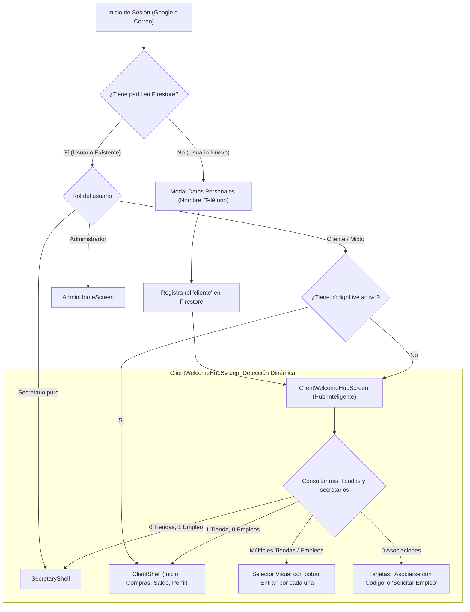

# Informe Técnico: Arquitectura Multi-Tienda del Cliente, Optimización de Tiempo Real y Seguridad

**Fecha:** 18 de Noviembre de 2026  
**Proyecto:** VENDIX Mobile (Flutter + Firebase Firestore)  
**Versión:** 1.1.1  
**Autor:** Antigravity AI & Equipo de Desarrollo Vendix  

---

## 1. Resumen Ejecutivo

En esta sesión se resolvió un conjunto crítico de requerimientos arquitectónicos y correcciones de producción para la aplicación móvil **VENDIX**:

1. **Arquitectura Multi-Tienda para Clientes:** Ahora un comprador puede estar asociado simultáneamente a múltiples tiendas/emprendimientos mediante códigos de Live, tal como un secretario puede trabajar para varios emprendedores.
2. **Hub Inteligente de Bienvenida (`ClientWelcomeHubScreen`):** Detecta automáticamente las tiendas y empleos del usuario. Si tiene exactamente una asociación, ingresa directo; si tiene varias, ofrece un selector visual; si no tiene ninguna, muestra las opciones para unirse o postularse.
3. **Resolución de Bloqueos en Tiempo Real (Finanzas / Saldo / Compras):** Se eliminó el almacenamiento en caché de flujos de difusión (`asBroadcastStream`) en `ClientService`, permitiendo que las compras y abonos se actualicen de inmediato en la pantalla de Inicio y Saldo sin quedarse congelados en *"Actualizando compras..."*.
4. **Corrección de Excepción de Document Path Vacío:** Se reforzó la extracción de `adminId` en `EnterCodeScreen` para prevenir errores de validación de argumentos en Firestore.
5. **Corrección de Desbordamiento Visual (Overflow de 2.8px):** Ajuste de `childAspectRatio` y espaciado interno en el GridView de prendas en `ClientPurchasesScreen`.
6. **Simplificación del Flujo de Google Sign-In:** Se eliminó la ventana obsoleta que obligaba al usuario nuevo de Google a elegir entre roles separados. Ahora completa sus datos y entra directo al Hub comercial.
7. **Blindaje de Credenciales Privadas:** Confirmación estricta de que `lib/secrets.dart` está fuera del seguimiento de Git (`.gitignore`).

---

## 2. Diagrama de Arquitectura y Navegación



---

## 3. Detalle de Archivos Modificados

### 3.1. [enter_code_screen.dart](file:///c:/Users/crist/Desktop/VENDIX/flutter_application_1/lib/screens/client/enter_code_screen.dart)
- **Persistencia en Subcolección:** Al ingresar un código válido (ej. `HCC-929`), además de registrar el vínculo en la raíz de `usuarios` y `clientes`, escribe un documento en `usuarios/{uid}/mis_tiendas/{adminId}` con:
  - `adminId`
  - `nombreEmprendimiento`
  - `adminNombre` (nombre y apellido del dueño)
  - `codigoLive`
  - `secretarioId`
  - `fecha_asociacion: FieldValue.serverTimestamp()`
- **Blindaje Anti-Crash:** Si el documento del secretario no contiene `adminId`, el código busca en campos alternos (`administradorId`, IDs compuestos con guion bajo, o datos del usuario) y utiliza una clave de respaldo para garantizar que `db.collection(...).doc(...)` **nunca reciba una cadena vacía**.
- **Merge Seguro:** Se sustituyó `update` por `set(..., SetOptions(merge: true))` para evitar fallos si el documento del usuario no existía previamente.

### 3.2. [client_welcome_hub_screen.dart](file:///c:/Users/crist/Desktop/VENDIX/flutter_application_1/lib/screens/client/client_welcome_hub_screen.dart)
- **Detección en Paralelo:** En `initState`, lanza consultas simultáneas a `usuarios/{uid}/mis_tiendas` y a `secretarios` (`where('clienteId', isEqualTo: uid)`).
- **Auto-Redirección Inteligente:**
  - 1 sola tienda y 0 empleos $\rightarrow$ Activa esa tienda en Firestore y entra directo a `ClientShell`.
  - 0 tiendas y 1 solo empleo $\rightarrow$ Entra directo a `SecretaryShell`.
- **Selector de Tiendas y Empleos:** Si el usuario tiene múltiples asociaciones, muestra una lista organizada de tarjetas con el nombre del negocio, dueño, código y botón interactivo "Entrar".
- **Accesos Rápidos Permanentes:** Siempre disponibles los enlaces para "Unirme a otro emprendimiento con código" y "Solicitar empleo en otra tienda".

### 3.3. [client_profile_screen.dart](file:///c:/Users/crist/Desktop/VENDIX/flutter_application_1/lib/screens/client/client_profile_screen.dart)
- **Desvinculación Selectiva:** Al pulsar "Desvincularme", el método `_desvincularDeEmprendimiento` ahora borra el registro de esa tienda específica en `usuarios/{uid}/mis_tiendas/{adminId}`.
- **Rotación Automática:** Si al cliente le quedan otras tiendas en `mis_tiendas`, activa automáticamente la siguiente disponible como la tienda activa actual. Si ya no le queda ninguna, limpia los campos raíz y lo redirige al Hub.

### 3.4. [client_service.dart](file:///c:/Users/crist/Desktop/VENDIX/flutter_application_1/lib/services/client_service.dart)
- **Eliminación de Deadlocks de Broadcast:** Se removieron `_comprasStreamCache`, `_pagosStreamCache`, `_clienteActualStream` y las llamadas a `.asBroadcastStream()`.
- **Flujo Directo y Reactivo:** Cada `StreamBuilder` ahora se suscribe directamente a los `snapshots()` nativos de Firestore, los cuales cuentan con multiplexación interna y caché local en memoria y disco. Esto solucionó de raíz el problema donde el cálculo de saldo y compras se quedaba congelado en *"Actualizando compras..."*.

### 3.5. [client_home_screen.dart](file:///c:/Users/crist/Desktop/VENDIX/flutter_application_1/lib/screens/client/client_home_screen.dart) y [client_balance_screen.dart](file:///c:/Users/crist/Desktop/VENDIX/flutter_application_1/lib/screens/client/client_balance_screen.dart)
- **Inicialización Inmediata:** Se añadió `initialData: const []` a los `StreamBuilder` de compras y pagos. El estado financiero calcula los montos desde el milisegundo 0 y se refresca de forma transparente y reactiva conforme llegan las actualizaciones de la base de datos.

### 3.6. [client_purchases_screen.dart](file:///c:/Users/crist/Desktop/VENDIX/flutter_application_1/lib/screens/client/client_purchases_screen.dart)
- **Solución al Desbordamiento de 2.8px:**
  - `childAspectRatio` modificado de `1.65` a `1.38`.
  - Padding interno ajustado a `horizontal: 14, vertical: 12`.
  - Proporciona más de 20 píxeles de espacio vertical libre para el icono, contador de unidades y nombre de prenda, eliminando cualquier overflow en teléfonos de cualquier resolución.

### 3.7. [login_screen.dart](file:///c:/Users/crist/Desktop/VENDIX/flutter_application_1/lib/screens/auth/login_screen.dart)
- **Flujo Google Optimizado:**
  - Se eliminó el diálogo que forzaba a elegir *"Soy Cliente / Soy Secretario / Soy Emprendedor"*.
  - Ahora cualquier cuenta nueva de Google abre directamente el formulario de datos personales (nombre, apellido, teléfono, dirección).
  - Al guardar, se registra con rol `cliente` y pasa de inmediato al Hub de bienvenida, permitiendo al usuario decidir si compra o postula a un empleo libremente.

---

## 4. Garantía de Seguridad de Credenciales en GitHub

> [!IMPORTANT]
> **VERIFICACIÓN TÉCNICA DE `.gitignore`**
>
> Se ejecutó la prueba formal de diagnóstico de Git en la terminal del sistema:
> ```powershell
> git check-ignore -v lib/secrets.dart
> # Salida:
> .gitignore:60:lib/secrets.dart    lib/secrets.dart
> ```
> 
> **Conclusiones de Seguridad:**
> 1. `lib/secrets.dart` está catalogado formalmente como archivo ignorado en la regla 60 del archivo `.gitignore`.
> 2. Las claves privadas de la **API de Gemini** y el **Token de Mapbox** existen **únicamente en tu disco local** para compilar la app en tu teléfono o generar el APK.
> 3. Aunque se ejecute `git add .`, `git add -A` o `git commit`, **Git ignorará por completo `lib/secrets.dart`**.
> 4. **Bajo ninguna circunstancia las llaves privadas serán subidas al repositorio de GitHub.**

---

## 5. Estado de Compilación y Verificación

- **Herramienta:** `flutter analyze lib/screens/ lib/services/`
- **Resultado:** `No issues found!` (0 errores, 0 warnings).
- **Despliegue Físico:** Compilado e instalado exitosamente en dispositivo Android `RMX3760` (Android 15) mediante sesión USB de depuración.
