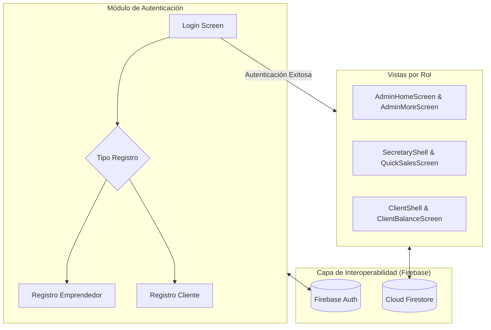

# Informe Integral de Avance y Estado del Proyecto: VENDIX

- **Proyecto:** VENDIX — Gestión de Ventas en Vivo (Live Shopping)
- **Editor:** Henry Cevallos
- **Fecha:** 30 de octubre de 2026
- **Documento:** Análisis integral del proyecto
- **Marco Metodológico:** Mobile-D (Fase 3: Producción)
- **Arquitectura:** Modelo-Vista-Controlador (MVC) sobre Flutter & Firebase

---

## 1. Resumen Ejecutivo del Proyecto

**VENDIX** es una solución móvil construida sobre Flutter con integración de servicios en la nube (Backend as a Service con Google Firebase). Su propósito es automatizar y centralizar la gestión de pedidos, clientes, inventario y cálculos acumulados generados durante transmisiones de ventas en vivo (*Live Streaming* en TikTok Live y Facebook Live), mitigando los errores del registro manual y reduciendo drásticamente las horas de conciliación pos-transmisión.

El presente informe sintetiza todos los componentes técnicos, pantallas, servicios e integraciones consolidadas hasta la fecha, complementando los análisis arquitectónicos y metodológicos previos.

---

## 2. Estado de la Arquitectura del Sistema (MVC)

El proyecto mantiene una estricta separación de responsabilidades en la raíz `lib/`:

```text
📁 lib/
  ├── 📁 data/            -> Datos locales en memoria y mocks de catálogo
  ├── 📁 models/          -> Entidades y modelos de datos tipados en Dart
  ├── 📁 screens/         -> Vistas organizadas modularmente por rol de usuario
  │     ├── 📁 auth/      -> Autenticación y registro diferenciado
  │     ├── 📁 admin/     -> Panel directivo, métricas de negocio y administración
  │     ├── 📁 secretary/ -> Ventas en tiempo real durante transmisiones y catálogo
  │     └── 📁 client/    -> Consulta de pedidos, histórico y balance personal
  ├── 📁 services/        -> Lógica de negocio y conexión a servicios cloud (Firestore / Auth)
  ├── 📁 theme/           -> Sistema centralizado de estilos, tipografías y paleta de color
  ├── 📄 firebase_options.dart -> Configuración de interoperabilidad multi-plataforma
  └── 📄 main.dart        -> Punto de entrada, bloqueo de orientación vertical e inicialización
```

### Componentes Arquitectónicos Clave:
- **Modelos (`lib/models/`):**
  - [`AdministradorModel`](file:///c:/Users/crist/Desktop/VENDIX/flutter_application_1/lib/models/administrador_model.dart): Encapsula la identidad, correo y privilegios de la cuenta administradora.
  - [`PrendaModel`](file:///c:/Users/crist/Desktop/VENDIX/flutter_application_1/lib/models/prenda_model.dart): Modela las propiedades del catálogo de prendas (código, categoría, precio de venta, descripción).
- **Vistas (`lib/screens/`):**
  - Implementación con widgets declarativos y reactivos que observan flujos de estado (`StatefulWidget`, `StreamBuilder`).
- **Controladores y Servicios (`lib/services/` y `lib/data/`):**
  - Desacoplan la persistencia y la interoperabilidad externa de la capa gráfica.

---

## 3. Módulos Funcionales Implementados



### 3.1. Autenticación y Registro (`lib/screens/auth/`)
- **Login Unificado ([`login_screen.dart`](file:///c:/Users/crist/Desktop/VENDIX/flutter_application_1/lib/screens/auth/login_screen.dart)):**
  - Autenticación con Firebase Authentication mediante correo y contraseña.
  - Interfaz refinada con selector deslizante animado (`_SelectorRegistroAnimado`) para elegir el tipo de cuenta sin saturar la pantalla.
  - Enrutamiento inteligente según el perfil del usuario autenticado.
- **Registro de Emprendedor ([`register_entrepreneur_screen.dart`](file:///c:/Users/crist/Desktop/VENDIX/flutter_application_1/lib/screens/auth/register_entrepreneur_screen.dart)):**
  - Formulario de alta para la cuenta administradora del negocio.
- **Registro de Cliente ([`register_client_screen.dart`](file:///c:/Users/crist/Desktop/VENDIX/flutter_application_1/lib/screens/auth/register_client_screen.dart)):**
  - Crea la credencial en Firebase Auth y genera automáticamente el documento de perfil en la colección `clientes` de Firestore.

### 3.2. Módulo de Administración (`lib/screens/admin/`)
- **Panel Principal ([`admin_home_screen.dart`](file:///c:/Users/crist/Desktop/VENDIX/flutter_application_1/lib/screens/admin/admin_home_screen.dart)):**
  - Resumen cuantitativo del desempeño del negocio (tarjetas KPI de ventas globales, balance diario y estado de cobranza).
  - Acceso directo a módulos operativos y enlace hacia la configuración avanzada.
- **Gestión de Personal y Más Opciones ([`admin_more_screen.dart`](file:///c:/Users/crist/Desktop/VENDIX/flutter_application_1/lib/screens/admin/admin_more_screen.dart)):**
  - Pantalla dedicada para administración interna.
  - Integración en tiempo real con Cloud Firestore mediante flujos continuos (`StreamBuilder`) sobre la colección `secretarios`.
  - Tarjetas dinámicas con avatar de iniciales, nombre, teléfono y badge cromático de estado (**Activo** / **Inactivo**).
  - Formulario modal validado para registrar nuevos asistentes administrativos con persistencia inmediata en la nube.

### 3.3. Módulo Operativo de Secretaría / Ventas en Vivo (`lib/screens/secretary/`)
- **Estructura Shell ([`secretary_shell.dart`](file:///c:/Users/crist/Desktop/VENDIX/flutter_application_1/lib/screens/secretary/secretary_shell.dart)):**
  - Barra de navegación inferior con acceso ágil durante la transmisión en vivo.
- **Venta Rápida en Vivo ([`quick_sales_screen.dart`](file:///c:/Users/crist/Desktop/VENDIX/flutter_application_1/lib/screens/secretary/quick_sales_screen.dart)):**
  - Núcleo operativo del asistente durante el live: selección rápida de clienta, asignación de prendas y cálculo instantáneo del saldo acumulado.
- **Directorio y Pedidos de Clientes ([`clients_screen.dart`](file:///c:/Users/crist/Desktop/VENDIX/flutter_application_1/lib/screens/secretary/clients_screen.dart)):**
  - Búsqueda en tiempo real por nombre de clienta.
  - Visualización y adición de pedidos y saldo en interfaz optimizada con protección de ciclo de vida (`Scaffold` integrado y manejo seguro de navegación).
- **Inventario y Precios ([`clothing_prices_screen.dart`](file:///c:/Users/crist/Desktop/VENDIX/flutter_application_1/lib/screens/secretary/clothing_prices_screen.dart)):**
  - Catálogo de prendas organizadas con sus tarifas vigentes para consulta inmediata durante el live.
- **Cobranzas y Métricas ([`payments_screen.dart`](file:///c:/Users/crist/Desktop/VENDIX/flutter_application_1/lib/screens/secretary/payments_screen.dart) y [`statistics_screen.dart`](file:///c:/Users/crist/Desktop/VENDIX/flutter_application_1/lib/screens/secretary/statistics_screen.dart)):**
  - Seguimiento de pagos parciales/totales y métricas de desempeño por transmisión.

### 3.4. Módulo de Cliente (`lib/screens/client/`)
- **Navegación del Comprador ([`client_shell.dart`](file:///c:/Users/crist/Desktop/VENDIX/flutter_application_1/lib/screens/client/client_shell.dart)):**
  - Vista limpia orientada a la experiencia del comprador final.
- **Consulta de Balance ([`client_balance_screen.dart`](file:///c:/Desktop/VENDIX/flutter_application_1/lib/screens/client/client_balance_screen.dart)):**
  - Transparencia total sobre lo adquirido en los lives, abonos efectuados y saldo pendiente por liquidar.
- **Histórico y Perfil ([`client_purchases_screen.dart`](file:///c:/Users/crist/Desktop/VENDIX/flutter_application_1/lib/screens/client/client_purchases_screen.dart) y [`client_profile_screen.dart`](file:///c:/Users/crist/Desktop/VENDIX/flutter_application_1/lib/screens/client/client_profile_screen.dart)):**
  - Detalle histórico de compras y datos personales para despachos.

---

## 4. Interoperabilidad de Plataformas y Servicios Externos

En cumplimiento con los requerimientos académicos de la asignatura, el sistema implementa interoperabilidad mediante arquitectura orientada a servicios:

1. **Google Firebase Authentication:**
   - Gestión desacoplada de identidades, tokens de sesión y seguridad.
2. **Google Cloud Firestore (`vendix-53bd7`):**
   - Base de datos distribuida NoSQL con sincronización en tiempo real (*WebSocket / Long-polling*).
   - Colecciones operativas activas: `clientes` y `secretarios`.
3. **Plataforma Web y Móvil Unificada:**
   - Compilación exitosa multicanal (Android / Web) manteniendo paridad de interfaz.

---

## 5. Mejoras Técnicas y Estabilización Recientes

En las últimas sesiones de trabajo se aplicaron las siguientes optimizaciones críticas:

1. **Depuración del Entorno y Limpieza de Errores:**
   - Se sanearon archivos huérfanos y duplicados fuera del árbol `lib/`, logrando que el analizador estático (`flutter analyze lib/`) reporte **cero errores de compilación**.
2. **Bloqueo de Orientación de Pantalla:**
   - Configuración estricta en modo **Vertical (*Portrait Only*)** a nivel de código Dart en [`main.dart`](file:///c:/Users/crist/Desktop/VENDIX/flutter_application_1/lib/main.dart) y en la capa nativa Android en [`AndroidManifest.xml`](file:///c:/Users/crist/Desktop/VENDIX/flutter_application_1/android/app/src/main/AndroidManifest.xml), garantizando usabilidad móvil constante sin desajustes por rotación involuntaria.
3. **Robustecimiento del Servidor Web:**
   - Configuración de encabezados anti-caché (`Cache-Control: no-store`) en el script de servicio para asegurar que cualquier actualización en el frontend se refleje instantáneamente en el navegador.

---

## 6. Estado Actual en la Metodología Mobile-D

El proyecto se encuentra en la **Fase 3: Implementación (Construcción)**:
- **Práctica Ágil:** Desarrollo incremental mediante iteraciones cortas.
- **Sprint / Iteración Vigente:** Consolidación de vistas administrativas, navegación multi-rol y persistencia en la nube de perfiles.
- **Próximos Pasos de la Iteración:**
  - Vincular la persistencia definitiva de compras y ventas rápidas con transacciones atómicas en Firestore.
  - Implementar reglas de seguridad en Firestore para restringir lectura/escritura según el rol autenticado.
