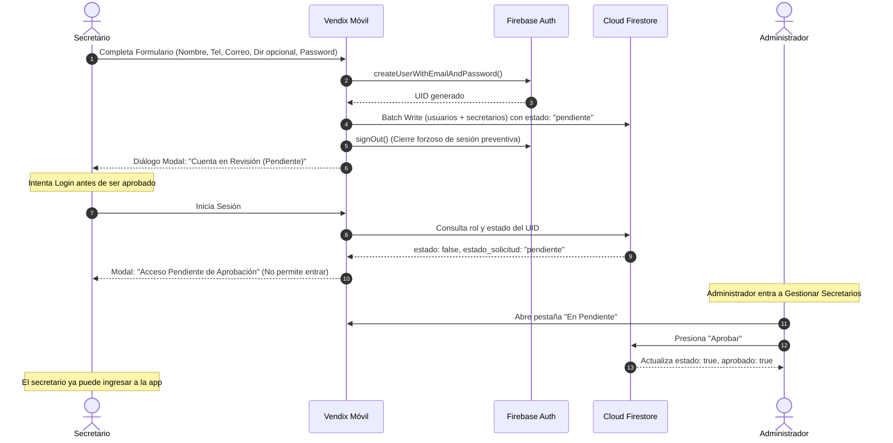

# Análisis Técnico Detallado: Nuevos Cambios en Arquitectura, Roles y Navegación

- **Proyecto:** VENDIX — Gestión de Ventas en Vivo (Live Shopping)
- **Editor:** Cristhian Batallas
- **Fecha:** 30 de octubre de 2026
- **Documento:** Análisis técnico de cambios
- **Marco Metodológico:** Mobile-D (Fase 3: Producción)
- **Patrón Arquitectónico:** Modelo - Vista - Controlador (MVC) sobre Flutter & Firebase

---

## 1. Resumen de los Cambios Implementados

En esta sesión se realizaron cuatro ajustes de alto impacto funcional y estructural en la plataforma:

1. **Clarificación y Redefinición de Roles:**  
   Se ajustó formalmente la jerarquía de actores del sistema:
   - **Administrador (Emprendedor):** Dueño del negocio, supervisor de ventas y aprobador de cuentas.
   - **Secretario (Operador):** Asistente operativo encargado del registro en vivo de prendas y clientas.
   - **Cliente:** Comprador en las transmisiones que revisa saldo, pedidos e historial.
2. **Flujo de Registro con Estado "Pendiente" y Aprobación:**  
   Los secretarios ahora se registran de forma autónoma pero su cuenta queda congelada en estado **PENDIENTE** hasta que el Administrador valide y active su acceso.
3. **Incorporación del Footer de Navegación (*BottomNavigationBar*) en Administrador:**  
   Se diseñó una barra inferior con indicador animado (estilo cápsula/pill) para alternar entre el Dashboard, Ventas Live, Gestión de Secretarios y Más Opciones.
4. **Campos Opcionales de Dirección y Validación de Teléfono:**  
   Tanto secretarios como clientes disponen de captura de teléfono y dirección con *placeholder* explícito `(opcional)`.

---

## 2. Mapa Arquitectónico de Archivos Modificados

```text
📁 lib/screens/
  ├── 📁 auth/
  │     ├── 📄 login_screen.dart                 <-- Selector animado "Secretario/Cliente" y bloqueo de cuentas pendientes
  │     ├── 📄 register_client_screen.dart       <-- Registro con teléfono y dirección de entrega opcional
  │     └── 📄 register_entrepreneur_screen.dart <-- Transformada a "Registro de Secretario" con estado pendiente
  └── 📁 admin/
        ├── 📄 admin_home_screen.dart            <-- Integración del Footer (NavigationBar) y cambio dinámico de vistas
        └── 📄 admin_more_screen.dart            <-- Pestañas "Activos" vs "En Pendiente" con botones Aprobar / Rechazar
```

---

## 3. Desglose Técnico de Implementación

### 3.1. Redefinición del Flujo de Registro para Secretarios

Anteriormente, la pantalla de registro creaba administradores directos. Con el cambio de requerimiento, la pantalla [`register_entrepreneur_screen.dart`](file:///c:/Users/crist/Desktop/VENDIX/flutter_application_1/lib/screens/auth/register_entrepreneur_screen.dart) se adaptó al rol **Secretario (Operador)**:



#### Estructura de Datos en Firestore para el Secretario (`secretarios`):
```json
{
  "uid": "ID_DE_FIREBASE_AUTH",
  "nombre": "Nombre y Apellido",
  "telefono": "099 123 4567",
  "correo": "correo@vendix.com",
  "direccion": "Dirección opcional",
  "estado": false,
  "aprobado": false,
  "estado_solicitud": "pendiente",
  "fecha_registro": "Timestamp"
}
```

---

### 3.2. Mecanismo de Seguridad y Bloqueo en el Login

En [`login_screen.dart`](file:///c:/Users/crist/Desktop/VENDIX/flutter_application_1/lib/screens/auth/login_screen.dart):
- Se actualizó el selector deslizante animado inferior para mostrar **"Secretario"** (con ícono de credencial `Icons.badge_outlined`) en lugar de "Emprendedor".
- En el método `_abrirInterfazPorRol(User usuario)` se evalúan los documentos de las colecciones `usuarios` y `secretarios`:
  - Si el usuario posee rol de secretaría pero su atributo `estado == false` o `aprobado == false` o `estado_solicitud == 'pendiente'`, el sistema ejecuta inmediatamente `FirebaseAuth.instance.signOut()`.
  - Despliega una alerta modal explicativa (`_mostrarDialogoPendiente`) impidiendo el acceso a la pantalla de ventas operativas.

---

### 3.3. Panel de Administración: Gestión de Secretarios con Aprobación en Tiempo Real

En [`admin_more_screen.dart`](file:///c:/Users/crist/Desktop/VENDIX/flutter_application_1/lib/screens/admin/admin_more_screen.dart):
- Se reestructuró la sección de personal en dos pestañas dinámicas con contadores reactivos:
  1. **Activos (`n`):** Secretarios validados y en funcionamiento con badge cromático verde (`Activo`).
  2. **En pendiente (`n`):** Solicitudes entrantes con badge ámbar, mostrando tarjeta de contacto (teléfono y dirección).
- **Acciones Disponibles en Solicitudes Pendientes:**
  - **Aprobar:** Ejecuta un lote (`WriteBatch`) que actualiza tanto en `secretarios` como en `usuarios` los campos `estado: true`, `aprobado: true` y `estado_solicitud: 'aprobado'`.
  - **Rechazar:** Marca la solicitud como rechazada tras un cuadro de confirmación.
- **Registro Directo por el Admin:** El botón "Registrar" del administrador conserva la capacidad de crear secretarios autorizados inmediatamente sin requerir ciclo de espera.

---

### 3.4. Footer de Navegación en Pantalla de Administrador

Se rediseñó [`admin_home_screen.dart`](file:///c:/Users/crist/Desktop/VENDIX/flutter_application_1/lib/screens/admin/admin_home_screen.dart) transformándola en una vista con navegación persistente mediante `NavigationBar` (Material 3):

```text
┌───────────────────────────────────────────────────────────┐
│                    VENDIX - ADMIN                         │
│  [Top Bar: Nombre y Saludo]                               │
│  [Banner EN VIVO AHORA]                                   │
│  [Métricas 2x2: Vendido, Prendas, Cobrado, Por Cobrar]     │
│  [Botón Acción Venta Rápida]                              │
│  [Accesos Directos a Clientes, Prendas, Estadísticas]     │
└───────────────────────────────────────────────────────────┘
│   [ 🏠 Inicio ]   [ ⚡ Ventas ]   [ 🪪 Secretarios ]   [ 👤 Más ]   │ <-- FOOTER
└───────────────────────────────────────────────────────────┘
```

#### Destinos del Footer:
1. **Inicio (`index: 0`):** Dashboard analítico de ventas y accesos rápidos.
2. **Ventas Live (`index: 1`):** Redirección integrada hacia `QuickSalesScreen`.
3. **Secretarios (`index: 2`):** Acceso directo a `AdminMoreScreen` posicionado en la gestión de personal.
4. **Perfil / Más (`index: 3`):** Configuración general, apariencia, seguridad y cierre de sesión.

---

## 4. Estado de Calidad y Compilación

- **Análisis Estático (`flutter analyze lib/`):**
  - **Resultado:** `No issues found!` (0 errores, 0 advertencias en código activo).
- **Compilación Web (`flutter build web --release`):**
  - **Resultado:** Exitosa (`√ Built build\web`), sin incompatibilidades en librerías ni tipado.
- **Servidor Local de Despliegue:**
  - Ejecutándose en puerto `5000` con políticas de invalidación de caché (`no-store, no-cache`) para visualización instantánea.

---

## 5. Próximos Pasos en el Marco Mobile-D

1. **Pruebas de Transición:** Probar en emulador/navegador el ciclo completo: creación de cuenta de secretario -> confirmación del estado pendiente -> aprobación desde el perfil de administrador -> inicio de sesión exitoso.
2. **Transacciones de Venta en Vivo:** Conectar la pantalla de venta rápida (`quick_sales_screen.dart`) a la colección `compras` de Firestore para descontar inventario en tiempo real.
