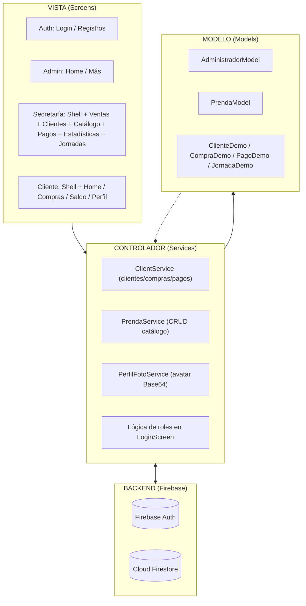
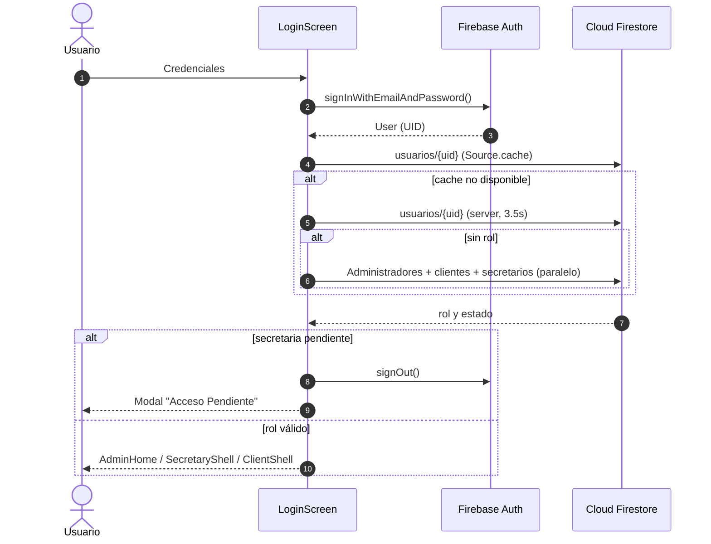

# Informe Exhaustivo de Análisis del Proyecto VENDIX

- **Proyecto:** VENDIX — Gestión de Ventas en Vivo (Live Shopping)
- **Editor:** Cristhian Batallas
- **Fecha:** 02 de noviembre de 2026
- **Documento:** Análisis exhaustivo (código fuente + artefactos)
- **Repositorio analizado:** flutter_application_1/

---

## 1. Resumen Ejecutivo

**VENDIX** es una aplicación móvil multiplataforma construida con **Flutter (Dart)** y respaldada por **Google Firebase** (Authentication + Cloud Firestore) como Backend-as-a-Service. Su propósito es **automatizar la gestión de pedidos, clientes, inventario, cobros y saldos durante transmisiones de venta en vivo** (TikTok Live y Facebook Live), reduciendo el registro manual y las horas de conciliación posteriores al directo.

El proyecto adopta el marco metodológico ágil **Mobile-D** (actualmente en **Fase 3: Producción / Implementación**, con estabilización en curso) y una arquitectura inspirada en **Modelo-Vista-Controlador (MVC)**.

> **Hallazgo central del análisis:** la aplicación funciona actualmente sobre **dos fuentes de datos en paralelo**: un conjunto de **datos demo en memoria** (catálogo, clientas, jornadas y ventas) y las **colecciones reales de Cloud Firestore**. El módulo del *Cliente* y el *Catálogo de Prendas* ya están conectados a Firestore en tiempo real, mientras que el núcleo operativo de *Secretaría* (venta rápida, clientas, pagos, estadísticas y jornadas) todavía opera sobre los datos locales de demostración.

---

## 2. Propósito y Contexto de Negocio

| Dimensión                 | Detalle                                                                                                                                                                                    |
| :------------------------- | :----------------------------------------------------------------------------------------------------------------------------------------------------------------------------------------- |
| **Problema**         | El registro de pedidos, control de productos, cálculo de totales y envío de saldos tras cada transmisión en vivo se realiza de forma manual, generando errores, cansancio y reclamos.   |
| **Solución**        | Centralizar y automatizar la gestión de ventas durante el live: registro ágil de pedidos, cálculo de saldos, control de abonos e historial.                                             |
| **Usuarios / Roles** | 1) **Administrador (Emprendedor)** — dueño del negocio. 2) **Secretario/a (Operador)** — registra ventas en vivo. 3) **Cliente** — consulta saldo, compras y perfil. |
| **Marca de tienda**  | "Moda Luna Showroom" (referencia visible en el portal del cliente).                                                                                                                        |

---

## 3. Stack Tecnológico y Dependencias

Definido en [`pubspec.yaml`](pubspec.yaml):

| Dependencia                           | Versión   | Propósito en el proyecto                                                   |
| :------------------------------------ | :--------- | :-------------------------------------------------------------------------- |
| `flutter` / `flutter_web_plugins` | SDK        | Framework base y plugins web.                                               |
| `cupertino_icons`                   | `^1.0.8` | Iconografía iOS.                                                           |
| `firebase_core`                     | `^5.0.0` | Inicialización de Firebase.                                                |
| `cloud_firestore`                   | `^7.0.0` | Base de datos NoSQL en tiempo real.                                         |
| `firebase_auth`                     | `^7.0.0` | Autenticación por correo/contraseña.                                      |
| `google_sign_in`                    | `^7.2.0` | **Declarada** (no se encontró cableada en el flujo de login actual). |
| `image_picker`                      | `^1.2.4` | Cámara/galería para foto de perfil.                                       |

**Datos técnicos relevantes:**

- SDK de Dart: `>=3.13.0 <4.0.0`.
- Nombre del paquete: `vendix`, versión `1.0.0+1`.
- Material 3 activado (`useMaterial3: true`).
- Tipografía base: **Roboto**.
- Orientación bloqueada en **vertical (portrait)** desde `main.dart` y `AndroidManifest.xml`.

---

## 4. Estructura del Proyecto

```text
flutter_application_1/
├── lib/                        ← Código fuente Dart de la aplicación
│   ├── data/
│   │   ├── datos_prueba.dart       ← Datos demo en memoria (clientas, prendas, jornadas)
│   │   └── prenda_service.dart     ← CRUD de prendas contra Firestore
│   ├── models/
│   │   ├── administrador_model.dart
│   │   └── prenda_model.dart
│   ├── screens/
│   │   ├── auth/                   ← login_screen, register_client_screen, register_entrepreneur_screen
│   │   ├── admin/                  ← admin_home_screen, admin_more_screen
│   │   ├── secretary/              ← shell + 8 pantallas operativas
│   │   └── client/                 ← shell + 4 pantallas del portal
│   ├── services/
│   │   ├── client_service.dart     ← Clientes / Compras / Pagos (Firestore, streams caché)
│   │   └── perfil_foto_service.dart← Foto de perfil estilo WhatsApp (Base64)
│   ├── theme/
│   │   └── app_theme.dart          ← Tema global y paleta de color
│   ├── firebase_options.dart       ← Configuración Firebase multi-plataforma
│   └── main.dart                   ← Punto de entrada + inicialización
├── python/
│   └── gestion_admin.py            ← Utilidad CLI (REST) para registrar administradores
├── artefacts/                      ← Documentación de análisis (9 archivos .md)
├── backups/                        ← 2 respaldos .rar del equipo
├── android/ ios/ linux/ macos/ web/ windows/   ← Plataformas Flutter
├── build/ .dart_tool/              ← Artefactos de compilación
├── run_web.bat / run_brave.bat / serve_web.ps1  ← Lanzadores y servidor web
├── firebase.json
└── pubspec.yaml / pubspec.lock
```

---

## 5. Arquitectura (MVC adaptado a Flutter + Firebase)

El proyecto separa responsabilidades en capas claras:

| Capa MVC                  | Ubicación                                           | Responsabilidad                                                                                                                                                                                    |
| :------------------------ | :--------------------------------------------------- | :------------------------------------------------------------------------------------------------------------------------------------------------------------------------------------------------- |
| **Modelo (M)**      | `lib/models/`, `lib/data/datos_prueba.dart`      | Entidades tipadas (`AdministradorModel`, `PrendaModel`) y modelos demo (`ClienteDemo`, `CompraDemo`, `PagoDemo`, `PrendaDemo`, `JornadaDemo`). Serialización `fromMap`/`toMap`. |
| **Vista (V)**       | `lib/screens/` + `lib/widgets/` + `lib/theme/` | Pantallas reactivas (`StatefulWidget`, `StreamBuilder`), formularios, modales y navegación.                                                                                                   |
| **Controlador (C)** | `lib/services/` + `lib/data/prenda_service.dart` | Lógica de negocio, cálculos de saldos, consultas/streams a Firestore, validaciones y orquestación de Firebase Auth.                                                                             |



---

## 6. Modelo de Datos en Cloud Firestore

**Proyecto Firebase:** `vendix-53bd7` (ver [`firebase_options.dart`](lib/firebase_options.dart)).

Colecciones detectadas en el código:

| Colección          | Documento (ID)                          | Campos principales                                                                                                                                     | Uso                                                                   |
| :------------------ | :-------------------------------------- | :----------------------------------------------------------------------------------------------------------------------------------------------------- | :-------------------------------------------------------------------- |
| `usuarios`        | `uid` de Auth                         | `uid`, `nombre`, `correo`, `telefono`, `direccion`, `rol`, `estado`, `aprobado`, `creadoEn`                                          | **Fuente única de rol** usada en el login (caché + servidor). |
| `clientes`        | `uid` (al registrarse) o autogenerado | `uid`, `nombre`, `correo`, `telefono`, `direccion`, `fotoBase64`, `creadoEn`                                                             | Ficha comercial del cliente y vínculo con su cuenta.                 |
| `secretarios`     | `uid` (al registrarse) o autogenerado | `uid`, `nombre`, `correo`, `telefono`, `direccion`, `estado`, `aprobado`, `estado_solicitud`, `fecha_registro`, `fecha_aprobacion` | Gestión y aprobación del equipo operativo.                          |
| `Administradores` | `uid`                                 | `nombre`, `apellido`, `correo`, `telefono`, `estado`, `rol`                                                                                | Cuenta del emprendedor (también escrita por el script Python).       |
| `prendas`         | autogenerado                            | `nombre`, `precio`, `activa`, `stock`, `fecha_creacion`                                                                                      | Catálogo de prendas (CRUD en tiempo real).                           |
| `compras`         | autogenerado                            | `clienteId`, `prendaNombre`, `precioUnitario`, `cantidad`, `subtotal`, `fecha`                                                             | Registro de pedidos del cliente.                                      |
| `pagos`           | autogenerado                            | `clienteId`, `monto`, `observacion`, `fecha`                                                                                                   | Abonos parciales/totales.                                             |
| `fotos_perfil`    | `usuarioId`                           | `usuarioId`, `fotoBase64`, `rol`, `actualizadoEn`                                                                                              | Colección dedicada a avatares (Base64).                              |

---

## 7. Entidades y Modelos Dart

### 7.1 `AdministradorModel` — [`lib/models/administrador_model.dart`](lib/models/administrador_model.dart)

- Campos: `id`, `nombre`, `apellido`, `correo`, `telefono`, `estado`.
- Getters: `nombreCompleto`, `iniciales` (con fallback `'AD'`).
- `toMap()` agrega `rol: 'admin'`.

### 7.2 `PrendaModel` — [`lib/models/prenda_model.dart`](lib/models/prenda_model.dart)

- Campos: `id`, `nombre`, `precio` (double), `activa`, `stock` (int), `fechaCreacion`.
- `fromFirestore()` convierte de forma defensiva `num → double` / `int`.
- `toMap()` usa `FieldValue.serverTimestamp()` cuando no hay fecha.

### 7.3 Modelos demo — [`lib/data/datos_prueba.dart`](lib/data/datos_prueba.dart)

| Clase           | Campos / Reglas                                                                                                                                                                                                         |
| :-------------- | :---------------------------------------------------------------------------------------------------------------------------------------------------------------------------------------------------------------------- |
| `JornadaDemo` | `nombre`, `fecha`, `horaInicio`, `horaFin`, `estado` (`activa`/`cerrada`/`pendiente`); `duracionTexto`.                                                                                               |
| `PrendaDemo`  | `nombre`, `precio`, `activa`.                                                                                                                                                                                     |
| `CompraDemo`  | `prendaNombre`, `precioUnitario`, `cantidad`, `fecha`; `subtotal = precio × cantidad`.                                                                                                                       |
| `PagoDemo`    | `monto`, `fecha`, `observacion`.                                                                                                                                                                                  |
| `ClienteDemo` | `nombre`, `telefono`, `direccion`, listas `compras`/`pagos`; `totalComprado`, `totalPagado`, `deuda` (nunca negativa), `prendas`; `agregarCompra()` y `registrarPago()` (rechaza montos > deuda). |

Listas globales demo: `prendasDemo` (5 prendas), `clientesDemo` (5 clientas con historial), `jornadasDemo` (4 jornadas).

---

## 8. Servicios (Capa Controlador)

### 8.1 `ClientService` — [`lib/services/client_service.dart`](lib/services/client_service.dart)

Singleton estático (`ClientService._()`). Responsabilidades:

- **Clientes:** `clienteActual()` (stream compartido por UID con `.asBroadcastStream()`), `todosLosClientes()`, `registrarCliente()`, `actualizarCliente()` (sincroniza `clientes` + `usuarios` + `updateDisplayName` en Auth).
- **Compras/Pagos:** `compras(clienteId)`, `pagos(clienteId)` con **caché de streams por cliente** (`_comprasStreamCache`, `_pagosStreamCache`); `registrarCompra()`, `registrarPago()`.
- **Caché y limpieza:** `limpiarCache()` para purgar streams al cerrar sesión.
- **Utilidades:** `numero()`, `dinero()` (formato `$X.XX`), `fecha()`, `calcularTotalComprado()`, `calcularTotalPagado()`, `calcularSaldo()`.

> Esta es la **pieza clave de optimización de rendimiento**: evita abrir múltiples conexiones Firestore simultáneas al montar el `ClientShell`.

### 8.2 `PrendaService` — [`lib/data/prenda_service.dart`](lib/data/prenda_service.dart)

CRUD completo sobre la colección `prendas`: `getPrendasStream()`, `agregarPrenda()`, `actualizarPrenda()`, `toggleActiva()`, `eliminarPrenda()`.

### 8.3 `PerfilFotoService` — [`lib/services/perfil_foto_service.dart`](lib/services/perfil_foto_service.dart)

- Almacena la foto **Base64** en `fotos_perfil/{usuarioId}` y sincroniza (vía `WriteBatch`) en `usuarios` y en la colección según el rol (`clientes`, `Administradores`, `secretarios`).
- `_seleccionarYGuardar()`: compresión a **512×512 px, calidad 70%**.
- `mostrarOpcionesFotoWhatsApp()`: hoja inferior con **Cámara / Galería / Enlace web**.
- `avatarConInsignia()`: avatar circular con iniciales de respaldo e insignia de cámara.
- `eliminarFoto()`: borra de `fotos_perfil` y anula `fotoBase64` en las colecciones relacionadas.

---

## 9. Flujo de Autenticación, Roles y Navegación

### 9.1 Registro de Cliente — [`register_client_screen.dart`](lib/screens/auth/register_client_screen.dart)

1. Valida formulario (nombre ≥ 3, teléfono, correo regex, dirección opcional, contraseña ≥ 6 y confirmación).
2. `createUserWithEmailAndPassword()`.
3. `WriteBatch`: escribe `usuarios/{uid}` con `rol: 'cliente'` y `clientes/{uid}`.
4. Navega directamente a `ClientShell`.

### 9.2 Registro de Secretario/a — [`register_entrepreneur_screen.dart`](lib/screens/auth/register_entrepreneur_screen.dart)

> ⚠️ El archivo conserva el nombre heredado `entrepreneur`, pero **registra secretarios**.

1. Crea la cuenta en Auth.
2. `WriteBatch`: escribe `usuarios/{uid}` con `rol: 'secretaria'`, `estado: 'pendiente'`, `aprobado: false` y `secretarios/{uid}` con `estado: false`, `estado_solicitud: 'pendiente'`.
3. **`signOut()` forzoso** y diálogo "Cuenta en Revisión".

### 9.3 Login y resolución de rol — [`login_screen.dart`](lib/screens/auth/login_screen.dart)

Estrategia de alto rendimiento en `_resolverPantalla()`:

1. **Caché local** (`Source.cache`, < 10 ms).
2. **Servidor** en `usuarios/{uid}` con timeout de 3.5 s.
3. **Consultas de respaldo en paralelo** (`Future.wait` + timeout 4 s) contra `Administradores`, `clientes` y `secretarios`.

`_crearPantallaSegunRol()` enruta:

- `cliente` → `ClientShell`.
- `secretaria/secretario/operador` → `SecretaryShell` (bloqueado si `estado == 'pendiente'` o `!aprobado`).
- `administrador/admin` → `AdminHomeScreen`.

Además:

- `_verificarSesionExistente()` en `initState()` implementa **auto-login**.
- `_abrirInterfazPorRol()` bloquea cuentas pendientes con `signOut()` + `ClientService.limpiarCache()`.
- Selector animado `_SelectorRegistroAnimado` (Secretario / Cliente).



### 9.4 Aprobación de Secretarios (Administrador) — [`admin_more_screen.dart`](lib/screens/admin/admin_more_screen.dart)

- Dos pestañas con contadores reactivos: **Activos** vs **En Pendiente**.
- **Aprobar:** `WriteBatch` que actualiza `secretarios` y `usuarios` (`estado: true/activo`, `aprobado: true`, `estado_solicitud: 'aprobado'`, `fecha_aprobacion`).
- **Rechazar:** `estado_solicitud: 'rechazado'`.
- **Registrar directo:** crea secretario ya activo/aprobado sin ciclo de espera.

---

## 10. Módulo Administrador

### 10.1 `AdminHomeScreen` — [`admin_home_screen.dart`](lib/screens/admin/admin_home_screen.dart)

- `NavigationBar` (Material 3) con 4 destinos: **Inicio / Ventas Live / Secretarios / Perfil-Más**.
- Dashboard con: banner "EN VIVO AHORA · TikTok & FB Live", KPIs 2×2 (**Total Vendido Hoy, Prendas Vendidas, Cobrado, Por Cobrar** — valores de ejemplo `$1,240`, `48`, `$890`, `$350`), botón "Venta Rápida en Vivo", accesos rápidos (Clientas, Prendas, Estadísticas) y acceso a Gestión de Secretarios.
- Tarjeta de perfil con `admin.iniciales`.

### 10.2 `AdminMoreScreen` — [`admin_more_screen.dart`](lib/screens/admin/admin_more_screen.dart)

- Tarjeta del administrador con gradiente y badge "Admin".
- Sección `_SecretariosSection` (pestañas y aprobación, ver 9.4).
- Acciones rápidas: Gestionar prendas (`ClothingPricesScreen`), Gestión de pagos (`PaymentsScreen`).
- Ajustes de cuenta: Tema, Seguridad (placeholders) y Cerrar sesión.

---

## 11. Módulo Secretario/a (Operativo)

Estructura `SecretaryShell` — [`secretary_shell.dart`](lib/screens/secretary/secretary_shell.dart): `BottomNavigationBar` de 5 pestañas con `IndexedStack`.

| Pantalla          | Archivo                         | Fuente de datos                          | Funcionalidad                                                                                              |
| :---------------- | :------------------------------ | :--------------------------------------- | :--------------------------------------------------------------------------------------------------------- |
| Inicio            | `home_screen.dart`            | `clientesDemo`                         | Saludo dinámico, tarjeta LIVE, resumen de hoy (ventas, clientas, prendas, por cobrar).                    |
| Ventas (rápidas) | `quick_sales_screen.dart`     | `clientesDemo` + `prendasDemo`       | Núcleo del live: busca clienta, suma prendas, calcula total, registra venta en memoria.                   |
| Clientas          | `clients_screen.dart`         | `clientesDemo`                         | Búsqueda/filtros (Todas / Con saldo / Al día), alta, resumen, agregar prenda, registrar pago, historial. |
| Prendas y precios | `clothing_prices_screen.dart` | **`PrendaService` → Firestore** | Catálogo en tiempo real con CRUD (nueva/editar/activar/eliminar).                                         |
| Pagos             | `payments_screen.dart`        | `clientesDemo`                         | Registro de abonos con validación (no superar deuda), observación e historial.                           |
| Estadísticas     | `statistics_screen.dart`      | `clientesDemo`                         | Totales, % cobrado, prendas más vendidas, clientes con más compras.                                      |
| Jornadas          | `jornadas_screen.dart`        | `jornadasDemo`                         | Crear/iniciar/cerrar/eliminar lives; historial de jornadas.                                                |
| Más              | `more_screen.dart`            | Auth + `PerfilFotoService`             | Avatar WhatsApp, accesos (Jornadas, Prendas, Pagos, Configuración), cierre de sesión seguro.             |

> **Nota:** `JornadasScreen` y `PaymentsScreen` están accesibles desde `MoreScreen`; `StatisticsScreen` y `ClientsScreen` desde el shell y desde el panel admin.

---

## 12. Módulo Cliente (Portal)

Estructura `ClientShell` — [`client_shell.dart`](lib/screens/client/client_shell.dart): `NavigationBar` (Material 3) con `IndexedStack`.

| Pantalla | Archivo                          | Funcionalidad                                                                                                                          |
| :------- | :------------------------------- | :------------------------------------------------------------------------------------------------------------------------------------- |
| Inicio   | `client_home_screen.dart`      | Saldo pendiente, total compras/pagado, tienda ("Moda Luna Showroom"), última compra. Renderizado instantáneo sin pantalla en blanco. |
| Compras  | `client_purchases_screen.dart` | Resumen de prendas compradas + historial detallado.                                                                                    |
| Saldo    | `client_balance_screen.dart`   | Estado de cuenta (compras, pagado, saldo) y pagos recientes.                                                                           |
| Perfil   | `client_profile_screen.dart`   | Avatar WhatsApp, datos personales editables (modal), correo y cierre de sesión.                                                       |

Estas pantallas consumen los **streams compartidos** de `ClientService` (`clienteActual`, `compras`, `pagos`).

---

## 13. Tema y Sistema de Diseño

Definido en [`app_theme.dart`](lib/theme/app_theme.dart):

| Token          | Valor       | Uso                            |
| :------------- | :---------- | :----------------------------- |
| `violet`     | `#6C4AB6` | Color primario / marca.        |
| `pink`       | `#E9A6C8` | Color secundario / acentos.    |
| `background` | `#F8F6FA` | Fondo de pantallas.            |
| `dark`       | `#292333` | Textos principales.            |
| `muted`      | `#81798D` | Textos secundarios.            |
| `border`     | `#E8E1ED` | Bordes de tarjetas e inputs.   |
| `green`      | `#15966B` | Estados positivos / "al día". |
| `orange`     | `#E76F45` | Deudas / "por cobrar".         |

Se usa `ColorScheme.fromSeed(seedColor: violet)` con Material 3, `AppBar` blanca sin elevación e `InputDecorationTheme` con bordes redondeados (radio 14).

---

## 14. Configuración Firebase y Plataformas

- **`main.dart`:** `WidgetsFlutterBinding.ensureInitialized()`, bloqueo `portraitUp/Down`, `Firebase.initializeApp(DefaultFirebaseOptions.currentPlatform)`, `MaterialApp` con `home: LoginScreen` y `debugShowCheckedModeBanner: false`.
- **`firebase_options.dart`:** configura Web, Android, iOS, macOS y Windows del proyecto `vendix-53bd7` (Linux lanza `UnsupportedError`).
- **`firebase.json`:** configuración de hosting/servicios.
- **`android/app/src/main/AndroidManifest.xml`:** orientación portrait y permiso `INTERNET`.

---

## 15. Herramientas Auxiliares

### 15.1 Scripts de lanzamiento y servidor

- `run_web.bat` / `run_brave.bat`: lanzadores con menú (Chrome / Edge / Brave / Android USB / emulador **MuMuPlayer** vía ADB) y servidor local con `Cache-Control: no-store`.
- `serve_web.ps1`: servidor web estático del build.

### 15.2 `python/gestion_admin.py`

Utilidad CLI que interactúa con **Firebase vía API REST** (Identity Toolkit + Firestore REST):

- `generar_correo()`: genera correo corporativo `nombre.apellido@vendix.com`.
- `registrar_en_firebase_auth()`: crea la cuenta vía `accounts:signUp`.
- `guardar_en_firestore_administrador()`: escribe en `Administradores/{uid}` con `rol: 'admin'`.
- Menú: **1) Crear administrador, 2) Listar administradores, 3) Salir**.

> ⚠️ **Observación de seguridad:** este script persiste la **contraseña en texto plano** dentro del documento `Administradores` (campo `contrasena`), lo cual no es una práctica recomendada.

---

## 16. Inventario de Artefactos Existentes

Carpeta [`artefacts/`](artefacts/):

| Archivo                                | Contenido                                                                                                         |
| :------------------------------------- | :---------------------------------------------------------------------------------------------------------------- |
| `2026-10-30_diapositiva_grupo1.md`                     | Guion de exposición del Grupo 1: planteamiento, objetivos, requisitos, tecnologías, metodología, arquitectura. |
| `2026-10-27_diagrama_mvc.md`             | Arquitectura MVC con diagramas Mermaid y mapeo de archivos.                                                       |
| `2026-10-27_arquitectura_diapositiva.md` | Arquitectura en formato diapositiva Canva.                                                                        |
| `2026-10-27_metodologia_mobile_d.md`     | Metodología Mobile-D y sus 5 fases aplicadas.                                                                    |
| `2026-10-30_analisis_integral.md`      | Informe integral de avance (30/10/2026).                                                                          |
| `2026-10-30_analisis_nuevos_cambios.md`  | Cambios en roles, navegación y aprobación de secretarios.                                                       |
| `2026-10-30_cevallos_cambios_hoy.md` | Registro de cambios/optimizaciones de Cevallos (30/10/2026).                                                      |
| `2026-10-30_adaptacion_backup_cevallos.md` | Integración del backup de Cevallos en la raíz del proyecto.                                                     |

**Backups:** `backups/backup_batallas_23102026.rar` y `backups/backup_cevallos_30102026.rar`.

---

## 17. Estado Actual, Calidad y Pendientes

### Estado (según artefactos y código)

- `flutter analyze lib/`: **0 errores, 0 advertencias**.
- `flutter build web --release`: **compila con éxito**.
- Multiplataforma: Android + Web compilados; configuración presente para iOS/macOS/Windows.

### Pendientes identificados (Mobile-D)

1. **Persistir ventas/compras/pagos del módulo Secretaría en Firestore** (hoy usan `clientesDemo` en memoria).
2. **Reglas de seguridad de Firestore** por rol autenticado.
3. Cablear `google_sign_in` (dependencia declarada, no usada).
4. Conectar KPIs del dashboard admin a datos reales (hoy son valores fijos).
5. Módulos "Tema y apariencia" y "Seguridad y accesos" (placeholders).

---

## 18. Hallazgos y Observaciones Técnicas

1. **Doble fuente de datos (crítico):** el módulo Secretaría (venta rápida, clientas, pagos, estadísticas, jornadas) opera sobre listas demo **volátiles en memoria** (`datos_prueba.dart`), mientras que Cliente y Catálogo ya usan Firestore. Los datos demo **se pierden al reiniciar la app**.
2. **Nomenclatura heredada:** `register_entrepreneur_screen.dart` registra secretarios (no emprendedores), lo que puede confundir en mantenimiento.
3. **Cierre de sesión no homogéneo:** `ClientProfileScreen` y `MoreScreen` ejecutan `signOut()` + `limpiarCache()` correctamente; sin embargo, el "Cerrar sesión" de `AdminMoreScreen` y el botón retroceso de `AdminHomeScreen` **solo navegan a `LoginScreen` sin purgar la sesión ni la caché**, a diferencia de lo indicado en el artefacto de cambios.
4. **Saludo estático en admin:** `AdminHomeScreen` usa literal "Buenas tardes" fijo, mientras el `HomeScreen` de Secretaría calcula el saludo por hora.
5. **Seguridad del script Python:** persiste la contraseña en texto plano en Firestore (campo `contrasena`).
6. **Fotos como Base64:** el avatar se guarda como Base64 en Firestore (funcional pero menos eficiente que Firebase Storage para imágenes grandes).
7. **Robustez defensiva:** hay buen manejo de `mounted`, `try/catch`, validación de tipos numéricos y `timeout` en consultas; señales de un proceso de estabilización consciente.
8. **`registrarCliente()` vs registro de cliente:** `ClientService.registrarCliente()` (usado por secretaría) crea documento con ID autogenerado y `uid` opcional, mientras el registro de cuenta crea `clientes/{uid}` — dos formas de vincular cliente/cuenta que conviene unificar.

---

## 19. Conclusión

VENDIX es un proyecto académico (ESPOCH · Interoperabilidad de Plataformas) con un **alcance funcional notable y una interfaz cuidada**, que ya implementa: autenticación multi-rol con flujo de aprobación, panel de administración, operación de ventas en vivo, portal de cliente con estado de cuenta, catálogo de prendas en tiempo real y gestión de fotos de perfil, todo bajo una arquitectura MVC y la metodología Mobile-D.

Su principal reto técnico pendiente es **cerrar la brecha entre los datos demo y la persistencia real en Firestore** en el módulo operativo, junto con la **estandarización del cierre de sesión** y la **aplicación de reglas de seguridad** en la base de datos. Resueltos estos puntos, el sistema estaría listo para la fase de estabilización final y las pruebas de sistema.
