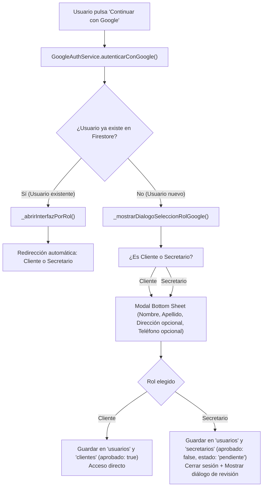

# Bitácora Técnica de Implementación: Autenticación con Google en VENDIX

**Fecha:** 03 de noviembre de 2026  
**Proyecto:** VENDIX Mobile (`flutter_application_1`)  
**Módulos Afectados:** Autenticación (`lib/screens/auth/`), Servicios (`lib/services/`), Firebase Console, Gradle/Android  
**Estado:** ✅ Implementado, configurado y validado en dispositivo Android y Web  

---

## 1. Resumen y Objetivo de la Jornada

El objetivo principal fue integrar el proveedor de autenticación con **Google Sign-In** para **Clientes** y **Secretarios (Operadores)**, permitiendo que puedan iniciar sesión o registrarse con un solo toque desde su dispositivo móvil o navegador, pero manteniendo de forma rigurosa la lógica de negocio y seguridad de la aplicación:

1. **Clientes:** Acceso inmediato a la tienda tras vincular su cuenta.
2. **Secretarios:** Creación de cuenta en estado **PENDIENTE** (`aprobado: false`), requiriendo aprobación previa del Administrador antes de acceder a las herramientas operativas.
3. **Formulario de Datos Complementarios:** Solicitud en campos independientes de nombre, apellido, teléfono (opcional) y dirección (opcional).
4. **Diseño Visual Oficial:** Integración del logotipo oficial multicolor de Google (WebP).

---

## 2. Configuración en la Consola de Firebase

Para que la aplicación interactúe con los servidores de Google se realizaron las siguientes configuraciones directas en la consola web de Firebase (`vendix-53bd7`):

1. **Habilitación del Proveedor:**
   * En **Firebase Console > Authentication > Sign-in method (Proveedores de acceso)** se activó el proveedor **Google** junto con el existente de Correo/Contraseña.
2. **Extracción y Vinculación del ID de Cliente Web (Web Client ID):**
   * En la configuración del SDK Web se obtuvo el identificador OAuth 2.0:
     ```text
     1072094421175-b9pe80lgr9r5g33oao2jb697po91plbq.apps.googleusercontent.com
     ```
3. **Registro de la Huella Digital de Seguridad (SHA-1 y SHA-256):**
   * Se aclaró el concepto de "Huella Digital": no tiene relación con datos biométricos de los usuarios, sino con el certificado criptográfico de firma de la aplicación Android.
   * Mediante la ejecución de `gradlew signingReport` se extrajeron los hashes del almacén de claves de desarrollo (`debug.keystore`):
     * **SHA-1:** `E2:A3:16:96:F1:D8:1B:5E:87:9C:88:90:09:B9:2F:36:8C:92:C8:63`
     * **SHA-256:** `35:E2:74:CB:4D:FD:54:19:4F:8F:70:31:5D:39:1F:89:D9:DC:D9:FD:8B:6B:DB:A6:C6:37:3F:80:F9:9D:86:90`
   * Se agregaron a **Configuración del proyecto > Tus apps > com.example.vendix**.
   * Se actualizó y descargó el archivo `android/app/google-services.json`.

---

## 3. Incidentes, Fallas Detectadas y Cómo se Solucionaron

Durante la sesión se encontraron errores técnicos que fueron analizados y resueltos uno a uno:

### A. Falla: Incompatibilidad con `google_sign_in` v7.2.0
* **Problema:** En la versión 7.2.0 del paquete en Dart, la clase `GoogleSignIn` pasó a ser un Singleton que usa constructores privados y el método `authenticate()` en lugar de `GoogleSignIn()` y `signIn()`.
* **Solución:** Se reescribió `GoogleAuthService` utilizando la API moderna:
  ```dart
  await GoogleSignIn.instance.initialize(serverClientId: _webClientId);
  final GoogleSignInAccount account = await GoogleSignIn.instance.authenticate();
  ```

### B. Falla en Android: `clientConfigurationError, serverClientId must be provided on Android`
* **Causa:** Al tocar el botón en el teléfono Android, la app arrojaba una excepción porque el plugin en Android requiere explícitamente el ID del cliente Web para generar el `idToken` de OAuth.
* **Solución:** Se pasó el parámetro `serverClientId: _webClientId` en la llamada a `GoogleSignIn.instance.initialize()`.

### C. Falla de Google Play Services: `[16] Account reauth failed`
* **Causa:** El selector de cuentas de Google abría y permitía elegir la cuenta de Gmail, pero al momento de confirmar, Google Play Services rechazaba la solicitud con código `16`. Esto ocurre cuando Firebase no tiene registrada la firma SHA-1 del APK en ejecución.
* **Solución:** Se registró la firma SHA-1 en Firebase Console y se refrescó la configuración.

---

## 4. Arquitectura y Nuevos Flujos Implementados



### A. Nuevo Servicio Centralizado: `lib/services/google_auth_service.dart`
* **Multiplataforma:** Soporte para Flutter Web mediante `signInWithPopup` y para Android mediante el SDK nativo de Google Play Services.
* **Manejo de Roles:** Separa nombre y apellido explícitamente y guarda la foto de perfil oficial de Google del usuario en la colección `fotos_perfil`.

### B. Formulario de Captura de Datos (`Bottom Sheet`)
Cuando el usuario se registra con Google (desde Login o desde las pantallas de registro de Cliente o Secretario), se despliega una hoja interactiva que solicita:
* **Nombre:** Campo independiente (autocompleta con el primer nombre de Google).
* **Apellido:** Campo independiente (autocompleta con los apellidos de Google).
* **Dirección (opcional):** Con placeholder descriptivo `Ej. Av. Amazonas y Colón (opcional)`.
* **Número de teléfono (opcional):** Con teclado numérico `Ej. 0991234567 (opcional)`.

### C. Integración del Logo Oficial de Google
Se sustituyó el ícono genérico de Material Design (`Icons.g_mobiledata_rounded`) por el logotipo oficial de Google en formato WebP:
* **Enlace CDN:** `https://i.ibb.co/q3b1Qb2v/Google-G-logo-svg.webp`
* **Dimensiones:** `22x22` píxeles con contenedor redondeado y sistema de respaldo (`errorBuilder`) en caso de fallo de red.
* **Aplicado en:**
  1. `lib/screens/auth/login_screen.dart`
  2. `lib/screens/auth/register_client_screen.dart`
  3. `lib/screens/auth/register_entrepreneur_screen.dart`

---

## 5. Verificación Final de Compilación

Se ejecutó el analizador de Dart en todo el proyecto:
```
> dart analyze lib/
Analyzing lib...
No issues found!
```
* **Errores encontrados:** 0
* **Advertencias:** 0
* **Estado del proyecto:** 100% operativo tanto para pruebas en emulador/dispositivo Android como en navegadores web.
