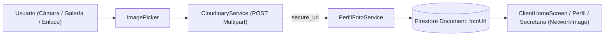

# Integración de la API de Cloudinary para la Gestión Multimedia en Vendix

**Autora:** Ximena Ayala  
**Rol:** Desarrolladora / Integración de Servicios Cloud  
**Proyecto:** VENDIX — Aplicación Móvil de Ventas en Vivo (Live Shopping)  
**Fecha:** Noviembre 2026  
**Tecnologías:** Flutter, Dart, Cloudinary REST API, Firebase Firestore, Firebase Authentication  

---

## 1. Justificación y Planteamiento del Problema

En las primeras etapas de la arquitectura de VENDIX, el almacenamiento de las fotos de perfil dependía de dos posibles vías:
1. Subida directa a Firebase Storage sin compresión previa, lo cual arriesgaba el consumo acelerado de la cuota gratuita (5 GB y límites estrictos de descarga y peticiones diarias).
2. O bien el guardado de imágenes codificadas en texto Base64 dentro de los propios documentos de Firebase Firestore, lo que saturaba la base de datos con cadenas kilométricas, ralentizaba la lectura de listas de usuarios/clientes y consumía ancho de banda innecesariamente.

### La Solución Implementada: Cloudinary
Para erradicar estos riesgos se integró **Cloudinary**, una plataforma en la nube especializada en la gestión, almacenamiento y optimización de recursos multimedia.

* **Almacenamiento Dedicado:** Cloudinary actúa como el servidor externo y especializado donde la aplicación sube las fotos de perfil de los usuarios mediante su API REST.
* **Persistencia Limpia en Firebase:** En Firestore ya no se guardan archivos pesados ni cadenas Base64; únicamente se almacena una URL de texto limpia y ligera (`fotoUrl`), la cual apunta directamente a la red de distribución de contenidos (CDN) de Cloudinary.
* **Capacidad y Escalabilidad:** Cloudinary ofrece hasta 25 GB de almacenamiento y ancho de banda gratuito con transformaciones automáticas de formato y calidad, lo cual permite manejar miles de fotos de perfil manteniendo un rendimiento óptimo en dispositivos móviles.

---

## 2. Configuración en la Plataforma Cloudinary

1. **Creación de la cuenta de trabajo:** Registro y autenticación oficial en el portal de Cloudinary, vinculando el entorno de trabajo para desarrollo con Flutter.
2. **Generación de credenciales:**
   * **Cloud Name:** `kjpffs0b` (Identificador único de la nube del proyecto Vendix).
   * **Directorio de destino:** `vendix/perfiles` para mantener clasificada y organizada la multimedia del proyecto.
3. **Upload Preset (Modo Unsigned / Sin firmar):**
   * **Preset Name:** `vendix_mobile`
   * **Propósito:** Al estar configurado en modo *Unsigned*, la app móvil puede subir las imágenes capturadas directamente desde el dispositivo cliente hacia Cloudinary sin necesidad de exponer llaves secretas o contraseñas API privadas en el código fuente de Flutter, preservando la seguridad del proyecto.

---

## 3. Arquitectura y Cambios en el Proyecto Flutter



### A. Dependencias en `pubspec.yaml`
Se incluyeron las librerías necesarias para el flujo multimedia:
* `http: ^1.2.2`: Cliente HTTP para el envío de peticiones asíncronas tipo `MultipartRequest` hacia los endpoints de Cloudinary.
* `image_picker: ^1.2.4`: Selector nativo de imágenes para captura con cámara o selección desde la galería.

### B. Servicio de Carga (`lib/services/cloudinary_service.dart`)
Se creó un servicio modular dedicado exclusivamente a la comunicación con la API de Cloudinary:
* **Endpoint:** `https://api.cloudinary.com/v1_1/kjpffs0b/image/upload` (API v1.1 estándar y estable).
* **Método de envío:** Construcción de un `MultipartRequest` (POST) que envía el preset `vendix_mobile`, asigna el folder `vendix/perfiles` y adjunta los bytes de la imagen con compresión controlada.
* **Respuesta procesada:** Al recibir un código HTTP 200/exitoso, parsea el JSON retornado y extrae la propiedad `secure_url` (HTTPS), retornándola a la capa de negocio.

```dart
class CloudinaryService {
  static const String cloudName = 'kjpffs0b';
  static const String uploadPreset = 'vendix_mobile';

  static Future<String> subirImagen(
    Uint8List bytes, {
    required String archivoNombre,
  }) async {
    final uri = Uri.parse(
      'https://api.cloudinary.com/v1_1/$cloudName/image/upload',
    );

    final request = http.MultipartRequest('POST', uri)
      ..fields['upload_preset'] = uploadPreset
      ..fields['folder'] = 'vendix/perfiles'
      ..files.add(
        http.MultipartFile.fromBytes('file', bytes, filename: archivoNombre),
      );

    final response = await request.send();
    final body = await response.stream.bytesToString();

    if (response.statusCode >= 200 && response.statusCode < 300) {
      final json = jsonDecode(body);
      final url = json['secure_url'] as String?;
      if (url == null || url.isEmpty) {
        throw Exception('Cloudinary no devolvió una URL válida.');
      }
      return url;
    }

    throw Exception('Error al subir a Cloudinary: ${response.statusCode} - $body');
  }
}
```

### C. Lógica de Negocio y Sincronización (`lib/services/perfil_foto_service.dart`)
1. **Flujo de selección y guardado:**
   * Al seleccionar la imagen mediante `ImagePicker`, se invocan sus bytes y se delega la subida a `CloudinaryService.subirImagen()`.
   * Una vez obtenida la `secure_url`, se invoca `guardarFoto(usuarioId: usuarioId, fotoUrl: url, rol: rol)`.
2. **Sincronización multi-colección en Firestore:**
   * Registra el campo `fotoUrl` en la colección dedicada `fotos_perfil`.
   * Sincroniza en la colección `usuarios` y en la colección específica del rol (`clientes`, `secretarios` o `Administradores`) mediante operaciones en lote (`WriteBatch`).
3. **Compatibilidad hacia atrás (Fallback):**
   * El stream `fotoStream` lee preferentemente `fotoUrl`. Si no existe, lee `fotoBase64` como respaldo para perfiles previos a la migración.
4. **Renderizado Inteligente (`avatarConInsignia`):**
   * Detecta si el identificador comienza con `http://` o `https://` para instanciar un `NetworkImage` (Cloudinary CDN), o decodifica memoria con `MemoryImage` en caso de Base64 histórico.

### D. Interfaz de Usuario (`lib/screens/client/client_home_screen.dart`)
* Se integró un `StreamBuilder` conectado a `PerfilFotoService.fotoStream` en el encabezado de bienvenida del cliente.
* Muestra dinámicamente la foto de perfil alojada en Cloudinary en tiempo real con radio optimizado e iniciales de respaldo si aún no tiene avatar configurado.

---

## 4. Estructura de Datos en Firestore Post-Migración

| Colección | Campo Almacenado | Tipo | Ejemplo de Valor |
| :--- | :--- | :--- | :--- |
| `fotos_perfil` | `fotoUrl` | String | `https://res.cloudinary.com/kjpffs0b/image/upload/v1/vendix/perfiles/...jpg` |
| `usuarios` | `fotoUrl` | String | `https://res.cloudinary.com/kjpffs0b/image/upload/v1/vendix/perfiles/...jpg` |
| `clientes` | `fotoUrl` | String | `https://res.cloudinary.com/kjpffs0b/image/upload/v1/vendix/perfiles/...jpg` |
| `secretarios` | `fotoUrl` | String | `https://res.cloudinary.com/kjpffs0b/image/upload/v1/vendix/perfiles/...jpg` |
| `Administradores`| `fotoUrl` | String | `https://res.cloudinary.com/kjpffs0b/image/upload/v1/vendix/perfiles/...jpg` |

---

## 5. Pruebas de Funcionamiento y Verificación

1. **Biblioteca Multimedia Cloudinary:**
   * En la ruta de Cloudinary `Media Library > Folders > vendix > perfiles`, las imágenes subidas desde la aplicación móvil se catalogan y almacenan con nombres únicos temporales (`perfil_<id>_<timestamp>.jpg`).
2. **Consultas en Firebase Firestore:**
   * En la consola de Firestore, los documentos ya no exceden los límites de tamaño, almacenando cadenas cortas con el hipervínculo seguro HTTPS.
3. **Experiencia Móvil y Web:**
   * Reducción drástica en el tiempo de renderizado de la imagen.
   * La caché nativa del navegador y del sistema Android descarga la imagen desde el CDN sin penalizar el rendimiento del dispositivo.

---

## 6. Conclusión de la Autora

Integrar la API de Cloudinary en lugar de depender únicamente del almacenamiento tradicional de Firebase no fue un proceso del todo directo ni libre de complicaciones. Al principio representó un reto técnico ajustar la arquitectura de Vendix, ya que tuve que reestructurar el flujo de datos para separar la persistencia de información en Firestore y delegar la gestión multimedia de forma externa. Sin embargo, tras superar la configuración de las credenciales, los presets de carga y la comunicación asíncrona, la migración es una decisión acertada y estratégica para la escalabilidad, ahorro de costos y rendimiento a largo plazo de la plataforma VENDIX.
