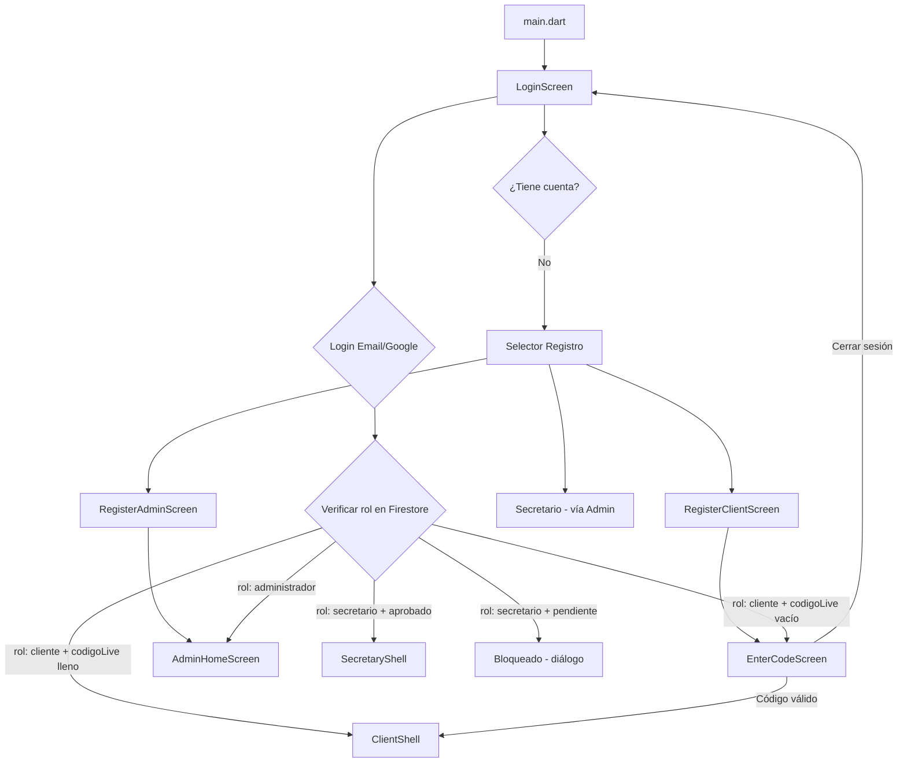
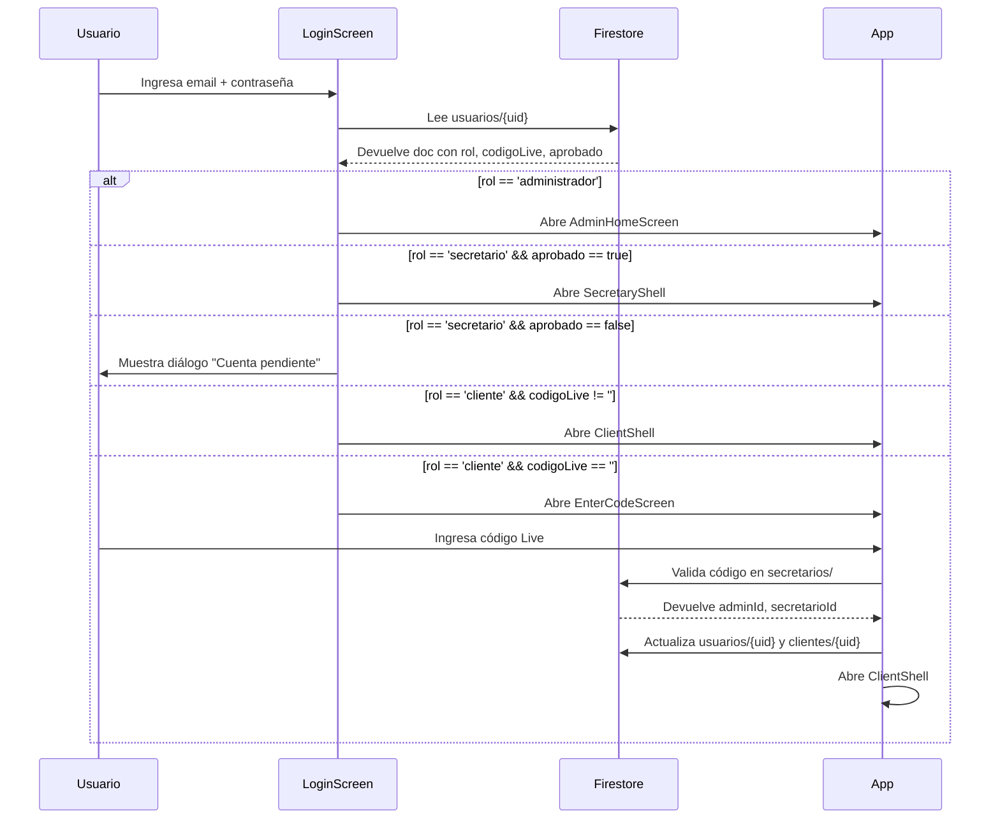

# 🏗️ Estructura y Funcionamiento de VENDIX

> [!NOTE]
> VENDIX es una app Flutter para ventas en vivo (live-stream selling). Los emprendedores crean sesiones en vivo, los secretarios gestionan ventas y clientes, y los clientes compran prendas durante el live.

---

## 📂 Árbol de archivos — `lib/`

```
lib/
├── main.dart                          ← Punto de entrada, inicializa Firebase
├── theme/
│   └── app_theme.dart                 ← Colores, estilos globales (violeta, verde, etc.)
├── models/
│   └── admin_model.dart               ← Modelo de datos del Administrador/Emprendedor
├── services/
│   ├── google_auth_service.dart       ← Autenticación con Google para todos los roles
│   ├── perfil_foto_service.dart       ← Subir/mostrar foto de perfil (Cloudinary + Firestore)
│   ├── cloudinary_service.dart        ← Upload de imágenes a Cloudinary
│   └── client_service.dart            ← Cache de datos de clientes
├── screens/
│   ├── auth/
│   │   ├── login_screen.dart          ← Pantalla de inicio de sesión (todos los roles)
│   │   ├── register_client_screen.dart ← Registro de Cliente (sin código)
│   │   ├── register_admin_screen.dart  ← Registro de Emprendedor ← NUEVO
│   │   └── register_entrepreneur_screen.dart ← (alternativo/legacy)
│   ├── admin/
│   │   ├── admin_home_screen.dart     ← Shell principal del Emprendedor (4 pestañas)
│   │   ├── admin_more_screen.dart     ← Gestión de secretarios y prendas
│   │   ├── admin_profile_screen.dart  ← Perfil editable del Emprendedor ← NUEVO
│   │   └── quick_sales_screen.dart    ← Ventas rápidas desde vista admin
│   ├── secretary/
│   │   ├── secretary_shell.dart       ← Shell principal del Secretario (4 pestañas)
│   │   ├── more_screen.dart           ← "Más opciones" del secretario + código Live
│   │   ├── quick_sales_screen.dart    ← Registro de ventas durante live
│   │   ├── payments_screen.dart       ← Registro de abonos/pagos
│   │   ├── statistics_screen.dart     ← Estadísticas de ventas y cobros
│   │   ├── jornadas_screen.dart       ← Gestión de sesiones Live (abrir/cerrar)
│   │   └── clothing_prices_screen.dart ← Catálogo de prendas con precios
│   └── client/
│       ├── client_shell.dart          ← Shell principal del Cliente
│       └── enter_code_screen.dart     ← Ingreso de código Live (obligatorio) ← NUEVO
```

---

## 🔄 Flujo de Navegación por Rol



---

## 🗄️ Colecciones de Firestore

### `usuarios/{uid}`
Documento principal de todos los usuarios.
| Campo | Tipo | Descripción |
|-------|------|-------------|
| `nombre` | String | Nombre del usuario |
| `apellido` | String | Apellido |
| `correo` | String | Email |
| `telefono` | String | Teléfono |
| `rol` | String | `'administrador'` / `'secretario'` / `'cliente'` |
| `adminId` | String | UID del emprendedor al que pertenece |
| `secretarioId` | String | UID del secretario que les dio acceso |
| `codigoLive` | String | Código del live (vacío si cliente sin conectar) |
| `estado` | bool | true = activo |
| `aprobado` | bool | true = aprobado por el admin |
| `creadoEn` | Timestamp | Fecha de creación |

### `Administradores/{uid}`
Perfil extendido del Emprendedor.
| Campo | Tipo | Descripción |
|-------|------|-------------|
| `nombre` | String | Nombre |
| `apellido` | String | Apellido |
| `correo` | String | Email |
| `telefono` | String | Teléfono |
| `fotoUrl` | String | URL de foto de perfil |
| `estado` | bool | true = activo |

### `secretarios/{uid}`
Perfil del Secretario + código Live.
| Campo | Tipo | Descripción |
|-------|------|-------------|
| `nombre` | String | Nombre completo |
| `correo` | String | Email |
| `codigoLive` | String | Código único (ej: `ABC-234`) |
| `adminId` | String | UID del emprendedor que lo aprobó |
| `estado` | bool | true = aprobado |
| `aprobado` | bool | true = puede ingresar |
| `codigoActualizadoEn` | Timestamp | Última vez que se regeneró el código |

### `clientes/{uid}`
Perfil del Cliente.
| Campo | Tipo | Descripción |
|-------|------|-------------|
| `nombre` | String | Nombre |
| `adminId` | String | Emprendedor al que pertenece |
| `secretarioId` | String | Secretario que les dio acceso |
| `codigoLive` | String | Código del live |
| `creadoEn` | Timestamp | Fecha de registro |

### `fotos_perfil/{uid}`
Fotos de perfil de cualquier usuario.
| Campo | Tipo | Descripción |
|-------|------|-------------|
| `fotoUrl` | String | URL de Cloudinary (si se subió imagen) |
| `fotoBase64` | String | Foto en base64 (alternativa) |
| `actualizadoEn` | Timestamp | Última actualización |

### `compras/{id}`
Registro de ventas durante lives.
| Campo | Tipo | Descripción |
|-------|------|-------------|
| `clienteId` | String | UID del cliente |
| `clienteNombre` | String | Nombre del cliente |
| `prenda` | String | Nombre de la prenda |
| `precio` | double | Precio |
| `cantidad` | int | Unidades |
| `jornadaId` | String | ID del live |
| `secretarioId` | String | Quien registró la venta |
| `fecha` | Timestamp | Fecha/hora |

### `pagos/{id}`
Abonos y pagos de clientes.
| Campo | Tipo | Descripción |
|-------|------|-------------|
| `clienteId` | String | UID del cliente |
| `monto` | double | Monto abonado |
| `secretarioId` | String | Quien registró |
| `fecha` | Timestamp | Fecha |

### `jornadas/{id}`
Sesiones de Live.
| Campo | Tipo | Descripción |
|-------|------|-------------|
| `secretarioId` | String | Quien abrió el live |
| `adminId` | String | Emprendedor |
| `inicio` | Timestamp | Hora de inicio |
| `fin` | Timestamp | Hora de cierre (null si activo) |
| `activa` | bool | true si el live está en curso |

### `prendas/{id}`
Catálogo de prendas con precios.
| Campo | Tipo | Descripción |
|-------|------|-------------|
| `nombre` | String | Nombre de la prenda |
| `precio` | double | Precio sugerido |
| `adminId` | String | Emprendedor al que pertenece |

---

## 🛠️ Servicios

### `google_auth_service.dart`
Maneja el login/registro con Google para **todos los roles**:
- Detecta si el usuario ya existe en Firestore.
- Si es nuevo → muestra diálogo de selección de rol → guarda en las colecciones correctas.
- Soporta roles: `cliente`, `secretario`, `administrador`.

### `perfil_foto_service.dart`
Gestiona fotos de perfil de cualquier usuario:
- `fotoStream(uid)` → `Stream<String?>` que emite la URL/base64 de la foto en tiempo real.
- `mostrarOpcionesFotoWhatsApp(...)` → bottom sheet estilo WhatsApp para tomar foto, subir de galería o eliminar.
- `avatarConInsignia(...)` → widget de avatar circular con foto o iniciales.
- Sube imágenes a Cloudinary y guarda URL en `fotos_perfil/{uid}`.

### `cloudinary_service.dart`
Upload de imágenes a Cloudinary:
- Convierte imagen a base64 o multipart.
- Retorna URL pública de la imagen subida.

### `client_service.dart`
Cache en memoria de listas de clientes:
- Evita múltiples lecturas a Firestore cuando se necesita la lista de clientes.
- Tiene método `limpiarCache()` llamado al cerrar sesión.

---

## 📱 Pantallas por Rol

### 🏪 Emprendedor (Admin)
| Pestaña | Pantalla | Función |
|---------|----------|---------|
| 0 — Inicio | `admin_home_screen.dart` | Dashboard con estadísticas y accesos rápidos |
| 1 — Ventas Live | `quick_sales_screen.dart` | Registro de ventas durante el live |
| 2 — Secretarios | `admin_more_screen.dart` | Aprobar/rechazar/crear secretarios, gestionar prendas |
| 3 — Perfil | `admin_profile_screen.dart` | Foto, nombre, editar datos, cambiar contraseña |

### 👩‍💼 Secretario
| Pestaña | Pantalla | Función |
|---------|----------|---------|
| 0 — Inicio | inicio del shell | Resumen rápido |
| 1 — Ventas | `quick_sales_screen.dart` | Registrar ventas de prendas durante live |
| 2 — Pagos | `payments_screen.dart` | Registrar abonos de clientes |
| 3 — Más | `more_screen.dart` | Código Live, ver estadísticas, jornadas, cerrar sesión |

Opciones dentro de "Más":
- Generar/ver código Live
- `jornadas_screen.dart` → Abrir y cerrar sesiones Live
- `statistics_screen.dart` → Estadísticas de ventas
- `clothing_prices_screen.dart` → Catálogo de prendas

### 👤 Cliente
| Pantalla | Función |
|----------|---------|
| `enter_code_screen.dart` | Ingresar código Live (obligatorio si no tiene uno) |
| `client_shell.dart` | Interfaz del cliente (ver compras, saldo, etc.) |

---

## 🔐 Lógica de Autenticación



---

## ⚙️ `main.dart`

```dart
void main() async {
  WidgetsFlutterBinding.ensureInitialized();
  await Firebase.initializeApp(options: DefaultFirebaseOptions.currentPlatform);
  runApp(const VendixApp());
}
```

- `MaterialApp` con `home: const LoginScreen()`.
- **No usa rutas nombradas** (sin `routes: {}`).
- Toda la navegación es por `Navigator.push` / `Navigator.pushAndRemoveUntil`.
- Tema: colores del `AppTheme` (violeta `#6C4AB6`, fondo blanco/gris claro).

---

## 🎨 `app_theme.dart`

Constantes de color usadas en toda la app:
| Nombre | Color |
|--------|-------|
| `AppTheme.violet` | `#6C4AB6` — Color principal |
| `AppTheme.green` | Verde — pagos/cobros |
| `AppTheme.orange` | Naranja — pendientes |
| `AppTheme.border` | Gris claro — bordes de tarjetas |

---

## 🗺️ Modelo `admin_model.dart`

```dart
class AdminModel {
  final String uid;
  final String nombre;
  final String apellido;
  final String correo;
  final String telefono;
  // fromMap() / toMap() helpers
}
```

Usado para pasar datos del emprendedor entre pantallas sin re-leer Firestore.

---

## ⚠️ Bugs Conocidos y Soluciones

| Bug | Pantalla afectada | Solución aplicada |
|-----|-------------------|-------------------|
| Nombre "Daniela León" hardcodeado | `more_screen.dart` (Secretario) | Lee nombre de Firestore via `StreamBuilder` |
| Import `client_shell.dart` sin usar | `register_client_screen.dart` | Eliminado el import |
| Import `app_theme.dart` sin usar | `admin_profile_screen.dart` | Eliminado el import |
| Campo `rosa` sin usar | `admin_profile_screen.dart` | Eliminado el campo |
| `Navigator.pushNamedAndRemoveUntil('/')` sin rutas definidas | `enter_code_screen.dart` | Reemplazado con `pushAndRemoveUntil + MaterialPageRoute` |
| `_generarOGuardarCodigo` inaccesible desde State | `more_screen.dart` | Movido a `_MoreScreenState` |
