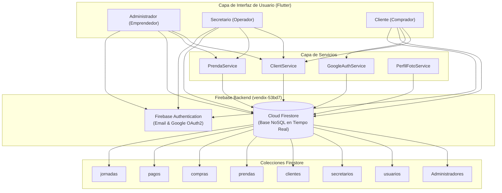

# Arquitectura e Integración de la Base de Datos Firebase Firestore - VENDIX

**Fecha de emisión:** 5 de noviembre de 2026  
**Proyecto:** VENDIX Mobile Application  
**Autor:** Antigravity AI (Pair Programming)  
**ID del Proyecto en la Nube:** `vendix-53bd7`  
**Estado:** 100% Funcional y en Producción Local / Sincronizado en GitHub  

---

## 1. Resumen Ejecutivo de la Integración

La aplicación **VENDIX** opera íntegramente sobre una arquitectura en la nube en tiempo real (*Cloud-Native Serverless*) provista por **Google Firebase**. 

* **Motor de Base de Datos:** **Cloud Firestore** (Base de datos documental NoSQL con sincronización bidireccional reactiva mediante Streams y WebSockets).
* **Gestor de Identidad:** **Firebase Authentication** (Soporte híbrido de credenciales Email/Contraseña y tokens OAuth2 con Google Sign-In).
* **Almacenamiento de Archivos Multimedia:** **Cloudinary REST API** (Para fotos de perfil de alta velocidad y compresión automática).

Todos los datos de prueba (`datos_prueba.dart`) fueron completamente erradicados. No existen datos simulados en memoria: cada pantalla de la aplicación lee y escribe directamente en Firestore.

---

## 2. ¿Se instalaron o no dependencias?

### ✅ RESPUESTA: SÍ, se instalaron dependencias oficiales.

Para conectar Flutter con la base de datos de Firebase no se inventó código desde cero; se instalaron los paquetes oficiales de **Firebase para Flutter (FlutterFire)**, auditados y mantenidos por Google.

Todas las dependencias están formalmente declaradas en el archivo raíz [pubspec.yaml](file:///c:/Users/crist/Desktop/VENDIX/flutter_application_1/pubspec.yaml):

```yaml
dependencies:
  flutter:
    sdk: flutter

  # 1. Núcleo obligatorio de Firebase
  firebase_core: ^5.0.0
  
  # 2. Motor de Base de Datos Firestore (NoSQL en Tiempo Real)
  cloud_firestore: ^7.0.0
  
  # 3. Autenticación y Gestión de Usuarios
  firebase_auth: ^7.0.0
  
  # 4. Acceso con Cuenta de Google (Google Sign-In)
  google_sign_in: ^7.2.0
  
  # 5. Peticiones HTTP para subir fotos a Cloudinary
  http: ^1.2.2
  
  # 6. Selector de Fotos (Cámara / Galería)
  image_picker: ^1.2.4
```

### ¿Cómo se instalan estas dependencias en cualquier computadora?
Nadie en el equipo necesita descargar archivos raros ni instalar paquetes uno por uno. Basta con abrir una terminal en la carpeta del proyecto y ejecutar:
```bash
flutter pub get
```
Flutter lee el `pubspec.yaml` y descarga e instala automáticamente todas las librerías en cuestión de segundos.

---

## 3. Archivos de Configuración e Inicialización de la Base de Datos

Para que la aplicación sepa a qué base de datos conectarse y con qué credenciales, intervienen los siguientes archivos clave:

| Archivo | Ubicación | Propósito Técnico |
|---|---|---|
| **`google-services.json`** | `android/app/google-services.json` | Contiene las credenciales del proyecto `vendix-53bd7`: Project ID, Client ID, API Key y configuración del OAuth2 de Google. *(Ya está versionado en Git para que todo el equipo lo tenga listo).* |
| **`build.gradle` (Raíz y App)** | `android/build.gradle` y `android/app/build.gradle` | Aplica el plugin oficial `com.google.gms.google-services` para que el compilador de Android enlace Firebase de forma nativa. |
| **`firebase_options.dart`** | `lib/firebase_options.dart` | Código generado por el CLI de FlutterFire que contiene las credenciales multiplataforma (Android, iOS y Web) en variables `const`. |
| **`main.dart`** | `lib/main.dart` | Punto de entrada donde se ejecuta `WidgetsFlutterBinding.ensureInitialized()` y se despierta la conexión con `await Firebase.initializeApp(...)`. |

---

## 4. Archivos de Servicios (Capa de Lógica y Datos)

Estos archivos concentran la lógica de comunicación con Firestore para no duplicar código en las pantallas:

### 1. `lib/services/client_service.dart`
* **Misión:** Maneja la lectura centralizada de clientes, compras y pagos.
* **Optimización de Memoria:** Implementa un sistema de caché de Streams (`_clienteActualStream`, `_comprasStreamCache`, `_pagosStreamCache`) que evita abrir conexiones repetidas a la base de datos, ahorrando batería y consumo de datos.

### 2. `lib/services/google_auth_service.dart`
* **Misión:** Controla el inicio de sesión con Google.
* **Transacciones por Lote (`WriteBatch`):** Cuando un usuario entra con Google por primera vez, este servicio guarda de forma atómica en las colecciones `usuarios` y `clientes` (o `secretarios`), vinculando de inmediato el `adminId`, `secretarioId` y `codigoLive`.

### 3. `lib/data/prenda_service.dart`
* **Misión:** Administra el catálogo de ropa en la colección `prendas`.
* **Funciones:** Stream reactivo de prendas activas (`getPrendasStream()`), agregar prenda, actualizar precio, stock y activar/desactivar artículos.

### 4. `lib/services/perfil_foto_service.dart`
* **Misión:** Conecta con Cloudinary para subir avatares y guarda la URL segura en la colección `fotos_perfil` de Firestore.

---

## 5. Mapa Completo de Archivos por Pantalla que usan Firestore

Todas las pantallas que leen o escriben en la base de datos están organizadas por rol:

```
lib/
├── screens/
│   ├── auth/                      # 🔐 AUTENTICACIÓN
│   │   ├── login_screen.dart
│   │   ├── register_client_screen.dart
│   │   └── register_entrepreneur_screen.dart
│   │
│   ├── admin/                     # 👑 EMPRENDEDOR / ADMINISTRADOR
│   │   ├── admin_home_screen.dart
│   │   └── admin_more_screen.dart
│   │
│   ├── secretary/                 # 💼 SECRETARIO / OPERADOR DE LIVE
│   │   ├── home_screen.dart
│   │   ├── clients_screen.dart
│   │   ├── quick_sales_screen.dart
│   │   ├── payments_screen.dart
│   │   ├── jornadas_screen.dart
│   │   ├── statistics_screen.dart
│   │   ├── clothing_prices_screen.dart
│   │   └── more_screen.dart
│   │
│   └── client/                    # 🛍️ CLIENTE
│       ├── client_home_screen.dart
│       ├── client_purchases_screen.dart
│       ├── client_balance_screen.dart
│       └── client_profile_screen.dart
```

### Detalle de qué hace cada archivo en Firestore:

#### 🔐 Módulo de Autenticación
1. **[login_screen.dart](file:///c:/Users/crist/Desktop/VENDIX/flutter_application_1/lib/screens/auth/login_screen.dart):**
   * Consulta las colecciones `Administradores`, `usuarios`, `secretarios` y `clientes`.
   * Determina el rol exacto (`cliente`, `secretario`, `admin`) y verifica si el secretario está aprobado antes de darle acceso.
2. **[register_client_screen.dart](file:///c:/Users/crist/Desktop/VENDIX/flutter_application_1/lib/screens/auth/register_client_screen.dart):**
   * Valida obligatoriamente el `codigoLive` en la colección `secretarios`.
   * Extrae el `adminId` del emprendedor.
   * Crea el registro sincronizado en las colecciones `usuarios` y `clientes`.
3. **[register_entrepreneur_screen.dart](file:///c:/Users/crist/Desktop/VENDIX/flutter_application_1/lib/screens/auth/register_entrepreneur_screen.dart):**
   * Registra nuevos emprendedores guardando su ficha en `Administradores` y `usuarios`.

#### 👑 Módulo Administrador (Emprendedor)
1. **[admin_home_screen.dart](file:///c:/Users/crist/Desktop/VENDIX/flutter_application_1/lib/screens/admin/admin_home_screen.dart):**
   * Escucha en vivo las colecciones `jornadas`, `clientes`, `compras` y `pagos`.
   * Calcula dinámicamente: Total Vendido Hoy, Prendas Vendidas, Cobrado y Por Cobrar.
   * Muestra el estado real del Live (sin números falsos quemados).
2. **[admin_more_screen.dart](file:///c:/Users/crist/Desktop/VENDIX/flutter_application_1/lib/screens/admin/admin_more_screen.dart):**
   * Lee la colección `secretarios`.
   * Filtra las solicitudes activas por `adminId` (cada admin solo ve a sus propios secretarios).
   * Al aprobar a un secretario, guarda `adminId: widget.admin.id` en Firestore.

#### 💼 Módulo Secretario (Operador de Live)
1. **[home_screen.dart](file:///c:/Users/crist/Desktop/VENDIX/flutter_application_1/lib/screens/secretary/home_screen.dart):**
   * Resumen en vivo de ingresos, ventas y clientas activas del día mediante `StreamBuilder`.
2. **[clients_screen.dart](file:///c:/Users/crist/Desktop/VENDIX/flutter_application_1/lib/screens/secretary/clients_screen.dart):**
   * Lee en tiempo real `clientes`, `compras` y `pagos`.
   * Calcula automáticamente la deuda (`Total Comprado - Total Pagado`).
   * Permite crear nuevas clientas directas (`clientes.add(...)`), registrar prendas compradas (`compras.add(...)`) y registrar pagos (`pagos.add(...)`).
3. **[quick_sales_screen.dart](file:///c:/Users/crist/Desktop/VENDIX/flutter_application_1/lib/screens/secretary/quick_sales_screen.dart):**
   * Lee prendas activas desde `prendas` y clientas desde `clientes`.
   * Al confirmar la venta del Live, realiza un **`WriteBatch`** que guarda múltiples artículos simultáneamente en la colección `compras`.
4. **[payments_screen.dart](file:///c:/Users/crist/Desktop/VENDIX/flutter_application_1/lib/screens/secretary/payments_screen.dart):**
   * Registra abonos oficiales en la colección `pagos` con fecha y observaciones.
5. **[jornadas_screen.dart](file:///c:/Users/crist/Desktop/VENDIX/flutter_application_1/lib/screens/secretary/jornadas_screen.dart):**
   * Guarda aperturas, tiempos de transmisión y cierres en la colección `jornadas`.
6. **[statistics_screen.dart](file:///c:/Users/crist/Desktop/VENDIX/flutter_application_1/lib/screens/secretary/statistics_screen.dart):**
   * Consolida métricas y gráficos en vivo consultando `compras`, `pagos` y `clientes`.
7. **[more_screen.dart](file:///c:/Users/crist/Desktop/VENDIX/flutter_application_1/lib/screens/secretary/more_screen.dart):**
   * Genera y actualiza el campo `codigoLive` en el documento del secretario en `secretarios/{uid}`.
8. **[clothing_prices_screen.dart](file:///c:/Users/crist/Desktop/VENDIX/flutter_application_1/lib/screens/secretary/clothing_prices_screen.dart):**
   * Control de precios e inventario directo en la colección `prendas`.

#### 🛍️ Módulo Cliente
1. **[client_home_screen.dart](file:///c:/Users/crist/Desktop/VENDIX/flutter_application_1/lib/screens/client/client_home_screen.dart):**
   * Muestra el saldo pendiente real, prendas apartadas y la tarjeta informativa del **Emprendedor** vinculado (consultando `Administradores/{adminId}`).
2. **[client_purchases_screen.dart](file:///c:/Users/crist/Desktop/VENDIX/flutter_application_1/lib/screens/client/client_purchases_screen.dart):**
   * Lista en tiempo real las compras de la clienta filtrando `compras` por su `clienteId`.
3. **[client_balance_screen.dart](file:///c:/Users/crist/Desktop/VENDIX/flutter_application_1/lib/screens/client/client_balance_screen.dart):**
   * Historial de pagos y abonos realizados por la clienta filtrando `pagos` por `clienteId`.
4. **[client_profile_screen.dart](file:///c:/Users/crist/Desktop/VENDIX/flutter_application_1/lib/screens/client/client_profile_screen.dart):**
   * Edición de nombre, teléfono y dirección actualizando el documento en `clientes/{uid}` y `usuarios/{uid}`.

---

## 6. Esquema de Colecciones en Firestore

| Colección | Propósito | Campos Clave y Tipos |
|---|---|---|
| **`Administradores`** | Cuentas de dueños de tienda | `id` (String), `nombre` (String), `correo` (String), `telefono` (String), `rol` (String) |
| **`secretarios`** | Cuentas de operadores de live | `uid` (String), `nombre` (String), `correo` (String), `adminId` (String), `codigoLive` (String), `estado` (String), `aprobado` (bool) |
| **`usuarios`** | Directorio global de accesos | `uid` (String), `correo` (String), `rol` (String), `adminId` (String), `secretarioId` (String), `creadoEn` (Timestamp) |
| **`clientes`** | Perfiles de clientas | `uid` (String), `nombre` (String), `telefono` (String), `direccion` (String), `adminId` (String), `secretarioId` (String), `codigoLive` (String) |
| **`prendas`** | Catálogo de artículos | `nombre` (String), `precio` (num), `activa` (bool), `stock` (int), `fecha_creacion` (Timestamp) |
| **`compras`** | Registro de ventas en vivo | `clienteId` (String), `clienteNombre` (String), `prenda` (String), `precio` (num), `cantidad` (int), `total` (num), `fecha` (Timestamp) |
| **`pagos`** | Abonos y cancelaciones | `clienteId` (String), `clienteNombre` (String), `monto` (num), `observacion` (String), `fecha` (Timestamp) |
| **`jornadas`** | Sesiones de transmisión en vivo | `nombre` (String), `fecha` (Timestamp), `estado` (String: 'activa'/'cerrada'), `horaInicio` (Timestamp), `horaFin` (Timestamp) |
| **`fotos_perfil`** | Fotos en la nube | `usuarioId` (String), `fotoUrl` (String), `rol` (String), `actualizadoEn` (Timestamp) |

---

## 7. Diagrama de Flujo de Datos


