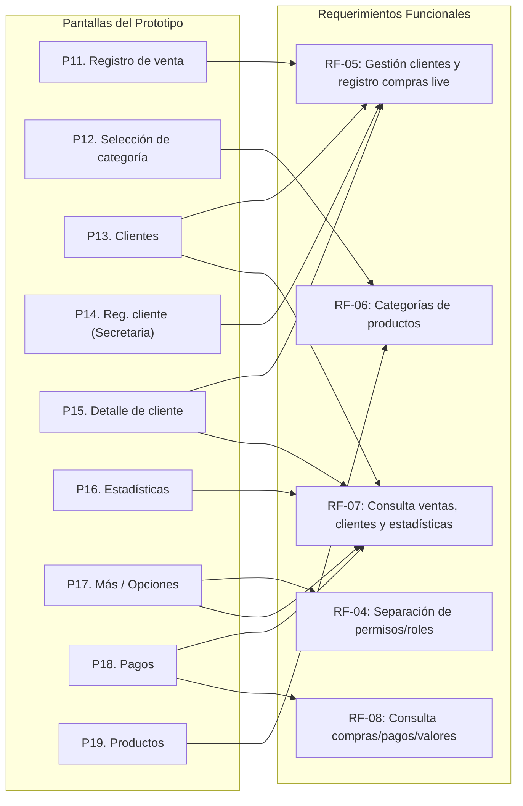

# 📑 Mapeo de Pantallas (11 a 19) vs. Requerimientos Funcionales — VENDIX

Este documento establece la trazabilidad formal entre las interfaces del prototipo (**Pantallas 11 a 19**) y el catálogo oficial de **Requerimientos Funcionales (RF)** del sistema VENDIX.

---

## 🎯 Catálogo Oficial de Requerimientos Funcionales (RF)

| ID | Declaración del Requerimiento Funcional |
| :--- | :--- |
| **RF-01** | Autenticación de usuarios mediante correo y contraseña, además de la opción de autenticación con Google. |
| **RF-02** | Registro de clientes desde la aplicación y asociación posterior con la cuenta de una secretaria mediante un código de vinculación. |
| **RF-03** | Registro de secretaria con estado pendiente de aprobación; el administrador revisa y aprueba su acceso al rol de secretaria. |
| **RF-04** | Separación de funcionalidades y permisos según los perfiles administrador, secretaria y cliente. |
| **RF-05** | Gestión de clientes y registro de las compras realizadas durante las ventas en vivo. |
| **RF-06** | Organización de productos por categorías, incluyendo ejemplos trabajados en la interfaz como camisetas, blusas y pantalones. |
| **RF-07** | Consulta de ventas, información de clientes y estadísticas desde el perfil de secretaria, de acuerdo con las opciones de navegación del prototipo. |
| **RF-08** | Consulta de compras, pagos o valores pendientes por parte del cliente, según las opciones desarrolladas para su perfil. |
| **RF-09** | Administración de usuarios y aprobación de secretarias desde el perfil administrador. |

---

## 📱 Matriz de Trazabilidad: Pantallas vs. Requerimientos

---

## 📋 Detalle Individual por Pantalla

---

### PANTALLA 11. Registro de venta

- **Requerimiento Funcional Asociado:**
  > **RF-05:** *Gestión de clientes y registro de las compras realizadas durante las ventas en vivo.*
- **Objetivo:** Capturar el detalle de una compra de un cliente en tiempo real durante la transmisión en vivo.
- **Elementos de la interfaz:**
  - Selector/Buscador interactivo de cliente (`TextField` de búsqueda por nombre o teléfono).
  - Selector de prendas/artículos disponibles con chips o tarjetas de prendas activas.
  - Controles incrementales de cantidades (`+` y `-`).
  - Resumen del pedido en vivo: detalle de prendas, precios unitarios, subtotal acumulado y total de la venta.
  - Botón de confirmación: `"Registrar venta"`.
- **Funcionamiento en el sistema:**
  La secretaria selecciona la clienta activa en el live, añade las prendas que va solicitando en la transmisión con sus respectivas cantidades, el sistema computa el importe total automáticamente y, al confirmar, ejecuta una transacción batch en la colección `compras` de Firestore vinculada a la jornada en vivo (`jornadaId`).
- **Archivo fuente del proyecto:**
  [`lib/screens/secretary/quick_sales_screen.dart`](file:///c:/Users/crist/Desktop/VENDIX/flutter_application_1/lib/screens/secretary/quick_sales_screen.dart)

---

### PANTALLA 12. Selección de categoría de productos

- **Requerimiento Funcional Asociado:**
  > **RF-06:** *Organización de productos por categorías, incluyendo ejemplos trabajados en la interfaz como camisetas, blusas y pantalones.*
- **Objetivo:** Facilitar la localización rápida de los artículos que se venden filtrando por tipología de prenda.
- **Elementos de la interfaz:**
  - Barra de categorías horizontales o pestañas filtrables (Camisetas, Blusas, Pantalones, Vestidos, etc.).
  - Cuadrícula o lista dinámica de prendas pertenecientes exclusivamente a la categoría seleccionada.
  - Indicador de precio unitario y disponibilidad de cada artículo de la categoría.
- **Funcionamiento en el sistema:**
  Al pulsar sobre el selector de una categoría específica, el estado local (`_categoriaSeleccionada`) filtra la lista maestra de productos provista por Firestore (`prendas`), permitiendo a la secretaria o al usuario ubicar en segundos la prenda requerida para agilizar la toma de pedidos.
- **Archivo fuente del proyecto:**
  [`lib/screens/secretary/clothing_prices_screen.dart`](file:///c:/Users/crist/Desktop/VENDIX/flutter_application_1/lib/screens/secretary/clothing_prices_screen.dart) y catálogo integrado en [`lib/screens/secretary/quick_sales_screen.dart`](file:///c:/Users/crist/Desktop/VENDIX/flutter_application_1/lib/screens/secretary/quick_sales_screen.dart).

---

### PANTALLA 13. Clientes

- **Requerimiento Funcional Asociado:**
  > **RF-05:** *Gestión de clientes y registro de las compras realizadas durante las ventas en vivo.*  
  > *(Concurrente con **RF-07:** Consulta de ventas, información de clientes y estadísticas desde el perfil de secretaria).*
- **Objetivo:** Permitir administrar y consultar los clientes atendidos por la secretaria.
- **Elementos de la interfaz:**
  - Barra de búsqueda predictiva por nombre, apellido, teléfono o dirección.
  - Listado dinámico (`ListView.builder` / `StreamBuilder`) de clientes registrados.
  - Tarjetas de cliente con nombre, iniciales/avatar, teléfono y estado de saldo/compras.
  - Botón flotante o superior para agregar un nuevo cliente.
- **Funcionamiento en el sistema:**
  La secretaria accede a la agenda de clientes vinculados a su cuenta o al administrador común. Permite inspeccionar rápidamente quiénes son las clientas frecuentes, filtrar por término de búsqueda y seleccionar una clienta para registrarle compras o abrir su perfil detallado.
- **Archivo fuente del proyecto:**
  [`lib/screens/secretary/clients_screen.dart`](file:///c:/Users/crist/Desktop/VENDIX/flutter_application_1/lib/screens/secretary/clients_screen.dart)

---

### PANTALLA 14. Registro de cliente desde secretaria

- **Requerimiento Funcional Asociado:**
  > **RF-05:** *Gestión de clientes y registro de las compras realizadas durante las ventas en vivo.*
  *(Nota técnica: Si el cliente se registra por sí mismo sin intervención de la secretaria, aplica **RF-02** mediante código).*
- **Objetivo:** Incorporar de manera directa a un cliente en la base de datos de la secretaria cuando el flujo presencial o manual lo requiera.
- **Elementos de la interfaz:**
  - Formulario modal o pantalla de entrada con campos:
    - Nombre completo.
    - Teléfono / Celular.
    - Dirección domiciliaria (opcional).
  - Botones de acción: `"Guardar clienta"` y `"Cancelar"`.
- **Funcionamiento en el sistema:**
  Cuando una clienta nueva compra en el live por primera vez sin tener la aplicación instalada, la secretaria ingresa sus datos básicos desde este formulario. El sistema crea el documento en `clientes/{id}` vinculándolo inmediatamente al `adminId` y `secretarioId` en sesión, dejándola disponible para asignarle ventas al instante.
- **Archivo fuente del proyecto:**
  Modal de nuevo cliente en [`lib/screens/secretary/clients_screen.dart`](file:///c:/Users/crist/Desktop/VENDIX/flutter_application_1/lib/screens/secretary/clients_screen.dart) y servicio [`lib/services/client_service.dart`](file:///c:/Users/crist/Desktop/VENDIX/flutter_application_1/lib/services/client_service.dart).

---

### PANTALLA 15. Detalle de cliente

- **Requerimiento Funcional Asociado:**
  > **RF-05:** *Gestión de clientes y registro de las compras realizadas durante las ventas en vivo.*  
  > *(Concurrente con **RF-07:** Consulta de ventas e información de clientes).*
- **Objetivo:** Consultar la información integral de un cliente específico y su histórico de compras y pagos.
- **Elementos de la interfaz:**
  - Ficha de perfil: Nombre, teléfono, dirección y fecha de ingreso.
  - Indicadores clave: Total acumulado comprado, total abonado y saldo pendiente de cobro.
  - Pestañas/Sección de histórico: Listado de prendas adquiridas con fecha, precio y jornada.
- **Funcionamiento en el sistema:**
  La secretaria revisa el historial consolidado de la clienta. El sistema realiza consultas cruzadas en Firestore hacia las colecciones `compras` y `pagos` filtrando por el `clienteId`, calculando el balance financiero en tiempo real.
- **Archivo fuente del proyecto:**
  Modal/Hoja de detalle en [`lib/screens/secretary/clients_screen.dart`](file:///c:/Users/crist/Desktop/VENDIX/flutter_application_1/lib/screens/secretary/clients_screen.dart).

---

### PANTALLA 16. Estadísticas

- **Requerimiento Funcional Asociado:**
  > **RF-07:** *Consulta de ventas, información de clientes y estadísticas desde el perfil de secretaria, de acuerdo con las opciones de navegación del prototipo.*
- **Objetivo:** Mostrar información ejecutiva y resumida del desempeño comercial de las ventas.
- **Elementos de la interfaz:**
  - Tarjetas métricas (KPIs):
    - *Total vendido* (monto monetario acumulado).
    - *Total abonado / Dinero cobrado*.
    - *Por cobrar / Saldo pendiente*.
    - *Prendas vendidas* (cantidad física total).
  - Ranking o desglose de prendas más vendidas y top clientas compradoras.
- **Funcionamiento en el sistema:**
  La interfaz escucha los streams de `compras` y `pagos`, agrega las cifras matemáticas en memoria sin alterar la base de datos y presenta los totales calculados en tarjetas de alto contraste visual para la secretaria.
- **Archivo fuente del proyecto:**
  [`lib/screens/secretary/statistics_screen.dart`](file:///c:/Users/crist/Desktop/VENDIX/flutter_application_1/lib/screens/secretary/statistics_screen.dart)

---

### PANTALLA 17. Más / Opciones adicionales

- **Requerimiento Funcional Asociado:**
  > **RF-04:** *Separación de funcionalidades y permisos según los perfiles administrador, secretaria y cliente.*  
  > *(Concurrente con **RF-07:** Opciones de navegación del prototipo).*
- **Objetivo:** Agrupar las funciones complementarias, de gestión de sesión y accesos operativos de la secretaria.
- **Elementos de la interfaz:**
  - Tarjeta de perfil de la secretaria activa con avatar interactivo (foto en tiempo real y nombre).
  - Tarjeta con el **Código de Live actual** y botón de *"Copiar código"* / *"Generar nuevo código"*.
  - Menú de opciones de navegación:
    - *Jornadas en vivo* (abrir/cerrar live).
    - *Catálogo y precios de prendas*.
    - *Registro de pagos / abonos*.
    - *Ver experiencia de cliente* (modo vista previa).
  - Botón destacado: `"Cerrar sesión"`.
- **Funcionamiento en el sistema:**
  Sirve como centro de control secundario para la secretaria. Desde aquí gestiona la vigencia del código de enlace que distribuye a los clientes para el **RF-02** y accede a pantallas auxiliares correspondientes a su perfil.
- **Archivo fuente del proyecto:**
  [`lib/screens/secretary/more_screen.dart`](file:///c:/Users/crist/Desktop/VENDIX/flutter_application_1/lib/screens/secretary/more_screen.dart)

---

### PANTALLA 18. Pagos

- **Requerimiento Funcional Asociado:**
  > **RF-07:** *Consulta de ventas, información de clientes y estadísticas desde el perfil de secretaria.*  
  > *(Sustenta también la contraparte del cliente en **RF-08:** Consulta de compras, pagos o valores pendientes).*
- **Objetivo:** Consultar y registrar abonos monetarios manuales sobre compras pendientes de clientes.
- **Elementos de la interfaz:**
  - Selector de cliente con deuda pendiente.
  - Resumen financiero de la cuenta: Total comprado, total abonado hasta la fecha y saldo restante por liquidar.
  - Campo numérico para registrar nuevo abono (`Monto a abonar`).
  - Botón: `"Guardar abono"`.
  - Historial de abonos registrados con fecha y hora.
- **Funcionamiento en el sistema:**
  La secretaria recibe un pago (efectivo o transferencia externa confirmada), selecciona la clienta, digita el valor recibido y el sistema lo añade como documento en `pagos/{id}`, recalculando de inmediato el saldo deudor visible tanto para la secretaria como para la clienta.
- **Archivo fuente del proyecto:**
  [`lib/screens/secretary/payments_screen.dart`](file:///c:/Users/crist/Desktop/VENDIX/flutter_application_1/lib/screens/secretary/payments_screen.dart)

---

### PANTALLA 19. Productos (Precios y Catálogo de Prendas)

- **Requerimiento Funcional Asociado:**
  > **RF-06:** *Organización de productos por categorías, incluyendo ejemplos trabajados en la interfaz como camisetas, blusas y pantalones.*
- **Objetivo:** Consultar los productos y precios unitarios base definidos para la venta durante las transmisiones.
- **Elementos de la interfaz:**
  - Listado de prendas existentes con nombre, precio sugerido e icono/categoría.
  - Filtro o agrupación por tipo de prenda (ej. camisetas, pantalones, blusas).
  - Buscador de artículos por texto.
  - Estado de lectura o edición según los permisos concedidos al rol.
- **Funcionamiento en el sistema:**
  La secretaria utiliza este catálogo para verificar los precios oficiales acordados con el administrador antes y durante el live, asegurando que al momento del registro de ventas (**Pantalla 11**) los precios cargados coincidan con el inventario comercial.
- **Archivo fuente del proyecto:**
  [`lib/screens/secretary/clothing_prices_screen.dart`](file:///c:/Users/crist/Desktop/VENDIX/flutter_application_1/lib/screens/secretary/clothing_prices_screen.dart)

---

## 📌 Resumen de Cobertura para Documentación

| Captura / Pantalla | Nombre en el Prototipo | Requerimiento Funcional Principal | Requerimiento Secundario |
| :---: | :--- | :---: | :---: |
| **PANTALLA 11** | Registro de venta | **RF-05** | — |
| **PANTALLA 12** | Selección de categoría de productos | **RF-06** | — |
| **PANTALLA 13** | Clientes | **RF-05** | **RF-07** |
| **PANTALLA 14** | Registro de cliente desde secretaria | **RF-05** | (**RF-02** para flujo cliente) |
| **PANTALLA 15** | Detalle de cliente | **RF-07** | **RF-05** |
| **PANTALLA 16** | Estadísticas | **RF-07** | — |
| **PANTALLA 17** | Más / opciones adicionales | **RF-04** | **RF-07** |
| **PANTALLA 18** | Pagos | **RF-07** | **RF-08** |
| **PANTALLA 19** | Productos / Precios | **RF-06** | — |
