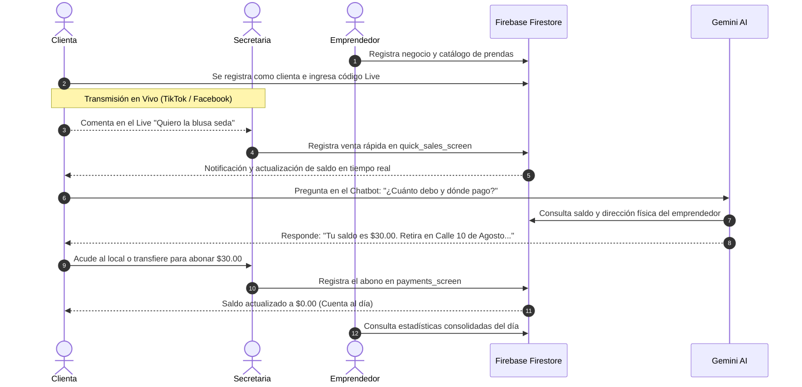

# 🚀 Estado Integral del Proyecto VENDIX Unificado

> **Fecha de Consolidación:** 12 de Noviembre de 2026  
> **Proyecto:** VENDIX — Solución Tecnológica Omnicanal para Ventas en Vivo (Live Shopping)  
> **Estado de Compilación:** `flutter analyze lib/` → **0 errores / 0 advertencias**  
> **Repositorio:** Unificado en rama `main`

---

## 1. 🌐 Visión General del Sistema Unificado

El proyecto **VENDIX** ha alcanzado su punto de convergencia arquitectónica, integrando en una sola base de código cohesiva el trabajo de autenticación, gestión comercial y roles desarrollado en conjunto con el usuario, junto con el subsistema de **Inteligencia Artificial con Google Gemini** aportado por Henry.

```
                                  VENDIX ECOSYSTEM
                                         │
        ┌────────────────────────────────┼────────────────────────────────┐
        ▼                                ▼                                ▼
  ROL CLIENTE                     ROL SECRETARIA                  ROL EMPRENDEDOR
  • Consulta de saldo en vivo    • Registro ultrarrápido en Live  • Dashboard general
  • Asistente Gemini AI (Chat)   • Control de clientas y abonos   • Aprobación de secretarios
  • Solicitud de empleo          • Estadísticas con calendario    • Gestión de prendas/precios
  • Historial de prendas         • Generación de código de Live   • Identidad del negocio
```

---

## 2. 🏛️ Arquitectura Técnica y Tecnologías

### 2.1. Pila Tecnológica
- **Framework Frontend:** Flutter 3.x (Dart 3.x), compilable en Android (APK/AAB), Web (HTML5/CanvasKit) y Escritorio Windows.
- **Autenticación:** Firebase Authentication (Correo/Contraseña + Google OAuth 2.0 con protección ante bloqueadores Brave).
- **Base de Datos NoSQL:** Google Cloud Firestore en tiempo real con sincronización offline.
- **Motor de Inteligencia Artificial:** Google Generative AI SDK (`gemini-3.5-flash-lite`) con fallback autónomo determinista.
- **Almacenamiento y Media:** Integración híbrida para avatares estilo WhatsApp (Cloudinary + Firestore Base64).

### 2.2. Mapa Estructural del Código Fuente (`lib/`)

```
lib/
├── data/                         # Repositorios estáticos y catálogos base
├── models/                       # Modelos tipados fuertemente
│   ├── administrador_model.dart  # Incluye nombreEmprendimiento
│   ├── prenda_model.dart         # Inventario y precios del Live
│   └── usuario_model.dart        # Identidad unificada y roles
├── screens/
│   ├── admin/                    # Módulo Emprendedor / Administrador
│   │   ├── admin_home_screen.dart
│   │   ├── admin_more_screen.dart
│   │   └── admin_profile_screen.dart
│   ├── auth/                     # Autenticación y registro simplificado
│   │   ├── login_screen.dart
│   │   ├── register_admin_screen.dart
│   │   ├── register_client_screen.dart
│   │   └── register_entrepreneur_screen.dart
│   ├── client/                   # Módulo Comprador
│   │   ├── client_balance_screen.dart
│   │   ├── client_home_screen.dart
│   │   ├── client_profile_screen.dart
│   │   ├── client_purchases_screen.dart
│   │   ├── client_shell.dart
│   │   ├── enter_code_screen.dart
│   │   ├── solicitud_empleo_screen.dart
│   │   └── widgets/
│   │       └── client_chatbot_sheet.dart  # Chatbot con Gemini AI
│   └── secretary/                # Módulo Operativo de Ventas
│       ├── clients_screen.dart
│       ├── clothing_prices_screen.dart
│       ├── home_screen.dart
│       ├── jornadas_screen.dart
│       ├── more_screen.dart
│       ├── payments_screen.dart
│       ├── quick_sales_screen.dart
│       ├── secretary_shell.dart
│       └── statistics_screen.dart
├── services/                     # Lógica de negocio y pasarelas externas
│   ├── client_service.dart
│   ├── gemini_service.dart       # Integración Gemini + Firebase Context
│   ├── google_auth_service.dart
│   └── perfil_foto_service.dart
├── theme/                        # Paleta de colores violeta/magenta corporativa
├── firebase_options.dart         # Credenciales multiplataforma de Firebase
├── main.dart                     # Punto de entrada de la aplicación
└── secrets.dart                  # Claves de API privadas (protegido por .gitignore)
```

---

## 3. 👥 Matriz de Roles y Permisos

| Capacidad | Cliente | Secretaria | Emprendedor |
|---|:---:|:---:|:---:|
| Ver catálogo y saldo personal | ✅ | ✅ | ✅ |
| Consultar Asistente IA (Gemini) | ✅ | ❌ | ❌ |
| Postularse como Secretario | ✅ | ❌ | ❌ |
| Alternar entre Cliente y Secretario | ✅ (con empleo aprobado) | ✅ | ❌ |
| Registrar ventas en vivo en el Live | ❌ | ✅ | ✅ |
| Crear y administrar clientas | ❌ | ✅ | ✅ |
| Registrar abonos y pagos de clientas | ❌ | ✅ | ✅ |
| Consultar estadísticas con calendario | ❌ | ✅ | ✅ |
| Modificar catálogo y precios oficiales | ❌ | ❌ | ✅ |
| Aprobar o rechazar secretarios | ❌ | ❌ | ✅ |
| Configurar nombre de la tienda física | ❌ | ❌ | ✅ |

---

## 4. 🗄️ Esquema de Base de Datos en Cloud Firestore

### 4.1. Colección `usuarios`
Identidad central vinculada al UID de Firebase Authentication:
- `uid` (String): ID único del usuario.
- `nombre` (String), `apellido` (String), `correo` (String), `telefono` (String).
- `rol` (String): `'cliente'` o `'administrador'`.
- `codigoLive` (String): Código activo si está vinculada a una secretaria.

### 4.2. Colección `Administradores`
Ficha comercial de los emprendedores:
- `nombre` (String), `apellido` (String), `email` (String), `telefono` (String).
- `nombreEmprendimiento` (String): Nombre oficial de la tienda o marca comercial.
- `estado` (Boolean): Estado activo del negocio.

### 4.3. Colección `secretarios`
Registros laborales y postulaciones:
- `uid` (String): ID del cliente que ejerce como secretario.
- `adminId` (String): ID del emprendedor que lo contrata.
- `nombreEmprendimiento` (String): Nombre del negocio donde labora.
- `aprobado` (Boolean): `true` para operar, `false` para solicitudes pendientes.
- `codigoLive` (String): Código alfanumérico generado para vincular clientas durante transmisiones en vivo.

### 4.4. Colección `clientes`
Fichas comerciales de las clientas atendidas:
- `nombre` (String), `telefono` (String), `direccion` (String).
- `uid` (String, opcional): UID si la clienta creó su cuenta en la app móvil.
- `saldo` (Double): Saldo deudor sincronizado.

### 4.5. Colección `compras`
Transacciones registradas durante los directos:
- `clienteId` (String), `clienteNombre` (String).
- `prenda` / `prendaNombre` (String), `precio` (Double), `cantidad` (Int), `subtotal` / `total` (Double).
- `fecha` (Timestamp): Momento del apartado en vivo.

### 4.6. Colección `pagos`
Abonos realizados por las clientas:
- `clienteId` (String), `clienteNombre` (String).
- `monto` (Double): Valor cancelado.
- `observacion` (String): Forma de pago (ej. "Efectivo", "Transferencia").
- `fecha` (Timestamp).

---

## 5. 🔄 Flujo Operativo End-to-End



---

## 6. 🧰 Herramientas y Scripts de Automatización

El proyecto cuenta con scripts por lotes en la raíz para facilitar el trabajo diario:
- **`run_vendix.bat`:** Menú interactivo multiplataforma (Chrome, Edge, Brave, Teléfono Android USB, Emulador MuMuPlayer).
- **`generar_apk.bat`:** Compilación automatizada de release APK optimizado en la carpeta `apk/`.
- **`serve_web.ps1`:** Servidor HTTP local de alto rendimiento con cabeceras `no-cache` para depuración web instantánea.
- **`web_relaciones.html`:** Visor relacional interactivo de la base de datos Firestore en tiempo real.

---

## 7. 🎯 Estado de Verificación y Calidad

- **Análisis Estático:** Se ejecutó `flutter analyze lib/` obteniendo **No issues found! (0 errores, 0 warnings)**.
- **Validación de Tipos Numéricos:** Blindaje frente a discrepancias de tipo entre `String` y `num` mediante conversores seguros.
- **Codificación:** 100% UTF-8 limpio sin BOM ni secuencias corruptas.
- **Seguridad:** Claves privadas aisladas mediante `lib/secrets.dart` y protegidas de forma garantizada en `.gitignore`.
