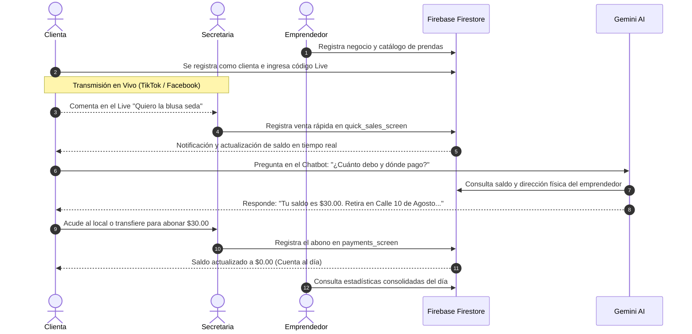

# 🚀 Estado Integral del Proyecto VENDIX Unificado

> **Fecha de Consolidación:** 12 de Noviembre de 2026
> **Proyecto:** VENDIX — Solución Tecnológica Omnicanal para Ventas en Vivo (Live Shopping)
> **Estado de Compilación:** `flutter analyze lib/` → **0 errores / 0 advertencias**
> **Repositorio:** Unificado en rama `main`

---

## 1. 🌐 Visión General del Sistema Unificado

El proyecto **VENDIX** ha alcanzado su punto de convergencia arquitectónica, integrando en una sola base de código cohesiva el trabajo de autenticación, gestión comercial y roles desarrollado en conjunto con el usuario, junto con el subsistema de **Inteligencia Artificial con Google Gemini** aportado por Henry.

```
                                  VENDIX ECOSYSTEM
                                         │
        ┌────────────────────────────────┼────────────────────────────────┐
        ▼                                ▼                                ▼
  ROL CLIENTE                     ROL SECRETARIA                  ROL EMPRENDEDOR
  • Consulta de saldo en vivo    • Registro ultrarrápido en Live  • Dashboard general
  • Asistente Gemini AI (Chat)   • Control de clientas y abonos   • Aprobación de secretarios
  • Solicitud de empleo          • Estadísticas con calendario    • Gestión de prendas/precios
  • Historial de prendas         • Generación de código de Live   • Identidad del negocio
```

---

## 2. 🏛️ Arquitectura Técnica y Tecnologías

### 2.1. Pila Tecnológica

- **Framework Frontend:** Flutter 3.x (Dart 3.x), compilable en Android (APK/AAB), Web (HTML5/CanvasKit) y Escritorio Windows.
- **Autenticación:** Firebase Authentication (Correo/Contraseña + Google OAuth 2.0 con protección ante bloqueadores Brave).
- **Base de Datos NoSQL:** Google Cloud Firestore en tiempo real con sincronización offline.
- **Motor de Inteligencia Artificial:** Google Generative AI SDK (`gemini-3.5-flash-lite`) con fallback autónomo determinista.
- **Almacenamiento y Media:** Integración híbrida para avatares estilo WhatsApp (Cloudinary + Firestore Base64).

### 2.2. Mapa Estructural del Código Fuente (`lib/`)

```
lib/
├── data/                         # Repositorios estáticos y catálogos base
├── models/                       # Modelos tipados fuertemente
│   ├── administrador_model.dart  # Incluye nombreEmprendimiento
│   ├── prenda_model.dart         # Inventario y precios del Live
│   └── usuario_model.dart        # Identidad unificada y roles
├── screens/
│   ├── admin/                    # Módulo Emprendedor / Administrador
│   │   ├── admin_home_screen.dart
│   │   ├── admin_more_screen.dart
│   │   └── admin_profile_screen.dart
│   ├── auth/                     # Autenticación y registro simplificado
│   │   ├── login_screen.dart
│   │   ├── register_admin_screen.dart
│   │   ├── register_client_screen.dart
│   │   └── register_entrepreneur_screen.dart
│   ├── client/                   # Módulo Comprador
│   │   ├── client_balance_screen.dart
│   │   ├── client_home_screen.dart
│   │   ├── client_profile_screen.dart
│   │   ├── client_purchases_screen.dart
│   │   ├── client_shell.dart
│   │   ├── enter_code_screen.dart
│   │   ├── solicitud_empleo_screen.dart
│   │   └── widgets/
│   │       └── client_chatbot_sheet.dart  # Chatbot con Gemini AI
│   └── secretary/                # Módulo Operativo de Ventas
│       ├── clients_screen.dart
│       ├── clothing_prices_screen.dart
│       ├── home_screen.dart
│       ├── jornadas_screen.dart
│       ├── more_screen.dart
│       ├── payments_screen.dart
│       ├── quick_sales_screen.dart
│       ├── secretary_shell.dart
│       └── statistics_screen.dart
├── services/                     # Lógica de negocio y pasarelas externas
│   ├── client_service.dart
│   ├── gemini_service.dart       # Integración Gemini + Firebase Context
│   ├── google_auth_service.dart
│   └── perfil_foto_service.dart
├── theme/                        # Paleta de colores violeta/magenta corporativa
├── firebase_options.dart         # Credenciales multiplataforma de Firebase
├── main.dart                     # Punto de entrada de la aplicación
└── secrets.dart                  # Claves de API privadas (protegido por .gitignore)
```

---

## 3. 👥 Matriz de Roles y Permisos

| Capacidad                               |         Cliente         | Secretaria | Emprendedor |
| --------------------------------------- | :----------------------: | :--------: | :---------: |
| Ver catálogo y saldo personal          |            ✅            |     ✅     |     ✅     |
| Consultar Asistente IA (Gemini)         |            ✅            |     ❌     |     ❌     |
| Postularse como Secretario              |            ✅            |     ❌     |     ❌     |
| Alternar entre Cliente y Secretario     | ✅ (con empleo aprobado) |     ✅     |     ❌     |
| Registrar ventas en vivo en el Live     |            ❌            |     ✅     |     ✅     |
| Crear y administrar clientas            |            ❌            |     ✅     |     ✅     |
| Registrar abonos y pagos de clientas    |            ❌            |     ✅     |     ✅     |
| Consultar estadísticas con calendario  |            ❌            |     ✅     |     ✅     |
| Modificar catálogo y precios oficiales |            ❌            |     ❌     |     ✅     |
| Aprobar o rechazar secretarios          |            ❌            |     ❌     |     ✅     |
| Configurar nombre de la tienda física  |            ❌            |     ❌     |     ✅     |

---

## 4. 🗄️ Esquema de Base de Datos en Cloud Firestore

### 4.1. Colección `usuarios`

Identidad central vinculada al UID de Firebase Authentication:

- `uid` (String): ID único del usuario.
- `nombre` (String), `apellido` (String), `correo` (String), `telefono` (String).
- `rol` (String): `'cliente'` o `'administrador'`.
- `codigoLive` (String): Código activo si está vinculada a una secretaria.

### 4.2. Colección `Administradores`

Ficha comercial de los emprendedores:

- `nombre` (String), `apellido` (String), `email` (String), `telefono` (String).
- `nombreEmprendimiento` (String): Nombre oficial de la tienda o marca comercial.
- `estado` (Boolean): Estado activo del negocio.

### 4.3. Colección `secretarios`

Registros laborales y postulaciones:

- `uid` (String): ID del cliente que ejerce como secretario.
- `adminId` (String): ID del emprendedor que lo contrata.
- `nombreEmprendimiento` (String): Nombre del negocio donde labora.
- `aprobado` (Boolean): `true` para operar, `false` para solicitudes pendientes.
- `codigoLive` (String): Código alfanumérico generado para vincular clientas durante transmisiones en vivo.

### 4.4. Colección `clientes`

Fichas comerciales de las clientas atendidas:

- `nombre` (String), `telefono` (String), `direccion` (String).
- `uid` (String, opcional): UID si la clienta creó su cuenta en la app móvil.
- `saldo` (Double): Saldo deudor sincronizado.

### 4.5. Colección `compras`

Transacciones registradas durante los directos:

- `clienteId` (String), `clienteNombre` (String).
- `prenda` / `prendaNombre` (String), `precio` (Double), `cantidad` (Int), `subtotal` / `total` (Double).
- `fecha` (Timestamp): Momento del apartado en vivo.

### 4.6. Colección `pagos`

Abonos realizados por las clientas:

- `clienteId` (String), `clienteNombre` (String).
- `monto` (Double): Valor cancelado.
- `observacion` (String): Forma de pago (ej. "Efectivo", "Transferencia").
- `fecha` (Timestamp).

---

## 5. 🔄 Flujo Operativo End-to-End



---

## 6. 🧰 Herramientas y Scripts de Automatización

El proyecto cuenta con scripts por lotes en la raíz para facilitar el trabajo diario:

- **`run_vendix.bat`:** Menú interactivo multiplataforma (Chrome, Edge, Brave, Teléfono Android USB, Emulador MuMuPlayer).
- **`generar_apk.bat`:** Compilación automatizada de release APK optimizado en la carpeta `apk/`.
- **`serve_web.ps1`:** Servidor HTTP local de alto rendimiento con cabeceras `no-cache` para depuración web instantánea.
- **`web_relaciones.html`:** Visor relacional interactivo de la base de datos Firestore en tiempo real.

---

## 7. 🎯 Estado de Verificación y Calidad

- **Análisis Estático:** Se ejecutó `flutter analyze lib/` obteniendo **No issues found! (0 errores, 0 warnings)**.
- **Validación de Tipos Numéricos:** Blindaje frente a discrepancias de tipo entre `String` y `num` mediante conversores seguros.
- **Codificación:** 100% UTF-8 limpio sin BOM ni secuencias corruptas.
- **Seguridad:** Claves privadas aisladas mediante `lib/secrets.dart` y protegidas de forma garantizada en `.gitignore`.

---

## 8. Actualización de Interfaz y Estabilidad (13/11/2026)

### A. Visor de Foto de Perfil en Pantalla Completa (Lightbox Interactivo)
- **Problema previo:** Al tocar el avatar de perfil propio, únicamente se desplegaba el selector de acciones de WhatsApp (Cámara, Galería, Enlace, Borrar), sin posibilidad de admirar o verificar la imagen completa. Además, en los paneles de administración y secretaría, los perfiles de clientes y secretarios mostraban únicamente iniciales de texto fijas, impidiendo consultar la imagen de perfil real.
- **Implementación técnica (`PerfilFotoService`):**
  - Se introdujo `verFotoCompleta(context, {fotoData, titulo, subtitulo})`, que monta un lightbox modal con fondo translúcido oscuro, encabezado con detalles y botón de salida, y un `InteractiveViewer` que permite hacer zoom táctil (de 0.8x a 4.0x) y paneo libre en la foto.
  - Se incorporó la opción explícita **"Ver foto"** dentro del menú estilo WhatsApp `mostrarOpcionesFotoWhatsApp`.
  - En `avatarConInsignia`: al pulsar sobre la foto se despliega el visor completo, mientras que al tocar el ícono de cámara se despliega el menú de edición de imagen.
  - Se creó el widget estandarizado `PerfilFotoService.avatarWidget(...)` para renderizar avatares con sincronización en vivo (`PerfilFotoService.fotoStream`), con fallback a iniciales estéticas y apertura automática del visor en pantalla completa al pulsar.
  - Se integró el visor en:
    - [admin_profile_screen.dart](file:///c:/Users/crist/Desktop/VENDIX/flutter_application_1/lib/screens/admin/admin_profile_screen.dart)
    - [client_profile_screen.dart](file:///c:/Users/crist/Desktop/VENDIX/flutter_application_1/lib/screens/client/client_profile_screen.dart)
    - [more_screen.dart](file:///c:/Users/crist/Desktop/VENDIX/flutter_application_1/lib/screens/secretary/more_screen.dart)
    - [admin_more_screen.dart](file:///c:/Users/crist/Desktop/VENDIX/flutter_application_1/lib/screens/admin/admin_more_screen.dart) (tanto en tarjeta del emprendedor, solicitudes de secretarios pendientes y secretarios activos).
    - [clients_screen.dart](file:///c:/Users/crist/Desktop/VENDIX/flutter_application_1/lib/screens/secretary/clients_screen.dart) (lista general de clientas, resumen modal de clienta e historial).

### B. Corrección de Pantalla Roja y Aserción en Registro de Pagos
- **Causa raíz:** En `clients_screen.dart`, el modal de resumen de clienta cerraba su ruta e inmediatamente abría el modal de registro de pago en el mismo tick (`Navigator.pop(); _registrarPago()`), causando colisión entre animaciones de transición de rutas en Flutter Web. Adicionalmente, el controlador de texto se liberaba en un `whenComplete` asíncrono mientras el stream de Firestore reconstruía la pantalla principal, disparando la aserción interna `_dependents.isEmpty is not true`.
- **Solución implementada:**
  - El modal de resumen ahora devuelve un token de acción limpio (`Navigator.pop(context, 'pago')`). El llamador espera a que el modal termine de desmontarse antes de invocar `_registrarPago`.
  - Se encapsuló el formulario de pago dentro de un `StatefulWidget` dedicado (`_ModalRegistrarPago`), que gestiona su propio `TextEditingController` y `GlobalKey<FormState>` con ciclo de vida seguro (`dispose()`), confirmación visual durante el guardado y reporte de éxito por `SnackBar` sin colisión de `BuildContext`.

### C. Eliminación de Desbordamiento Visual en Historial de Clientas
- **Causa raíz:** El diálogo de historial utilizaba un `Column(mainAxisSize: MainAxisSize.min)` dentro del bottom sheet; al acumular más de 4 o 5 compras o pagos registrados, el contenido excedía el alto de la ventana generando la barra rayada amarilla/negra `BOTTOM OVERFLOWED BY 203 PIXELS`.
- **Solución implementada:**
  - Se reestructuró `_verHistorial` utilizando `DraggableScrollableSheet` con `ListView`, drag handle central, tarjeta de cliente con avatar interactivo y secciones independientes para compras con contadores, fechas legibles y estado vacío estilizado. Cero desbordamientos para cualquier cantidad de transacciones.

### D. Solución Definitiva a la Pantalla Roja al Agregar Clienta (`_dependents.isEmpty`)
- **Causa raíz:** Al presionar "Guardar" en el diálogo de nueva clienta, se ejecutaba `Navigator.pop()` e inmediatamente se escribía en Firestore mientras los controladores se liberaban en `.then((_) { dispose(); })`. La escritura desencadenaba la reconstrucción por `StreamBuilder` de la lista mientras la ruta del diálogo se encontraba en proceso de desactivación, lanzando `Assertion failed: line 6281 pos 12: '_dependents.isEmpty': is not true`.
- **Solución implementada:**
  - Se modularizó la creación de clientas y prendas en `StatefulWidget`s desacoplados (`_DialogoNuevaClienta` y `_DialogoAgregarPrenda`).
  - El ciclo de vida de los controladores está confinado a su propio `State.dispose()`.
  - La operación de guardado en Firestore se completa con indicador de progreso en el botón antes de cerrar el diálogo, evitando cualquier colisión con el ciclo de vida del árbol de widgets.

### E. Aislamiento y Segregación de Clientes por Negocio (`adminId`)
- **Problema previo:** Todos los administradores y secretarios consultaban la colección global `clientes` sin ningún filtro, provocando que cualquier cuenta viera exactamente los mismos clientes sin importar la tienda a la que pertenecían. Además, al crear una clienta no se asociaba el `adminId` del negocio correspondiente.
- **Solución implementada:**
  - Se agregó la resolución automática de `_adminId` en [clients_screen.dart](file:///c:/Users/crist/Desktop/VENDIX/flutter_application_1/lib/screens/secretary/clients_screen.dart) y [quick_sales_screen.dart](file:///c:/Users/crist/Desktop/VENDIX/flutter_application_1/lib/screens/secretary/quick_sales_screen.dart).
  - Al abrir desde el administrador ([admin_home_screen.dart](file:///c:/Users/crist/Desktop/VENDIX/flutter_application_1/lib/screens/admin/admin_home_screen.dart)), se pasa explícitamente `widget.admin.id`.
  - Al abrir desde el secretario, el sistema recupera el `adminId` del emprendedor al que fue asignado el secretario.
  - Al registrar una nueva clienta, se almacena de forma mandatoria: `'adminId': adminId`, `'creadoPor': currentUid`, asegurando que cada tienda opere de forma aislada.
  - Las listas y buscadores de clientas filtran en tiempo real para desplegar únicamente a los clientes del negocio en sesión.

### F. Remoción de Opciones de Pagos y Abonos
- Conforme a los requerimientos del flujo operativo:
  - Se eliminó la tarjeta "Gestión de pagos" en [admin_more_screen.dart](file:///c:/Users/crist/Desktop/VENDIX/flutter_application_1/lib/screens/admin/admin_more_screen.dart).
  - Se eliminó la opción "Pagos" en [more_screen.dart](file:///c:/Users/crist/Desktop/VENDIX/flutter_application_1/lib/screens/secretary/more_screen.dart).
  - Se removió el botón "Registrar pago" del modal de resumen de clientas en [clients_screen.dart](file:///c:/Users/crist/Desktop/VENDIX/flutter_application_1/lib/screens/secretary/clients_screen.dart).

### G. Navegación al Perfil al Tocar el Avatar Superior Derecho
- En [client_home_screen.dart](file:///c:/Users/crist/Desktop/VENDIX/flutter_application_1/lib/screens/client/client_home_screen.dart) y [client_shell.dart](file:///c:/Users/crist/Desktop/VENDIX/flutter_application_1/lib/screens/client/client_shell.dart), al tocar el avatar de la esquina superior derecha se activa la redirección inmediata a la pestaña y vista del perfil del cliente.
- En [home_screen.dart](file:///c:/Users/crist/Desktop/VENDIX/flutter_application_1/lib/screens/secretary/home_screen.dart), al tocar el avatar superior se abre la sección de perfil y opciones del secretario (`MoreScreen`).


