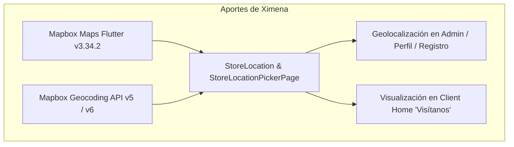

# Estado Técnico Integral de VENDIX: Detección de Cambios de Ximena y Arquitectura de APIs

> **Fecha:** 16 de Noviembre, 2026  
> **Proyecto:** VENDIX (`flutter_application_1`)  
> **Rama de trabajo:** `main` (sin sincronizar con control remoto por solicitud)  
> **Propósito:** Análisis exhaustivo y consolidado de los cambios introducidos por **Ximena**, arquitectura de APIs activas, dependencias, flujos funcionales y mapa de archivos del proyecto.

---

## 1. Detección de Cambios Realizados por Ximena

Tras la inspección del árbol de trabajo local frente al historial previo (`git diff` y análisis de archivos no rastreados), se detectaron cambios sustanciales realizados por **Ximena**. A continuación se detalla cada componente modificado y creado:



### 1.1 Nueva Dependencia: Mapbox Maps SDK
- **Archivo:** `pubspec.yaml` (línea 45).
- **Paquete:** `mapbox_maps_flutter: ^3.34.2`.
- **Propósito:** Renderizado de mapas vectoriales nativos interactivos, marcado de puntos geográficos (`PointAnnotation`) y visualización de la tienda física del emprendedor/administrador.

### 1.2 Configuración en Inicialización Global
- **Archivo:** `lib/main.dart` (líneas 13-20).
- **Lógica implementada:**
  ```dart
  final mapboxAccessToken = const String.fromEnvironment(
    'ACCESS_TOKEN',
    defaultValue: AppSecrets.mapboxAccessToken,
  );
  if (mapboxAccessToken.isNotEmpty) {
    MapboxOptions.setAccessToken(mapboxAccessToken);
  }
  ```
  Permite inyectar el token vía `--dart-define=ACCESS_TOKEN=...` con fallback al token configurado en `lib/secrets.dart`.

### 1.3 Nuevo Módulo Integral: `lib/widgets/store_location_map.dart` (657 líneas)
Ximena creó un módulo completo con 4 componentes clave:
1. **`StoreLocation` (Modelo):**
   - Atributos: `latitude`, `longitude`, `address` (opcional).
2. **`StoreLocationPickerPage` (Página de Selección):**
   - Permite al Administrador buscar una dirección o tocar en el mapa para posicionar el marcador de su tienda.
   - Cuenta con **Geocodificación Forward** (Texto $\rightarrow$ Coordenadas):
     - Intento 1: **Mapbox Geocoding API v6** (`/search/geocode/v6/forward`).
     - Fallback: **Mapbox Geocoding API v5** (`/geocoding/v5/mapbox.places/$query.json`).
     - Prioriza resultados de Ecuador (`country=EC`) con proximidad a Riobamba (`-78.65887, -1.66506`).
   - Cuenta con **Geocodificación Reverse** (Coordenadas $\rightarrow$ Dirección legible):
     - Intento 1: Mapbox v6 reverse.
     - Fallback: Mapbox v5 reverse.
3. **`StoreLocationPreview` (Previsualizador de Mapa):**
   - Muestra un mapa interactivo embebido con el estilo `MapboxStyles.MAPBOX_STREETS`.
   - Coloca automáticamente una anotación visual (`PointAnnotation`) con un pin vectorial SVG morado generado con `Canvas` y `PictureRecorder`.
4. **`StoreLocationAddressField` (Form Field Reutilizable):**
   - Campo de formulario que enlaza la dirección escrita con el selector en mapa.

### 1.4 Integración de Ubicaciones en las Pantallas
- **`lib/screens/client/client_home_screen.dart`:**
  - En la tarjeta "VISÍTANOS", ahora se abre un modal inferior (`_mostrarMapaTienda`) que embebe `StoreLocationPreview` mostrando la tienda del emprendedor asignado en vivo.
- **`lib/screens/admin/admin_home_screen.dart`:**
  - Se agregó la pantalla `AdminStoreLocationScreen` para configurar la tienda física.
- **`lib/screens/admin/admin_profile_screen.dart`:**
  - Integración de `StoreLocationAddressField` para guardar `ubicacion_tienda: {latitud, longitud, direccion}` en Firestore.
- **`lib/screens/auth/register_admin_screen.dart`:**
  - Los nuevos emprendedores pueden registrar la ubicación de su local comercial desde el alta.

### 1.5 Ajustes de Compilación Android (Gradle)
- **`android/build.gradle.kts`:**
  - Forzado del plugin de Kotlin para librerías nativas (`subprojects { pluginManager.withPlugin("com.android.library") { ... } }`), necesario para compatibilidad del SDK de Mapbox.
- **`android/gradle.properties`:**
  - `kotlin.incremental=false` y `org.gradle.parallel=false` para evitar corrupciones de caché en el daemon de Gradle durante la compilación de Mapbox.
- **`android/app/src/main/res/drawable-nodpi/`:**
  - Incorporó imágenes `ic_launcher_background.png` e `ic_launcher_foreground.png` de 1024x1024 para control de densidad neutra.

---

## 2. Mapa Completo de APIs del Ecosistema VENDIX

A continuación se resume qué APIs existen en el proyecto, en qué archivos residen, qué dependencias usan y cómo operan:

| API / Servicio | Archivo Principal | Dependencias (`pubspec.yaml`) | Credenciales / Token | Propósito |
| :--- | :--- | :--- | :--- | :--- |
| **Mapbox Maps & Geocoding** | `lib/widgets/store_location_map.dart` | `mapbox_maps_flutter: ^3.34.2`<br>`http: ^1.2.2` | `lib/secrets.dart` o `--dart-define` | Mapas vectoriales interactivos, geolocalización de tiendas y geocodificación v5/v6 |
| **Google Gemini AI (Henry Chatbot)** | `lib/services/gemini_service.dart`<br>`lib/screens/client/widgets/client_chatbot_sheet.dart` | `google_generative_ai: ^0.4.7` | `lib/secrets.dart` o `--dart-define=GEMINI_API_KEY` | Asistente virtual inteligente para clientes (consultas de saldo, compras, estado de cuenta y recomendaciones) |
| **Cloudinary** | `lib/services/cloudinary_service.dart`<br>`lib/services/perfil_foto_service.dart` | `http: ^1.2.2`<br>`image_picker: ^1.2.4` | `cloudName: 'kjpffs0b'`<br>`uploadPreset: 'vendix_mobile'` | Almacenamiento y optimización CDN de fotos de perfil en la nube |
| **Firebase Auth & Google Sign-In** | `lib/services/google_auth_service.dart`<br>`lib/screens/auth/login_screen.dart` | `firebase_auth: ^7.0.0`<br>`google_sign_in: ^7.2.0` | `google-services.json` | Autenticación con correo/contraseña y OAuth con Google |
| **Cloud Firestore** | `lib/services/client_service.dart`<br>`lib/data/prenda_service.dart` | `cloud_firestore: ^7.0.0` | Proyecto Firebase configurado | Base de datos NoSQL en tiempo real para usuarios, clientes, compras, prendas, secretarios y administradores |

---

## 3. Detalle Técnico de Cada API

### 3.1 Mapbox Maps & Geocoding API
- **Archivo:** `lib/widgets/store_location_map.dart`
- **Endpoints Utilizados:**
  1. `https://api.mapbox.com/search/geocode/v6/forward`
  2. `https://api.mapbox.com/geocoding/v5/mapbox.places/{query}.json`
  3. `https://api.mapbox.com/search/geocode/v6/reverse`
  4. `https://api.mapbox.com/geocoding/v5/mapbox.places/{lng},{lat}.json`
- **Funcionamiento:**
  - El usuario escribe una dirección o mueve la cámara del mapa.
  - El sistema ejecuta una petición HTTP con debounce (`Future.delayed`) hacia Mapbox Search.
  - La respuesta JSON contiene coordenadas `[longitude, latitude]` o texto de dirección formateada (`formatted_address` o `place_name`).
  - La cámara se mueve con `_map?.setCamera(CameraOptions(center: Point(coordinates: Position(lng, lat)), zoom: 15.5))`.
  - Se dibuja un marcador dinámico generado con `ui.PictureRecorder` y `PointAnnotationManager`.

### 3.2 Google Gemini AI (Henry Chatbot)
- **Archivos:**
  - `lib/services/gemini_service.dart`
  - `lib/screens/client/widgets/client_chatbot_sheet.dart`
  - `lib/secrets.dart` (gestión de clave)
- **Modelo:** `gemini-1.5-flash` (rápido y con latencia mínima).
- **Funcionamiento:**
  - `GeminiService.obtenerContextoCliente(uid)` consulta Firestore (`clientes`, `compras`, `pagos`, `Administradores`) para armar el `ContextoClienteChatbot`.
  - Se inyecta un *System Prompt* exhaustivo donde Gemini asume la identidad de **Henry**, el asesor comercial de VENDIX.
  - Henry responde conociendo el nombre exacto de la clienta, su saldo pendiente, prendas compradas, total abonado y datos de contacto de la tienda.

### 3.3 Cloudinary Service (Fotos de Perfil)
- **Archivos:**
  - `lib/services/cloudinary_service.dart`
  - `lib/services/perfil_foto_service.dart`
- **Funcionamiento:**
  - Mediante `ImagePicker`, el usuario selecciona una imagen de la galería o toma una foto.
  - `CloudinaryService.subirImagen(bytes, archivoNombre: '...')` envía una solicitud multipart POST a `https://api.cloudinary.com/v1_1/kjpffs0b/image/upload`.
  - Utiliza el preset unsigned `vendix_mobile` en la carpeta `vendix/perfiles`.
  - Retorna una URL segura `https://res.cloudinary.com/...` que se guarda en el documento de Firestore (`fotoUrl`), actualizando instantáneamente la interfaz con `PerfilFotoService.fotoStream`.

### 3.4 Google Sign-In & Firebase Auth
- **Archivos:**
  - `lib/services/google_auth_service.dart`
  - `lib/screens/auth/login_screen.dart`
- **Funcionamiento:**
  - `GoogleAuthService.signInWithGoogle()` invoca el flujo nativo de Google (`GoogleSignIn.signIn()`).
  - Obtiene el `idToken` y `accessToken` para generar una credencial `GoogleAuthProvider.credential`.
  - Autentica en Firebase (`FirebaseAuth.instance.signInWithCredential`).
  - Determina si el usuario ya tiene un rol registrado (`usuarios/{uid}`). Si no existe, lo redirige al flujo de selección de rol (Cliente o Emprendedor).

---

## 4. Estado Actual del Workspace y Decisiones de Control de Versiones

### 4.1 Cambios Locales vs. GitHub
Por solicitud explícita, **no se han ejecutado comandos `git push`**. Los cambios actuales residen en el espacio de trabajo local:
- Las modificaciones de Ximena (Mapbox, Gradle, mapas) se encuentran integradas en los archivos de la app.
- Se mantienen las funciones previas de segregación de clientes por negocio (`adminId`), visor de fotos en pantalla completa y correcciones de ciclo de vida.
- El archivo `lib/secrets.dart` y las claves privadas permanecen protegidos.

---

## 5. Resumen de Dependencias (`pubspec.yaml`)

```yaml
dependencies:
  flutter:
    sdk: flutter
  flutter_web_plugins:
    sdk: flutter

  cupertino_icons: ^1.0.8
  firebase_core: ^5.0.0
  cloud_firestore: ^7.0.0
  firebase_auth: ^7.0.0
  google_sign_in: ^7.2.0
  image_picker: ^1.2.4
  http: ^1.2.2
  mapbox_maps_flutter: ^3.34.2    # <-- Integrado por Ximena
  google_generative_ai: ^0.4.7   # <-- Henry Chatbot Gemini

dev_dependencies:
  flutter_test:
    sdk: flutter
  flutter_lints: ^6.0.0
```
