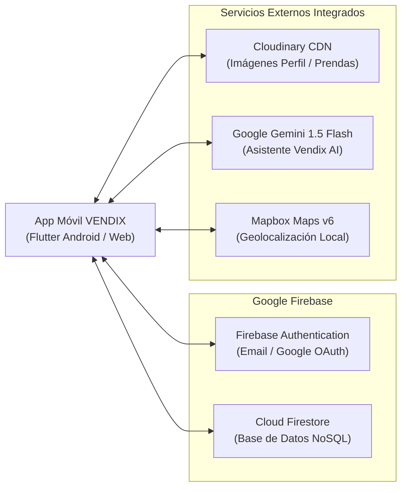
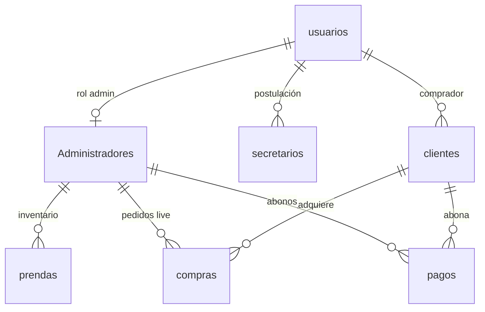

# ANEXOS TÉCNICOS — SISTEMA VENDIX

### Anexo A. Diagrama de arquitectura actualizado y flujo general



**Flujo general de información:** La aplicación móvil autentica al usuario mediante Firebase Authentication (Email/Google), recuperando su rol desde Cloud Firestore. La información de inventario, ventas, compras y saldos se sincroniza bidireccionalmente en tiempo real con Firestore. Las imágenes se procesan externamente mediante Cloudinary retornando URLs HTTPS. El Asistente Vendix consulta Cloud Firestore para alimentar el contexto de Gemini 1.5 Flash y responder sobre pedidos y saldos. Finalmente, Mapbox API v6 resuelve la geolocalización y despliegue cartográfico de las tiendas.

### Anexo B. Esquema real de Firebase (Cloud Firestore)



| Colección | Identificador (PK) | Campos Principales | Relación / Clave Foránea |
| :--- | :--- | :--- | :--- |
| **`usuarios`** | `uid` (Auth) | `nombre`, `apellido`, `correo`, `telefono`, `direccion`, `rol`, `fotoUrl`, `activo`, `fecha_registro` | Entidad central de cuentas |
| **`Administradores`** | `uid` | `nombre`, `apellido`, `correo`, `telefono`, `nombreEmprendimiento`, `ubicacion_tienda`, `latitud`, `longitud`, `estado` | Tienda titular (`adminId`) |
| **`secretarios`** | `${clienteId}_${adminId}` | `nombre`, `correo`, `telefono`, `codigoLive` (ej. `HCC-929`), `estado_solicitud`, `aprobado`, `estado`, `fecha_solicitud` | `adminId` ➔ Administradores<br>`uid` ➔ usuarios |
| **`clientes`** | `doc.id` | `nombre`, `correo`, `telefono`, `direccion`, `codigoLive`, `saldoPendiente`, `totalCompras`, `totalPagado`, `creadoEn` | `adminId` ➔ Administradores<br>`secretarioId` ➔ secretarios |
| **`prendas`** | `doc.id` | `nombre`, `tipo`, `color`, `talla`, `codigoPrenda`, `precio`, `stock`, `imagenUrl`, `disponible` | `adminId` ➔ Administradores |
| **`compras`** | `doc.id` | `nombreCliente`, `nombrePrenda`, `precio`, `cantidad`, `subtotal`, `estado`, `tipoEnvio`, `fecha` | `adminId`, `clienteId`, `prendaId` |
| **`pagos`** | `doc.id` | `monto`, `metodoPago` (Efectivo / Transferencia / DeUna), `comprobanteUrl`, `fecha` | `adminId`, `clienteId`, `secretarioId` |
| **`fotos_perfil`** | `uid` | `url` (Cloudinary HTTPS), `publicId`, `actualizadoEn` | `uid` ➔ usuarios |

### Anexo C. Evidencia de configuración y pruebas de Firebase Authentication y Google

| Parámetro | Detalle Técnico |
| :--- | :--- |
| **Código Evidencia** | `EVI-AUTH-01` (Módulo de Autenticación) |
| **Fecha de Validación** | 16 de noviembre de 2026 |
| **Proveedores Configurados** | Correo / Contraseña y Google Sign-In (OAuth 2.0 Client ID) |
| **Resultado de Prueba** | Inicio de sesión exitoso, generación de token JWT y mapeo de rol en Firestore |

**Registro de verificación en consola (Logcat):**
```text
I/FirebaseAuth: Logging in with provider: google.com
I/FirebaseAuth: Successfully obtained user credential for UID: wDDUMmSHN1XwwXctnFnEvMGWDQI2
I/flutter: Redireccionando a interfaz según rol del usuario: cliente
```

### Anexo D. Evidencia de carga y recuperación de imágenes mediante Cloudinary

| Parámetro | Detalle Técnico |
| :--- | :--- |
| **Código Evidencia** | `EVI-MEDIA-01` (Módulo de Gestión Multimedia) |
| **Fecha de Validación** | 16 de noviembre de 2026 |
| **Configuración CDN** | Cloud Name: `kjpffs0b` \| Upload Preset: `vendix_mobile` (Unsigned SSL) |
| **Carpeta y Almacenamiento** | `vendix_perfiles` y catálogo de prendas \| Entrega vía CDN HTTPS |
| **Resultado de Prueba** | Imagen cargada desde dispositivo móvil y URL asegurada persistida en Firestore |

### Anexo E. Evidencia de consulta y respuesta del Asistente Vendix (Gemini AI)

| Parámetro | Detalle Técnico |
| :--- | :--- |
| **Código Evidencia** | `EVI-AI-01` (Módulo Asistente Inteligente) |
| **Fecha de Validación** | 16 de noviembre de 2026 (19:55 hrs) |
| **Identidad en Interfaz** | `Asistente Vendix (Gemini AI)` \| Estado: *En línea • Conectado a Firebase* |
| **Modelo y Conexión** | `gemini-1.5-flash` con inyección de contexto de cliente desde Cloud Firestore |

**Transcripción de consulta y respuesta real obtenida en la aplicación:**

| Emisor | Mensaje Registrado |
| :--- | :--- |
| **Usuario (Jorman)** | *«en un mensaje corto dime qué compras he realizado, si he cancelado o no y que productos han sido??»* |
| **Asistente Vendix** | *«¡Hola, Jorman! 🛍️ Aquí tienes el resumen:<br><br>• Productos apartados (3 en total): 1 camiseta ($7.00), 1 pantalón ($14.00) y 1 falda ($6.00).<br>• Total comprado: $27.00.<br>• Estado de pago: Aún no has realizado abonos, por lo que tienes un saldo pendiente de $27.00 por cancelar 🏷️.»* |

### Anexo F. Evidencia de funcionalidad de ubicación y mapas con Mapbox

| Parámetro | Detalle Técnico |
| :--- | :--- |
| **Código Evidencia** | `EVI-MAP-01` (Módulo de Geolocalización Comercial) |
| **Fecha de Validación** | 16 de noviembre de 2026 |
| **Librería Integrada** | SDK Oficial `mapbox_maps_flutter: ^3.34.2` |
| **Servicio y Región** | Mapbox Search API v6 (Filtro Ecuador: `country=EC`) |
| **Coordenadas de Prueba** | Riobamba, Chimborazo (`Lat: -1.66506, Lng: -78.65887`) |
| **Resultado de Prueba** | Renderizado de mapa de calles interactivo con marcador y botón de redirección |

### Anexo G. Trazabilidad de capturas de interfaz descritas en el Capítulo IV

> **Nota de referencia:** Las 29 capturas auténticas se encuentran integradas en la sección 4.6 del documento principal con datos reales de prueba. La siguiente tabla sintetiza su propósito y trazabilidad:

| Identificador | Pantalla / Interfaz | Propósito Técnico |
| :--- | :--- | :--- |
| **Figura 01** | Flujo de registro e inicio de sesión | Acceso general por credenciales o proveedor Google. |
| **Figura 02** | Solicitud para trabajar en un emprendimiento | Directorio de tiendas con acción de postulación. |
| **Figura 03** | Gestión y aprobación de solicitudes | Bandeja administrativa para admitir o declinar postulantes. |
| **Figura 04** | Cambio entre modo cliente y modo secretario | Menú modal para alternar de rol sin cerrar sesión. |
| **Figura 05** | Estructura real de Firebase Database | Consola de Cloud Firestore con colecciones operativas. |
| **Figura 06** | Pantalla de bienvenida o acceso | Presentación de marca e inicio de navegación. |
| **Figura 07** | Registro mediante correo y contraseña | Formulario de alta para nuevos usuarios. |
| **Figura 08** | Autenticación con Google | Ventana del selector de cuentas de Google OAuth. |
| **Figura 09** | Panel principal del emprendedor | Tablero con accesos a stock, ventas y colaboradores. |
| **Figura 10** | Configuración del emprendimiento | Datos del negocio, horario y ubicación del local. |
| **Figura 11** | Administración de solicitudes | Listado de aspirantes pendientes de respuesta. |
| **Figura 12** | Detalle de solicitud | Hoja con perfil y contacto del postulante. |
| **Figura 13** | Aceptación o rechazo de solicitud | Asignación de `codigoLive` o descarte de solicitud. |
| **Figura 14** | Gestión de productos | Catálogo de prendas, tallas, colores y existencias. |
| **Figura 15** | Gestión de clientes | Directorio de compradoras registradas en el local. |
| **Figura 16** | Gestión de ventas | Módulo de asignación de prendas en transmisiones en vivo. |
| **Figura 17** | Gestión de pagos | Control de cobros en efectivo, transferencias y DeUna. |
| **Figura 18** | Estadísticas del emprendimiento | Reportes consolidados de recaudación e inventario. |
| **Figura 19** | Inicio del secretario | Consola con código live asignado para la jornada. |
| **Figura 20** | Módulo de ventas del secretario | Selección rápida de pedidos durante el directo. |
| **Figura 21** | Módulo de clientes del secretario | Consulta de saldos pendientes de compradoras. |
| **Figura 22** | Estadísticas del secretario | Balance de transacciones gestionadas en la sesión. |
| **Figura 23** | Menú Más del secretario | Accesos complementarios y cierre de turno. |
| **Figura 24** | Inicio del cliente | Tarjeta de saldo adeudado y botón de ubicación de tienda. |
| **Figura 25** | Consultas con Gemini | Chat del Asistente Vendix resolviendo compras y saldo. |
| **Figura 26** | Geolocalización con Mapbox | Despliegue cartográfico y trazado del local comercial. |
| **Figura 27** | Consulta de compras del cliente | Historial de prendas apartadas y estado de entrega. |
| **Figura 28** | Panel de administración general | Supervisión global de la plataforma. |
| **Figura 29** | Gestión general de usuarios | Control de usuarios y estados de cuenta. |

### Anexo H. Matriz de pruebas y validación ejecutadas

| ID | Prueba | Entrada / Caso | Resultado Esperado | Resultado Obtenido | Estado | Evidencia |
| :--- | :--- | :--- | :--- | :--- | :--- | :--- |
| **P-01** | Registro con correo y contraseña | Correo y clave válidos | Registro de cuenta e inicio de sesión | Usuario registrado e interfaz cargada | **Realizado** | `EVI-AUTH-01` |
| **P-02** | Inicio de sesión con Google | Selección de cuenta Google | Autenticación y sincronización de rol | Credencial obtenida y acceso concedido | **Realizado** | `EVI-AUTH-01` |
| **P-03** | Registro de emprendedor | Formulario de tienda física | Registro en `Administradores` | Tienda persistida con datos comerciales | **Realizado** | Anexo B / Fig. 10 |
| **P-04** | Solicitud para trabajar | Presionar *"Postular"* en tienda | Registro en colección `secretarios` | Solicitud registrada en estado pendiente | **Realizado** | Fig. 02 |
| **P-05** | Aprobación de solicitud | Presionar *"Aprobar"* en admin | Asignación de rol y `codigoLive` | Modo secretario habilitado con código | **Realizado** | Fig. 03 / Fig. 13 |
| **P-06** | Rechazo de solicitud | Presionar *"Rechazar"* en admin | Solicitud descartada sin rol | Solicitud denegada; usuario queda como cliente | **Realizado** | Fig. 13 |
| **P-07** | Cambio de modo | Selección de rol en perfil | Alternar cliente / secretario | Transición inmediata sin cerrar sesión | **Realizado** | Fig. 04 |
| **P-08** | Carga de fotografía | Imagen desde galería móvil | Carga en Cloudinary y URL en perfil | Imagen almacenada en CDN y visible en app | **Realizado** | `EVI-MEDIA-01` |
| **P-09** | Consulta Gemini | Pregunta de compras y deuda | Respuesta contextualizada de Firestore | Resumen de 3 prendas y saldo de $27.00 | **Realizado** | `EVI-AI-01` |
| **P-10** | Geolocalización Mapbox | Pulsar *"VISÍTANOS"* en tienda | Mapa interactivo con ubicación de local | Mapa de calles cargado con pin comercial | **Realizado** | `EVI-MAP-01` |
| **P-11** | Persistencia de información | Recarga y reingreso a la app | Datos íntegros recuperados de Firebase | Sesión, pedidos y saldos conservados | **Realizado** | Anexo B / Fig. 05 |
