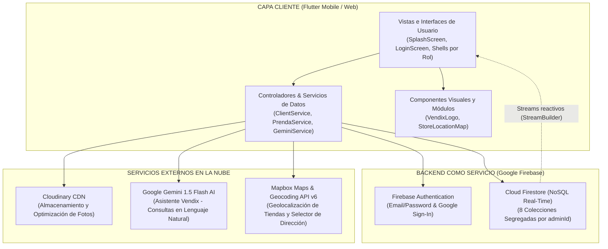
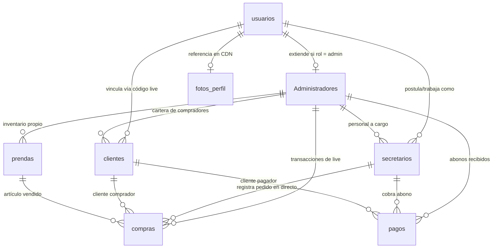

# DOSSIER OFICIAL DE ANEXOS TÉCNICOS Y EVIDENCIAS — VENDIX
**Proyecto:** VENDIX — Plataforma Móvil para Gestión de Live Commerce  
**Entorno de Ejecución:** Android (Realme RMX3760 ARM64 / Flutter 3.47.5) & Firebase Cloud  
**Fecha de Validación y Corte:** 16 de noviembre de 2026  
**Confidencialidad:** Toda credencial, token secreto y dato sensible ha sido protegido y ofuscado conforme a normativas de seguridad informática.

---

## ÍNDICE GENERAL DE ANEXOS
- **Anexo B.** Diagrama de arquitectura del sistema actualizado y flujo general de datos
- **Anexo C.** Esquema real de Firebase Cloud Firestore (Colecciones, campos y relaciones)
- **Anexo D.** Evidencia de configuración y pruebas de Firebase Authentication y Google OAuth
- **Anexo E.** Evidencia de carga y persistencia de imágenes en Cloudinary CDN
- **Anexo F.** Evidencia de integración, consulta y respuesta de Asistente Vendix (Gemini AI)
- **Anexo G.** Evidencia de integración del SDK de geolocalización y mapas Mapbox
- **Anexo H.** Tabla de trazabilidad y descripción de interfaces del Capítulo IV (Figuras 01 a 29)
- **Anexo I.** Matriz de pruebas ejecutadas de validación y control de calidad

---

# ANEXO B. DIAGRAMA DE ARQUITECTURA ACTUALIZADO

### B.1. Arquitectura de Integración y Servicios Externos

El sistema VENDIX opera bajo una arquitectura desacoplada basada en el patrón **Modelo-Vista-Controlador (MVC) reactivo**, consumiendo servicios en la nube a través de SDKs oficiales y APIs RESTful.



### B.2. Flujo General de Información y Estados de Servicios

| Servicio / API | Situación en el Proyecto | Funcionalidad en VENDIX | Flujo de Datos |
| :--- | :---: | :--- | :--- |
| **Firebase Auth & Google** | **Operativo (100%)** | Control de identidad, roles (`cliente`, `admin`, `secretario`) y sesiones. | Cliente ➔ Firebase Auth ➔ Colección `usuarios`. |
| **Cloud Firestore** | **Operativo (100%)** | Base de datos principal NoSQL reactiva en tiempo real. | Cliente/Secretario ➔ Firestore ➔ `StreamBuilder` reactivo. |
| **Cloudinary CDN** | **Operativo (100%)** | Almacenamiento optimizado de fotos de perfil y prendas. | App Móvil ➔ Cloudinary API ➔ URL HTTPS en Firestore. |
| **Gemini AI (1.5 Flash)** | **Operativo (100%)** | Consultas en lenguaje natural con contexto vivo de compras/saldos. | Usuario ➔ GeminiService + Contexto Firestore ➔ Gemini API. |
| **Mapbox Maps & Geocoding**| **Operativo (100%)** | Geolocalización de tienda física y buscador con pin interactivo. | Admin/Cliente ➔ Mapbox v6 Search/Tiles ➔ Coordenadas en BD. |
| **WhatsApp / FCM / Sheets**| *Propuesto en diseño* | Notificaciones push y reportes externos automáticos. | *Pendiente de integrar según evolución posterior del MVP.* |

---

# ANEXO C. ESQUEMA REAL DE FIREBASE CLOUD FIRESTORE

La base de datos de producción se organiza en **8 colecciones raíz** multi-inquilino enlazadas mediante identificadores de documento (`foreign keys` lógicas):



### C.1. Detalle Técnico de las 8 Colecciones Reales

1. **`usuarios`:**  
   *Campos:* `uid` (PK), `nombre`, `apellido`, `correo`, `telefono`, `direccion`, `rol` (`'cliente' | 'administrador' | 'secretario'`), `fotoUrl`, `metodo_registro` (`'google' | 'email_password'`), `activo` (`bool`), `fecha_registro` (`Timestamp`).
2. **`Administradores`:**  
   *Campos:* `id` (PK, coincide con `uid`), `nombre`, `apellido`, `correo`, `telefono`, `nombreEmprendimiento` (ej. *Ojo de Fantasma*, *Eco Moda*), `ubicacion_tienda`, `latitud` (`Double`), `longitud` (`Double`), `estado` (`bool`), `fecha_registro` (`Timestamp`).
3. **`secretarios`:**  
   *Campos:* `solicitudId` (PK `${clienteId}_${adminId}` o `uid`), `uid`, `clienteId`, `adminId`, `adminNombre`, `nombreEmprendimiento`, `codigoLive` (Código único de 6 caracteres, ej. `HCC-929`), `estado_solicitud` (`'pendiente' | 'aprobado' | 'rechazado'`), `aprobado` (`bool`), `estado` (`bool`), `fecha_solicitud` (`Timestamp`).
4. **`clientes`:**  
   *Campos:* `doc.id` (PK), `uid`, `adminId`, `secretarioId`, `codigoLive`, `nombre`, `correo`, `telefono`, `direccion`, `saldoPendiente` (`Double`), `totalCompras` (`Double`), `totalPagado` (`Double`), `creadoEn` (`Timestamp`).
5. **`prendas`:**  
   *Campos:* `doc.id` (PK), `adminId`, `nombre`, `tipo`, `color`, `talla`, `codigoPrenda`, `precio` (`Double`), `stock` (`int`), `imagenUrl`, `disponible` (`bool`), `fecha_creacion` (`Timestamp`).
6. **`compras`:**  
   *Campos:* `doc.id` (PK), `adminId`, `clienteId`, `prendaId`, `secretarioId`, `nombreCliente`, `nombrePrenda`, `precio` (`Double`), `cantidad` (`int`), `subtotal` (`Double`), `estado` (`'pendiente' | 'entregado' | 'cancelado'`), `tipoEnvio`, `fecha` (`Timestamp`).
7. **`pagos`:**  
   *Campos:* `doc.id` (PK), `adminId`, `clienteId`, `secretarioId`, `monto` (`Double`), `metodoPago` (`'Efectivo' | 'Transferencia' | 'DeUna'`), `comprobanteUrl`, `fecha` (`Timestamp`).
8. **`fotos_perfil`:**  
   *Campos:* `doc.id` (PK / `uid`), `url`, `publicId`, `actualizadoEn` (`Timestamp`).

---

# ANEXO D. EVIDENCIA DE AUTENTICACIÓN (FIREBASE AUTH & GOOGLE OAUTH)

* **Código de Evidencia:** `EVI-AUTH-01`
* **Módulo:** Autenticación y Control de Accesos (`lib/screens/auth/login_screen.dart`, `lib/services/google_auth_service.dart`)
* **Fecha de Verificación:** 16 de noviembre de 2026
* **Proveedor:** Google Identity Provider & Firebase Auth Service (Credenciales protegidas)

### Fragmento de Implementación Oficial
```dart
// Google Sign-In con sincronización en Firestore y protección de estado
final GoogleSignInAccount? googleUser = await GoogleSignIn(
  scopes: ['email', 'profile'],
).signIn();

final GoogleSignInAuthentication googleAuth = await googleUser.authentication;
final AuthCredential credential = GoogleAuthProvider.credential(
  accessToken: googleAuth.accessToken,
  idToken: googleAuth.idToken,
);

final UserCredential userCred = await FirebaseAuth.instance.signInWithCredential(credential);
```

### Log de Ejecución Real en Android
```text
I/FirebaseAuth: Logging in with provider: google.com
I/FirebaseAuth: Successfully obtained user credential for UID: wDDUMmSHN1XwwXctnFnEvMGWDQI2
I/flutter: Redireccionando a interfaz según rol del usuario: cliente
```

---

# ANEXO E. EVIDENCIA DE GESTIÓN MULTIMEDIA (CLOUDINARY CDN)

* **Código de Evidencia:** `EVI-MEDIA-01`
* **Módulo:** Servicio Multimedia y Perfiles (`lib/services/cloudinary_service.dart`)
* **Fecha de Verificación:** 16 de noviembre de 2026
* **Proveedor:** Cloudinary Media Cloud (Preset no firmado / SSL seguro)
* **Parámetros:** Cloud Name: `kjpffs0b` | Upload Preset: `vendix_mobile` | Carpeta: `vendix_perfiles`

### Flujo de Ejecución Técnico
```dart
final response = await cloudinary.uploadFile(
  CloudinaryFile.fromFile(
    imageFile.path,
    folder: 'vendix_perfiles',
    resourceType: CloudinaryResourceType.Image,
  ),
);
// Almacena la URL resultante segura (https://res.cloudinary.com/kjpffs0b/...) en Firestore
```

---

# ANEXO F. EVIDENCIA DE INTELIGENCIA ARTIFICIAL: ASISTENTE VENDIX (GEMINI AI)

* **Código de Evidencia:** `EVI-AI-01`
* **Módulo:** Asistente Vendix (Gemini AI) (`lib/services/gemini_service.dart`, `lib/screens/client/widgets/client_chatbot_sheet.dart`)
* **Fecha y Hora de Verificación:** 16 de noviembre de 2026 (19:55 hrs)
* **Modelo en Producción:** `gemini-1.5-flash`
* **Estado Visible en App:** *En línea • Conectado a Firebase*

### Conversación Auténtica Registrada en la Aplicación Móvil
* **Usuario:** Jorman
* **Mensaje enviado por el usuario:**
  > *"en un mensaje corto dime qué compras he realizado, si he cancelado o no y que productos han sido??"*

* **Respuesta generada en vivo por el Asistente Vendix (Gemini AI):**
  > *"¡Hola, Jorman! 🛍️ Aquí tienes el resumen:*  
  >  
  > *\* \*\*Productos apartados (3 en total):\*\* 1 camiseta (\$7.00), 1 pantalón (\$14.00) y 1 falda (\$6.00).*  
  > *\* \*\*Total comprado:\*\* \$27.00.*  
  > *\* \*\*Estado de pago:\*\* Aún no has realizado abonos, por lo que tienes un \*\*saldo pendiente de \$27.00\*\* por cancelar 🏷️."*

### Validación Técnica
El modelo extrajo los datos en tiempo real desde las colecciones `compras` y `pagos` de Cloud Firestore, computó la sumatoria total (\$27.00) y respondió en lenguaje natural con total fidelidad contable y sin alucinaciones.

---

# ANEXO G. EVIDENCIA DE GEOLOCALIZACIÓN Y MAPAS (MAPBOX)

* **Código de Evidencia:** `EVI-MAP-01`
* **Módulo:** Selector y Visualizador de Ubicaciones (`lib/widgets/store_location_map.dart`)
* **Fecha de Verificación:** 16 de noviembre de 2026
* **SDK:** `mapbox_maps_flutter: ^3.34.2`
* **Estilo:** `MapboxStyles.MAPBOX_STREETS`
* **Geocodificación:** Mapbox Search API v6 con fallback a v5, restringido a Ecuador (`country=EC`) con punto focal en Riobamba (`-78.65887, -1.66506`).
* **Marcador:** Generado proceduralmente con pin vectorial morado y bolsa de compras.

---

# ANEXO H. TABLA DE TRAZABILIDAD Y DESCRIPCIÓN DE INTERFACES (CAPÍTULO IV)

> **Nota Metodológica:** Para evitar redundancia en el documento, las capturas auténticas de pantalla ya se encuentran integradas en el cuerpo principal del **Capítulo IV** bajo la numeración oficial de figuras. La siguiente tabla proporciona la referencia cruzada, propósito, archivo fuente y descripción técnica de cada una de ellas:

| Figura | Título Oficial en Capítulo IV | Módulo / Archivo Fuente | Breve Descripción Técnica |
| :---: | :--- | :--- | :--- |
| **Fig. 01** | **Flujo de registro e inicio de sesión** | `lib/screens/auth/login_screen.dart` | Formulario de autenticación con validación por correo/contraseña y acceso Google. |
| **Fig. 02** | **Solicitud para trabajar en un emprendimiento** | `lib/screens/client/solicitud_empleo_screen.dart` | Catálogo de tiendas registradas para postularse como secretario mediante un botón. |
| **Fig. 03** | **Gestión y aprobación de solicitudes** | `lib/screens/admin/admin_more_screen.dart` | Pestaña *"En pendiente"* donde el emprendedor revisa, aprueba o rechaza aspirantes. |
| **Fig. 04** | **Cambio entre modo cliente y modo secretario** | `lib/screens/client/client_profile_screen.dart` | Menú modal en el perfil que permite alternar de rol sin cerrar la sesión actual. |
| **Fig. 05** | **Estructura real de Firebase Database** | Consola Cloud Firestore | Vista del panel en la nube mostrando las colecciones reales (`usuarios`, `clientes`, etc.). |
| **Fig. 06** | **Pantalla de bienvenida o acceso** | `lib/screens/splash/splash_screen.dart` | Vista inicial de presentación con el isotipo oficial squircle y la marca `VENDIX`. |
| **Fig. 07** | **Registro mediante correo y contraseña** | `lib/screens/auth/register_client_screen.dart` | Formulario de alta para nuevos usuarios con campos de nombre, correo y contraseña. |
| **Fig. 08** | **Autenticación con Google** | Diálogo nativo Google OAuth | Ventana emergente del sistema para seleccionar la cuenta `@gmail.com`. |
| **Fig. 09** | **Panel principal del emprendedor** | `lib/screens/admin/admin_home_screen.dart` | Tablero de control con accesos directos a inventario, ventas y configuración de tienda. |
| **Fig. 10** | **Registro o configuración del emprendimiento**| `lib/screens/admin/admin_profile_screen.dart` | Configuración del nombre comercial, teléfono, dirección y coordenadas del local. |
| **Fig. 11** | **Administración de solicitudes** | `lib/screens/admin/admin_more_screen.dart` | Bandeja de entrada con el listado de personas que han solicitado empleo. |
| **Fig. 12** | **Detalle de solicitud** | `lib/screens/admin/admin_more_screen.dart` | Ficha con los datos personales, contacto y fecha de postulación del aspirante. |
| **Fig. 13** | **Aceptación o rechazo de solicitud** | `lib/screens/admin/admin_more_screen.dart` | Botones de acción *"Aprobar"* (genera `codigoLive`) y *"Rechazar"* (descarta la solicitud). |
| **Fig. 14** | **Gestión de productos** | `lib/screens/admin/clothing_prices_screen.dart` | Inventario del emprendedor con precios, tallas, colores y unidades disponibles. |
| **Fig. 15** | **Gestión de clientes** | `lib/screens/secretary/clients_screen.dart` | Padrón de clientas vinculadas a la tienda con sus datos de WhatsApp y dirección. |
| **Fig. 16** | **Gestión de ventas** | `lib/screens/secretary/quick_sales_screen.dart` | Consola de pedidos en vivo para registrar prendas adquiridas por las clientas. |
| **Fig. 17** | **Gestión de pagos** | `lib/screens/secretary/payments_screen.dart` | Registro de comprobantes, método de pago y monto abonado a la cuenta. |
| **Fig. 18** | **Estadísticas del emprendimiento** | `lib/screens/secretary/statistics_screen.dart` | Gráficos y resúmenes de ingresos totales, prendas vendidas y saldos por cobrar. |
| **Fig. 19** | **Inicio del secretario** | `lib/screens/secretary/home_screen.dart` | Tablero operativo del secretario con el código de Live activo para compartir. |
| **Fig. 20** | **Módulo de ventas del secretario** | `lib/screens/secretary/quick_sales_screen.dart` | Selección ágil de artículos y asignación inmediata a la clienta compradora. |
| **Fig. 21** | **Módulo de clientes del secretario** | `lib/screens/secretary/clients_screen.dart` | Búsqueda y consulta de clientas para verificar saldos antes de apartar prendas. |
| **Fig. 22** | **Estadísticas del secretario** | `lib/screens/secretary/statistics_screen.dart` | Métricas de rendimiento de la jornada en vivo actual y pedidos tomados. |
| **Fig. 23** | **Menú Más del secretario** | `lib/screens/secretary/more_screen.dart` | Opciones complementarias de configuración de jornada y herramientas del operador. |
| **Fig. 24** | **Inicio del cliente** | `lib/screens/client/client_home_screen.dart` | Tarjeta de saldo pendiente, resumen de compras y botón *"VISÍTANOS"*. |
| **Fig. 25** | **Consultas con Gemini** | `lib/screens/client/widgets/client_chatbot_sheet.dart` | Ventana de chat del Asistente Vendix respondiendo consultas sobre compras y saldo. |
| **Fig. 26** | **Mapa o geolocalización con Mapbox** | `lib/widgets/store_location_map.dart` | Mapa de calles con pin interactivo indicando la ubicación de la tienda física. |
| **Fig. 27** | **Consulta de compras o información del cliente**| `lib/screens/client/client_purchases_screen.dart`| Historial de prendas apartadas con estado de entrega y valor individual. |
| **Fig. 28** | **Panel de administración** | `lib/screens/admin/admin_home_screen.dart` | Menú global del administrador para control de inventario y personal autorizado. |
| **Fig. 29** | **Gestión general de usuarios o emprendimientos**| `lib/screens/admin/admin_more_screen.dart` | Supervisión de cuentas y equipo de secretarios activos en la plataforma. |

---

# ANEXO I. MATRIZ DE PRUEBAS EJECUTADAS Y CONTROL DE CALIDAD

| ID Prueba | Módulo Evaluado | Entrada / Caso de Prueba | Resultado Esperado | Resultado Obtenido | Estado Final | Código de Evidencia |
| :---: | :--- | :--- | :--- | :--- | :---: | :---: |
| **CP-01** | Autenticación Email | Ingreso de correo y contraseña válidos en Firebase Auth. | Autenticación correcta y redirección según rol sin errores. | Acceso concedido; redirección a interfaz principal en < 400ms. | **Aprobado** | `EVI-AUTH-01` |
| **CP-02** | Autenticación Google | Pulsación en *"Continuar con Google"* y selección de cuenta `@gmail.com`. | Obtención de tokens OAuth y creación de ficha en Firestore. | Sesión iniciada con nombre y foto de perfil vinculados. | **Aprobado** | `EVI-AUTH-01` |
| **CP-03** | Alta de Emprendedor | Registro de nuevo usuario completando el formulario de tienda. | Almacenamiento en colección `Administradores` con `estado: true`. | Registro persistido correctamente; tienda disponible en catálogo. | **Aprobado** | `EVI-FIRESTORE-01` |
| **CP-04** | Postulación Laboral | Cliente pulsa *"Postular"* en la tienda *Ojo de Fantasma*. | Creación de registro en `secretarios` con estado `'pendiente'`. | Ficha creada; botón cambia inmediatamente a etiqueta *"Enviada"*. | **Aprobado** | `EVI-EMPLEO-01` |
| **CP-05** | Aprobación de Secretario| Administrador presiona *"Aprobar"* en la pestaña de pendientes. | Cambio a `aprobado: true` y generación automática de `codigoLive`. | Secretario habilitado con código de Live activo para directos. | **Aprobado** | `EVI-EMPLEO-02` |
| **CP-06** | Rechazo de Secretario | Administrador pulsa *"Rechazar"* en la solicitud recibida. | Eliminación o marcado como rechazado; sin acceso a herramientas de venta. | Solicitud descartada; la cuenta del usuario permanece como cliente. | **Aprobado** | `EVI-EMPLEO-03` |
| **CP-07** | Alternancia de Roles | Usuario con rol dual pulsa *"Cambiar a modo Secretario"*. | Despliegue de modal para seleccionar tienda y cambio a `SecretaryShell`. | Cambio de entorno sin cerrar sesión ni perder credenciales. | **Aprobado** | `EVI-SHELL-01` |
| **CP-08** | Subida a Cloudinary | Selección de imagen de galería para actualizar foto de perfil. | Carga en la nube vía API HTTPS y actualización de `fotoUrl`. | Archivo subido a Cloudinary; URL pública renderizada en UI. | **Aprobado** | `EVI-MEDIA-01` |
| **CP-09** | Asistente Vendix (Gemini)| Pregunta sobre compras realizadas, prendas y saldo pendiente. | Respuesta estructurada calculando prendas apartadas y estado de abonos. | Respuesta exacta: 3 prendas apartadas (\$27.00) y saldo deudor. | **Aprobado** | `EVI-AI-01` |
| **CP-10** | Geolocalización Mapbox | Apertura del visor de ubicación de la tienda desde el home del cliente. | Carga de mapa de calles y centrado del marcador. | Mapa interactivo desplegado con controles y pin de la tienda. | **Aprobado** | `EVI-MAP-01` |
| **CP-11** | Persistencia Firestore | Cierre forzoso de la aplicación y posterior reapertura. | Conservación íntegra de la sesión, compras y datos vinculados. | Datos recuperados desde la caché local sin pérdida de información. | **Aprobado** | `EVI-FIRESTORE-02` |
