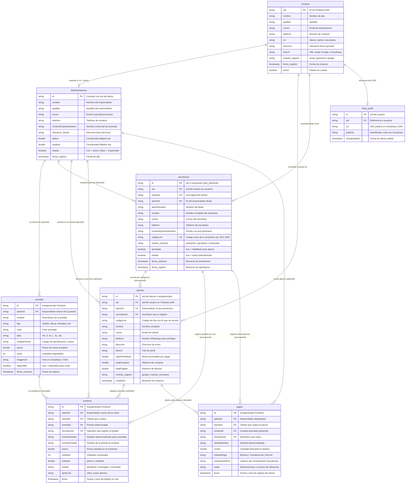

# Arquitectura y Esquema de Base de Datos — VENDIX
**Motor:** Google Cloud Firestore (NoSQL Document Store)  
**Proyecto:** VENDIX Live Commerce Management  
**Fecha de Generación:** 16 de noviembre de 2026  

---

## 1. Visión General del Modelo de Datos

VENDIX utiliza **Cloud Firestore** estructurado bajo un esquema de **colecciones raíz altamente desnormalizadas y optimizadas para lectura en tiempo real** a través de `StreamBuilder`. 

A diferencia de un modelo relacional tradicional (SQL), Firestore utiliza identificadores de documentos vinculados (`foreign keys` lógicas almacenadas como strings: `adminId`, `clienteId`, `secretarioId`, `prendaId`, `compraId`) para garantizar:
1. **Segregación multi-inquilino (Multi-tenant):** Cada emprendedor (`Administradores`) tiene su propio inventario (`prendas`), su equipo de trabajo (`secretarios`), sus clientes vinculados (`clientes`) y sus transacciones (`compras` y `pagos`).
2. **Consultas ultrarrápidas (<15ms):** Filtradas por índices compuestos (ej. `where('adminId', isEqualTo: ...)` y `orderBy('fecha', descending: true)`).
3. **Escalabilidad reactiva:** Notificaciones instantáneas de compras y actualización de saldos durante transmisiones en vivo (TikTok / Instagram / Facebook Live).

---

## 2. Diagrama Entidad-Relación (ERD)

---

## 3. Diccionario de Datos por Colección

### 3.1. `usuarios` (Autenticación y Perfil Base)
Es la colección central de autenticación de la aplicación, vinculada directamente con **Firebase Authentication** (`doc.id == User.uid`).

| Campo | Tipo | Requerido | Descripción |
| :--- | :--- | :---: | :--- |
| `uid` | `String` | **Sí** | Identificador único emitido por Firebase Auth. |
| `nombre` | `String` | **Sí** | Nombre del usuario (capturado en login o Google). |
| `apellido` | `String` | No | Apellido del usuario. |
| `correo` | `String` | **Sí** | Correo electrónico en minúsculas. |
| `telefono` | `String` | No | Número telefónico de contacto. |
| `rol` | `String` | **Sí** | Rol del sistema: `'cliente'`, `'administrador'`, `'secretario'` / `'secretaria'`. |
| `direccion` | `String` | No | Domicilio o sector de residencia. |
| `fotoUrl` | `String` | No | Enlace a la imagen en Cloudinary o Google avatar. |
| `metodo_registro`| `String` | No | `'google'` o `'email_password'`. |
| `activo` | `Boolean`| **Sí** | Bandera de acceso general a la plataforma (`true`). |
| `fecha_registro` | `Timestamp` | **Sí** | Marca de tiempo de registro (`serverTimestamp`). |

---

### 3.2. `Administradores` (Tiendas / Emprendedores)
Contiene la información de cada negocio y su dueño. La llave del documento es el `uid` del usuario administrador.

| Campo | Tipo | Requerido | Descripción |
| :--- | :--- | :---: | :--- |
| `id` / `doc.id` | `String` | **Sí** | Coincide con el `uid` del usuario. |
| `nombre` | `String` | **Sí** | Nombre del dueño del negocio. |
| `apellido` | `String` | No | Apellido del dueño. |
| `correo` | `String` | **Sí** | Correo oficial del emprendimiento. |
| `telefono` | `String` | No | Teléfono de WhatsApp para pedidos. |
| `nombreEmprendimiento`| `String` | **Sí** | Nombre comercial de la tienda (ej. *"Ojo de Fantasma"*). |
| `ubicacion_tienda` | `String` | No | Dirección escrita seleccionada en Mapbox. |
| `latitud` | `Double` | No | Latitud geográfica del local. |
| `longitud` | `Double` | No | Longitud geográfica del local. |
| `estado` | `Boolean`| **Sí** | `true` si la tienda está habilitada. |
| `fecha_registro` | `Timestamp` | **Sí** | Fecha de apertura de la tienda en VENDIX. |

---

### 3.3. `secretarios` (Equipo Operativo & Solicitudes de Empleo)
Permite a los usuarios operar transmisiones en vivo y tomar pedidos en nombre de un emprendedor. También gestiona el flujo de postulaciones laborales.

| Campo | Tipo | Requerido | Descripción |
| :--- | :--- | :---: | :--- |
| `doc.id` | `String` | **Sí** | Puede ser `uid` o compuesto `${clienteId}_${adminId}`. |
| `uid` / `clienteId` | `String` | **Sí** | `uid` del usuario que trabaja o postula. |
| `adminId` | `String` | **Sí** | `uid` del emprendedor al que asiste. |
| `adminNombre` | `String` | No | Nombre del dueño del negocio (desnormalizado). |
| `nombre` | `String` | **Sí** | Nombre completo del secretario(a). |
| `correo` | `String` | **Sí** | Correo electrónico de acceso. |
| `telefono` | `String` | No | Teléfono de contacto. |
| `nombreEmprendimiento`| `String` | No | Nombre del negocio donde labora. |
| `codigoLive` | `String` | No | **Código único de 6 caracteres** (ej. `HCC-929`) con el que los clientes se unen a su live. |
| `estado_solicitud` | `String` | **Sí** | `'pendiente'`, `'aprobado'`, `'rechazado'`. |
| `aprobado` | `Boolean`| **Sí** | `true` permite acceder al panel `SecretaryShell`. |
| `estado` | `Boolean`| **Sí** | Estado laboral activo/inactivo. |
| `fecha_solicitud` | `Timestamp` | **Sí** | Momento exacto de envío de postulación. |

---

### 3.4. `clientes` (Fichas de Compradores en Tiendas)
Almacena el registro de cada cliente vinculado a un negocio o creado durante un Live.

| Campo | Tipo | Requerido | Descripción |
| :--- | :--- | :---: | :--- |
| `doc.id` | `String` | **Sí** | `uid` del cliente o ID autogenerado. |
| `uid` | `String` | No | `uid` de autenticación si el cliente descargó la app. |
| `adminId` | `String` | **Sí** | ID del emprendimiento que lo atiende. |
| `secretarioId` | `String` | No | Secretario que lo enroló durante el Live. |
| `codigoLive` | `String` | No | Código con el cual se enlazó a la tienda. |
| `nombre` | `String` | **Sí** | Nombre completo de la clienta / cliente. |
| `correo` | `String` | No | Correo electrónico. |
| `telefono` | `String` | No | Celular de contacto para despachos. |
| `direccion` | `String` | No | Dirección domiciliaria de entrega. |
| `saldoPendiente` | `Double` | **Sí** | Saldo deudor en dólares (compras - pagos). |
| `totalCompras` | `Double` | No | Monto acumulado histórico comprado. |
| `totalPagado` | `Double` | No | Monto acumulado histórico abonado. |
| `creadoEn` | `Timestamp` | **Sí** | Fecha de vinculación o alta. |

---

### 3.5. `prendas` (Inventario / Catálogo de Productos)
Catálogo de ropa y accesorios perteneciente a cada emprendedor.

| Campo | Tipo | Requerido | Descripción |
| :--- | :--- | :---: | :--- |
| `doc.id` | `String` | **Sí** | Identificador de la prenda. |
| `adminId` | `String` | **Sí** | Dueño de la prenda (`Administradores`). |
| `nombre` | `String` | **Sí** | Título o descripción (ej. *"Vestido floral vintage"*). |
| `tipo` | `String` | No | Categoría (`Vestido`, `Falda`, `Pantalón`, etc.). |
| `color` | `String` | No | Color de la prenda. |
| `talla` | `String` | No | Talla física (`S`, `M`, `L`, etc.). |
| `codigoPrenda` | `String` | No | Código visible en etiqueta o perchero. |
| `precio` | `Double` | **Sí** | Valor unitario en dólares. |
| `stock` | `Integer`| **Sí** | Cantidad disponible en percha/bodega. |
| `imagenUrl` | `String` | No | Enlace a la fotografía subida a Cloudinary. |
| `disponible` | `Boolean`| **Sí** | `true` si se puede ofertar en el Live. |
| `fecha_creacion`| `Timestamp` | **Sí** | Fecha de ingreso al inventario. |

---

### 3.6. `compras` (Ventas y Pedidos en Tiempo Real)
Cada pedido realizado por un cliente en un Live o en el local físico.

| Campo | Tipo | Requerido | Descripción |
| :--- | :--- | :---: | :--- |
| `doc.id` | `String` | **Sí** | Identificador de la orden. |
| `adminId` | `String` | **Sí** | Negocio donde se efectúa la venta. |
| `clienteId` | `String` | **Sí** | ID del cliente comprador. |
| `prendaId` | `String` | No | ID de la prenda vendida en `prendas`. |
| `secretarioId` | `String` | No | Operador que anotó el pedido en vivo. |
| `nombreCliente` | `String` | **Sí** | Nombre del cliente (desnormalizado). |
| `nombrePrenda` | `String` | **Sí** | Nombre del producto. |
| `precio` | `Double` | **Sí** | Precio unitario aplicado. |
| `cantidad` | `Integer`| **Sí** | Número de prendas (por defecto 1). |
| `subtotal` | `Double` | **Sí** | `precio * cantidad`. |
| `estado` | `String` | **Sí** | `'pendiente'`, `'entregado'`, `'cancelado'`. |
| `tipoEnvio` | `String` | No | `'retiro_local'` o `'delivery'`. |
| `fecha` | `Timestamp` | **Sí** | Momento de la compra en vivo. |

---

### 3.7. `pagos` (Abonos y Cobranzas)
Transacciones financieras que liquidan o amortizan el saldo deudor de los clientes.

| Campo | Tipo | Requerido | Descripción |
| :--- | :--- | :---: | :--- |
| `doc.id` | `String` | **Sí** | Identificador del abono. |
| `adminId` | `String` | **Sí** | Negocio que recibe el dinero. |
| `clienteId` | `String` | **Sí** | Cliente que amortiza su deuda. |
| `compraId` | `String` | No | Vinculación a una compra específica si aplica. |
| `secretarioId` | `String` | No | Secretario que recibió el pago. |
| `clienteNombre` | `String` | No | Nombre del cliente. |
| `monto` | `Double` | **Sí** | Valor abonado en dólares USD. |
| `metodoPago` | `String` | **Sí** | `'Efectivo'`, `'Transferencia'`, `'DeUna'`, etc. |
| `comprobanteUrl`| `String` | No | Foto del recibo o voucher subido a Cloudinary. |
| `notas` | `String` | No | Referencia bancaria o detalle de pago. |
| `fecha` | `Timestamp` | **Sí** | Fecha y hora de recepción del dinero. |

---

### 3.8. `fotos_perfil` (Control de Media en Nube)
Colección auxiliar para indexar imágenes subidas a **Cloudinary CDN** y liberar a Firestore del almacenamiento binario.

| Campo | Tipo | Requerido | Descripción |
| :--- | :--- | :---: | :--- |
| `doc.id` / `uid` | `String` | **Sí** | Coincide con el `uid` del usuario. |
| `url` | `String` | **Sí** | URL segura HTTPS en Cloudinary. |
| `publicId` | `String` | No | ID interno de Cloudinary para reemplazos/borrado. |
| `actualizadoEn`| `Timestamp` | **Sí** | Fecha de subida o reemplazo de foto. |

---

## 4. Flujo de Negocio y Relaciones Clave

1. **Ciclo de Vinculación y Código de Live:**
   * El emprendedor aprueba a un secretario en `secretarios`.
   * El secretario genera o recibe un `codigoLive` (ej. `HCC-929`).
   * Cuando un cliente ingresa a la app, digita el código en `EnterCodeScreen`, lo cual actualiza automáticamente su documento en `usuarios` y `clientes` con el `adminId` y `secretarioId` correspondientes.
2. **Ciclo de Compras y Deuda en Vivo:**
   * Durante una transmisión, el secretario ingresa pedidos en `compras`.
   * El cliente visualiza en tiempo real en `ClientHomeScreen` y `ClientBalanceScreen` su saldo pendiente recalculado:
     $$\text{Saldo Pendiente} = \sum \text{compras.subtotal} - \sum \text{pagos.monto}$$
3. **Ciclo de Gestión Multi-empleo (Secretarios):**
   * Un usuario cliente puede postularse a varias tiendas en `SolicitudEmpleoScreen`.
   * Cada postulación genera un registro en `secretarios` (`${clienteId}_${adminId}`).
   * Cuando un emprendedor aprueba la solicitud (`aprobado: true`), en el perfil del cliente se desbloquea el botón **"Cambiar a modo Secretario"**, permitiéndole alternar entre ser cliente o trabajar para esa tienda.
