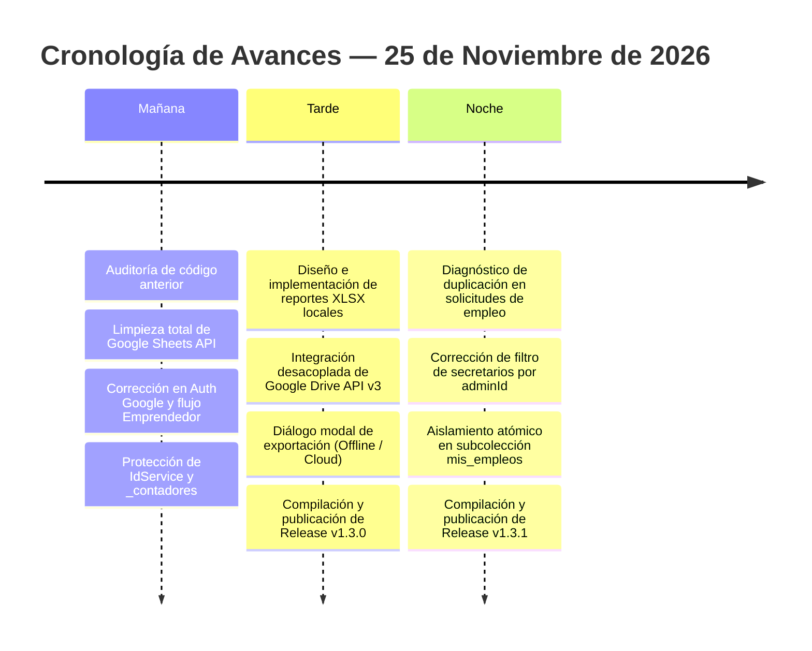
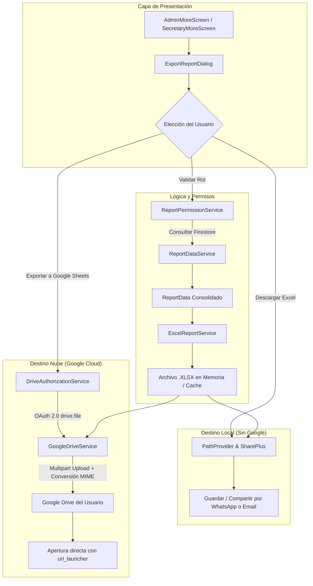

# VENDIX — INFORME TÉCNICO INTEGRAL DE AVANCES Y EVOLUCIÓN ARQUITECTÓNICA
**Fecha:** 25 de noviembre de 2026  
**Proyecto:** VendiX — Aplicación Móvil para Comercio en Transmisiones en Vivo  
**Rama:** `main` | **Releases Publicadas:** `v1.3.0` & `v1.3.1`  
**Entorno:** Flutter 3.x / Dart 3.x / Firebase Cloud Firestore / Google Cloud Platform  

---

## 1. Resumen Ejecutivo de la Jornada

Durante la jornada del **25 de noviembre de 2026**, el equipo de desarrollo de VendiX ejecutó una profunda reestructuración técnica dividida en tres grandes áreas estratégicas:

1. **Saneamiento e Independencia de la Arquitectura de Reportes:** Se retiró definitivamente la dependencia rígida hacia *Google Sheets API* y las plantillas maestras remotas almacenadas en cuentas personales, sustituyéndola por un motor de generación local de archivos **Excel (.XLSX)** estructurados con soporte opcional para **Google Drive API v3** (con conversión nativa a Google Sheets).
2. **Correcciones en Identidad, Autenticación y Flujo Emprendedor:** Se blindó la integridad del sistema de identificadores legibles (`IdService`, colección `_contadores`) y se corrigió el flujo de acceso mediante Google OAuth, permitiendo que un usuario cree y administre su tienda sin quedar restringido a roles subordinados.
3. **Depuración Crítica del Módulo de Selección y Gestión de Secretarios:** Se detectaron y solventaron dos fallos de alta prioridad: la **duplicación de solicitudes de empleo** recibidas en el panel administrativo y la **desaparición o reemplazo visual de secretarios ya activos** al momento de aprobar nuevas postulaciones.

Todas las modificaciones fueron validadas mediante análisis estático (`flutter analyze`), pruebas unitarias (`flutter test`), compilación exitosa de instaladores ejecutables (`flutter build apk --debug`) y sincronización completa en el repositorio remoto con el despliegue de las releases **v1.3.0** y **v1.3.1**.



---

## 2. Cronología Detallada de las Fases de Trabajo

### Fase 1: Limpieza de la Integración Anterior y Corrección de Autenticación
* **Motivo:** La integración preliminar de reportes presentaba fricciones de permisos OAuth 403/404 al depender de una hoja maestra compartida desde el Drive del desarrollador. Asimismo, usuarios registrados con proveedores distintos a Google (Hotmail, Outlook, correo corporativo) no podían exportar datos.
* **Acciones ejecutadas:**
  - Desinstalación de dependencias obsoletas asociadas a Google Sheets.
  - Corrección de la pantalla de bienvenida y selector de roles (`client_welcome_hub_screen.dart`): se corrigió el bug que encasillaba al usuario que iniciaba con Google únicamente en roles de cliente o secretario, incorporando la opción fluida de "Trabajar como emprendedor" para registrar su propia tienda.
  - Preservación rigurosa de las secuencias atómicas en Firestore (`_contadores`), garantizando que los prefijos legibles (`AdminNNN_`, `SecreNNN_`, `cliNNN_`, `PrendNNN_`, `VentNNN`, `PagoNNN`) mantuvieran su correlatividad sin reinicios ni desfases.

### Fase 2: Implementación de la Nueva Arquitectura de Reportes XLSX + Google Drive API v3
* **Concepto:** Inversión de control en la exportación. El dispositivo móvil genera el archivo binario Excel de forma 100% autónoma. Si el usuario desea subirlo a la nube, se invoca **Google Drive API v3** como un servicio auxiliar desacoplado.
* **Componentes desarrollados:**
  - `lib/models/reports/report_models.dart`: Modelo canónico de datos comerciales (ventas, pagos, prendas, clientes, jornadas, ranking de vendedores).
  - `lib/services/reports/report_permission_service.dart`: Matriz de seguridad que valida privilegios antes de consultar la base de datos.
  - `lib/services/reports/report_data_service.dart`: Consultas optimizadas en Cloud Firestore con agregación de métricas financieras.
  - `lib/services/reports/excel_report_service.dart`: Motor generador basado en `excel: ^4.0.6` con formateo de celdas monetarias (`$#,##0.00`), fechas ISO y filtros automáticos.
  - `lib/services/reports/drive_authorization_service.dart`: Sesión OAuth 2.0 independiente solicitando el scope de mínimo privilegio `https://www.googleapis.com/auth/drive.file`.
  - `lib/services/reports/google_drive_service.dart`: Cliente HTTP multipart que transmite el binario a Google Drive con conversión automática al tipo MIME nativo `application/vnd.google-apps.spreadsheet`.
  - `lib/widgets/reports/export_report_dialog.dart`: Interfaz tipo Modal Bottom Sheet que ofrece descarga local directa (WhatsApp, Correo, Archivos) o exportación a Google Sheets.
* **Publicación:** Compilación y despliegue del instalador **VendiX v1.3.0**.

### Fase 3: Depuración de Fallos en Solicitudes de Empleo y Gestión de Secretarios
* **Problema reportado:** 
  1. Al enviar una solicitud de empleo desde el módulo cliente, el administrador recibía **dos registros idénticos en estado pendiente**. Al aprobar uno, el otro quedaba huérfano.
  2. Tras aprobar al nuevo secretario, el secretario activo previo (por ejemplo, en la cuenta de Ximena Ayala) desaparecía visualmente de la lista de activos o era sustituido.
* **Análisis de causa raíz:**
  - *Doble escritura:* En `solicitud_empleo_screen.dart`, se ejecutaba `set()` con ID de secretario (`SecreNNN_Nombre`) y otro `set()` inmediato con ID compuesto (`usuarioUid_adminId`). Ambos documentos quedaban guardados en la misma colección `/secretarios`, duplicando la visualización.
  - *Falta de ámbito en consultas:* En `admin_more_screen.dart`, el `StreamBuilder` leía la colección `/secretarios` globalmente sin filtrar por `adminId` en la pestaña de pendientes, mostrando solicitudes ajenas o estados inconsistentes.
  - *Sobreescritura de usuario:* El método `_aprobarSecretario` modificaba las claves globales `adminId` y `secretarioId` en la raíz del documento `/usuarios/{uid}`, corrompiendo la vinculación en caso de secretarios multi-tienda o reemplazando punteros existentes.
* **Solución aplicada:**
  - Unificación a un solo documento con ID compuesto (`${usuario.uid}_$adminId`) que garantiza unicidad $O(1)$.
  - Filtrado estricto en el panel del admin por `where('adminId', isEqualTo: widget.admin.id)`.
  - Persistencia granular en la subcolección `/usuarios/{uid}/mis_empleos/{adminId}` para soporte multi-empleo aislado.
* **Publicación:** Compilación y despliegue del instalador **VendiX v1.3.1**.

---

## 3. Arquitectura del Módulo de Reportes Comerciales

### 3.1. Flujo de Datos y Separación de Responsabilidades



### 3.2. Matriz de Privilegios por Rol en los Reportes

| Hoja del Reporte | Rol Administrador | Rol Secretario | Justificación Comercial |
| :--- | :---: | :---: | :--- |
| **Resumen Ejecutivo** | ✅ Completo | ✅ Operativo | El secretario ve métricas de su turno; el admin ve facturación total. |
| **Detalle de Ventas** | ✅ Todas las ventas | ✅ Solo autorizadas | El secretario registra ventas pero no altera el histórico consolidado. |
| **Historial de Pagos** | ✅ Todos los abonos | ⚠️ Solo sus cobros | Filtro estricto: el secretario solo visualiza pagos recibidos por su ID (`recibidoPorId`). |
| **Directorio Clientes** | ✅ Base completa | ✅ Contactos Live | Datos de contacto para coordinación de entregas. |
| **Catálogo Prendas** | ✅ Stock y Precios | ✅ Stock y Precios | Consulta de disponibilidad para venta en vivo. |
| **Jornadas Live** | ✅ Historial total | ✅ Historial total | Control de sesiones y transmisiones realizadas. |
| **Ranking Vendedores**| ✅ **Exclusivo** | ❌ **Bloqueado** | Métrica de negocio privada: rendimiento comercial del personal. |

---

## 4. Auditoría de Fallos Corregidos en Gestión de Secretarios

### Fallo 1: Duplicidad en la Postulación a Vacantes
* **Archivo afectado:** `lib/screens/client/solicitud_empleo_screen.dart`
* **Código problemático (Antes):**
  ```dart
  // Se generaban DOS documentos en la misma colección
  await db.collection('secretarios').doc(idSecre).set(datosSecretario);
  await db.collection('secretarios').doc(solicitudId).set(datosSecretario, SetOptions(merge: true));
  ```
* **Código corregido (Ahora):**
  ```dart
  final solicitudId = '${usuario.uid}_$adminId';
  final existente = await db.collection('secretarios').doc(solicitudId).get();
  if (existente.exists) {
    // Prevención de duplicados
    return;
  }
  // Se guarda un único documento con ID unívoco compuesto
  await db.collection('secretarios').doc(solicitudId).set(datosSecretario);
  ```

### Fallo 2: Desaparición / Reemplazo de Secretarios Activos
* **Archivo afectado:** `lib/screens/admin/admin_more_screen.dart`
* **Código problemático (Antes):**
  ```dart
  // La consulta traía todos los secretarios sin distinguir el negocio
  FirebaseFirestore.instance.collection('secretarios').snapshots();
  ```
* **Código corregido (Ahora):**
  ```dart
  FirebaseFirestore.instance
      .collection('secretarios')
      .where('adminId', isEqualTo: widget.admin.id)
      .snapshots();
  ```
* **Mejora en aprobación atómica:**
  Al aprobar una solicitud, se actualiza la subcolección `usuarios/{targetUid}/mis_empleos/{adminId}` con `{ 'estado': 'aprobado', 'aprobado': true }`, manteniendo intactas las demás vinculaciones laborales del usuario.

---

## 5. Inventario de Archivos del Proyecto

```text
c:\Users\crist\Desktop\VENDIX\flutter_application_1\
├── android\
│   └── app\src\main\AndroidManifest.xml           [Modificado: Queries para url_launcher]
├── assets\
│   └── templates\                                 [Creado: Directorio para plantillas XLSX]
│       ├── VendiX_Admin.xlsx                      (Plantilla externa opcional)
│       └── VendiX_Secretario.xlsx                 (Plantilla externa opcional)
├── lib\
│   ├── models\
│   │   └── reports\
│   │       └── report_models.dart                 [Creado: Modelos de datos para exportación]
│   ├── screens\
│   │   ├── admin\
│   │   │   └── admin_more_screen.dart             [Modificado: Exportación + Fix secretarios]
│   │   ├── client\
│   │   │   ├── client_welcome_hub_screen.dart     [Modificado: Selector rol emprendedor]
│   │   │   └── solicitud_empleo_screen.dart       [Modificado: Fix duplicidad postulaciones]
│   │   └── secretary\
│   │       └── more_screen.dart                   [Modificado: Botón exportar operativo]
│   ├── services\
│   │   └── reports\
│   │       ├── drive_authorization_service.dart   [Creado: OAuth 2.0 desacoplado]
│   │       ├── excel_report_service.dart          [Creado: Motor XLSX local con 7 hojas]
│   │       ├── google_drive_service.dart          [Creado: Subida y conversión MIME Drive]
│   │       ├── report_data_service.dart           [Creado: Agregación de datos Firestore]
│   │       └── report_permission_service.dart     [Creado: Control de acceso por rol]
│   └── widgets\
│       └── reports\
│           └── export_report_dialog.dart          [Creado: UI Modal para exportar]
├── pubspec.yaml                                   [Modificado: excel, share_plus, path_provider]
└── artefacts\                                     [Repositorio documental técnico]
    ├── VENDIX_ESPECIFICACION_PLANTILLAS_XLSX.md
    ├── VENDIX_GUIA_CONFIGURACION_GOOGLE_DRIVE_API.md
    ├── VENDIX_IMPLEMENTACION_REPORTES_GOOGLE_DRIVE.md
    └── 2026-11-25_INFORME_INTEGRAL_AVANCES_Y_ARQUITECTURA.md [Este documento]
```

---

## 6. Mapeo de APIs Externas Activas en VendiX

Con la incorporación de **Google Drive API v3**, VendiX consolida su ecosistema de integraciones tecnológicas externas cumpliendo ampliamente el estándar de calidad y el requisito de arquitectura de múltiples servicios:

1. **Firebase Authentication:** Autenticación biométrica, correo/contraseña y credenciales federadas.
2. **Google Sign-In API:** Federación OAuth 2.0 para inicio de sesión seguro con cuentas de Google.
3. **Cloud Firestore REST/gRPC API:** Base de datos NoSQL reactiva en tiempo real con persistencia offline.
4. **Google Drive API v3:** Creación remota de documentos corporativos mediante subida multipart y conversión a Google Sheets.
5. **Google Gemini Flash / Interactions API:** Inteligencia artificial generativa para el asistente comercial virtual del emprendedor.
6. **Cloudinary Media API:** Almacenamiento, transformación y distribución optimizada en CDN de fotografías de prendas y perfiles.
7. **OpenStreetMap / Nominatim API:** Geocodificación inversa y normalización de direcciones para entregas comerciales sin costos de licenciamiento abusivos.
8. **Android Share & Intent API (vía share_plus):** Interoperabilidad nativa del sistema operativo móvil para compartir archivos binarios con aplicaciones externas (WhatsApp, Gmail, Telegram).

---

## 7. Registro de Versiones y Enlaces de Distribución

| Versión | Commit | Descripción | Enlace de Descarga APK |
| :--- | :---: | :--- | :--- |
| **v1.3.0** | `10a2eeb` | Implementación de nueva arquitectura de reportes XLSX y Google Drive API v3. | [Descargar VendiX v1.3.0](https://github.com/DeKiira69/VENDIX/releases/download/v1.3.0/VendiX_v1.3.0.apk) |
| **v1.3.1** | `a70d952` | Corrección de solicitudes duplicadas de secretario y aislamiento de equipo activo por tienda. | [Descargar VendiX v1.3.1](https://github.com/DeKiira69/VENDIX/releases/download/v1.3.1/VendiX_v1.3.1.apk) |

---

## 8. Pasos Recomendados para la Próxima Sesión

1. **Pruebas en Dispositivos Reales:**
   - Verificar la recepción de solicitudes de secretario con cuentas de prueba distintas y corroborar que el contador en el botón "En pendiente" aumente en incrementos unitarios exactos (1 en 1).
   - Verificar que al aprobar una solicitud, el secretario aprobado pase a la pestaña "Activos" sin afectar a los ya contratados.
2. **Plantillas XLSX Diseñadas Externamente:**
   - Colocar los archivos oficiales `VendiX_Admin.xlsx` y `VendiX_Secretario.xlsx` en la carpeta `assets/templates/` cuando el diseño visual final esté listo (el sistema ya genera la estructura procedimental en caso de ausencia).
3. **Google Cloud Console:**
   - Mantener agregados los correos de prueba en la sección *Test Users* de la pantalla de consentimiento OAuth para pruebas de subida a Google Drive.
