# 📋 Análisis Integral del Proyecto VENDIX (Actualización de Equipo)

> **Ubicación:** Guardado en la carpeta `backups/analisis_integral_proyecto.md` y en el directorio de artefactos del proyecto.
> **Fecha de Análisis:** 25 de Octubre de 2026.

---

## 1. Resolución del Problema de SDK y Dependencias

* **Diagnóstico:** Tu entorno local cuenta con **Dart 3.13.4** y **Flutter 3.47.5**. Cuando se actualizan proyectos que traen `sdk: ^3.13.5`, `flutter pub get` se bloquea exigiendo una versión superior.
* **Solución aplicada:** Se fijó la restricción en [`pubspec.yaml`](file:///c:/Users/crist/Desktop/VENDIX/flutter_application_1/pubspec.yaml#L21-L23) a:
  ```yaml
  environment:
    sdk: '>=3.13.0 <4.0.0'
  ```
* **Estado actual:** `flutter pub get` ejecutado y validado con éxito. Las dependencias de Firebase (`firebase_core`, `cloud_firestore`, `firebase_auth`, `google_sign_in`, `cupertino_icons`) están completamente resueltas y operativas.

---

## 2. Diagnóstico Comparativo: ¿Qué trajo nuevo tu compañera?

Al cotejar la carpeta recién integrada contra nuestra **Línea Base**, se identificó una evolución muy positiva. Tu compañera implementó la capa para **Clientes** y **Emprendedoras**, complementando armónicamente lo que ya habíamos hecho para el Administrador y Firestore:

```mermaid
flowchart TD
    subgraph "NUEVOS MÓDULOS DE TU COMPAÑERA"
        C1["lib/services/client_service.dart\n(Capa Firestore para Clientes, Compras y Pagos)"]
        C2["lib/screens/client/client_shell.dart\n(BottomNav exclusivo del Cliente)"]
        C3["lib/screens/client/client_home_screen.dart\n(Dashboard del comprador de TikTok)"]
        C4["lib/screens/client/client_purchases_screen.dart\n(Historial de compras en vivo)"]
        C5["lib/screens/client/client_balance_screen.dart\n(Estado de cuenta y saldos pendientes)"]
        C6["lib/screens/client/client_profile_screen.dart\n(Perfil del cliente)"]
        C7["lib/screens/auth/register_client_screen.dart\n(Registro autónomo de clienta)"]
        C8["lib/screens/auth/register_entrepreneur_screen.dart\n(Registro de negocio/emprendimiento)"]
    end

    subgraph "MÓDULOS DEL ADMINISTRADOR (NUESTROS)"
        A1["python/gestion_admin.py\n(Script CLI de registro y consulta de Admins)"]
        A2["lib/screens/admin/admin_home_screen.dart\n(Dashboard Admin Figma + Gestión Secretarios)"]
        A3["lib/models/administrador_model.dart & prenda_model.dart"]
        A4["lib/data/prenda_service.dart\n(Prendas en tiempo real con Firestore)"]
        A5["run_web.bat / run_brave.bat\n(Lanzador Web + Conexión USB a Celular)"]
    end

    C1 -.-> Login["login_screen.dart (Enrutador Multi-Rol Unificado)"]
    A2 -.-> Login
```



---

## 3. Estado de la Navegación y Roles en `login_screen.dart`

La pantalla de inicio de sesión [`login_screen.dart`](file:///c:/Users/crist/Desktop/VENDIX/flutter_application_1/lib/screens/auth/login_screen.dart) cuenta con una arquitectura de detección jerárquica:

1. **Si es Administrador:** Verifica en Firestore la colección `Administradores` (creados desde [`python/gestion_admin.py`](file:///c:/Users/crist/Desktop/VENDIX/flutter_application_1/python/gestion_admin.py)) o en `usuarios` con rol `'admin'` $\rightarrow$ Abre [`admin_home_screen.dart`](file:///c:/Users/crist/Desktop/VENDIX/flutter_application_1/lib/screens/admin/admin_home_screen.dart).
2. **Si es Cliente:** Verifica el rol `'cliente'` en `usuarios` o `clientes` $\rightarrow$ Abre el portal [`client_shell.dart`](file:///c:/Users/crist/Desktop/VENDIX/flutter_application_1/lib/screens/client/client_shell.dart).
3. **Si es Secretaria:** Verifica el rol `'secretaria'` $\rightarrow$ Abre el panel operativo [`secretary_shell.dart`](file:///c:/Users/crist/Desktop/VENDIX/flutter_application_1/lib/screens/secretary/secretary_shell.dart).
4. **Bypass de Desarrollo:** Mantiene habilitado el acceso rápido de prueba para que puedas inspeccionar cualquiera de las vistas sin necesidad de ingresar credenciales.

---

## 4. Estado de los Datos y Conexión con Firestore

| Entidad / Colección | Estado en Flutter | Estado en Firestore |
| :--- | :--- | :--- |
| **`Administradores`** | Conectado ([`administrador_model.dart`](file:///c:/Users/crist/Desktop/VENDIX/flutter_application_1/lib/models/administrador_model.dart)) | Gestionado mediante CLI [`python/gestion_admin.py`](file:///c:/Users/crist/Desktop/VENDIX/flutter_application_1/python/gestion_admin.py). |
| **`prendas`** | Conectado en tiempo real ([`clothing_prices_screen.dart`](file:///c:/Users/crist/Desktop/VENDIX/flutter_application_1/lib/screens/secretary/clothing_prices_screen.dart)) | Sincronizado vía `StreamBuilder` con operaciones CRUD completas. |
| **`clientes`** | Conectado con [`client_service.dart`](file:///c:/Users/crist/Desktop/VENDIX/flutter_application_1/lib/services/client_service.dart) | Registra datos comerciales, compras y abonos. |
| **`secretarios`** | Conectado desde el modal del Admin | Guarda nombre, correo, teléfono y estado activo. |
| **`jornadas` (Live Sessions)** | **Pendiente** | Falta vincular la apertura/cierre de la transmisión de TikTok a Firestore. |
| **`ventas` & `detalle_venta`** | **Pendiente** | Falta enlazar `quick_sales_screen.dart` con la colección de ventas reales de Firestore. |

---

## 5. Resumen de Salud del Código

* **Análisis estático (`flutter analyze`):** 0 errores de compilación.
* **Compatibilidad de Plataformas:**
  * **Web (Brave / Chrome / Edge):** Totalmente funcional mediante `run_web.bat`.
  * **Móvil Android:** Listo para ejecutar con cable USB mediante la opción `4` de `run_web.bat`.
* **Copia de Respaldo:** Preservada intacta en la carpeta [`backups/`](file:///c:/Users/crist/Desktop/VENDIX/flutter_application_1/backups/).
