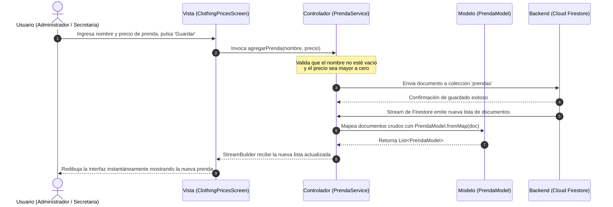

# Arquitectura Modelo-Vista-Controlador (MVC) en VENDIX

> [!NOTE]
> Este documento describe la arquitectura **MVC (Model-View-Controller)** implementada en la aplicación móvil **VENDIX** (desarrollada con Flutter y Firebase). Contiene diagramas visuales en Mermaid, el mapeo exacto de los archivos del proyecto y un resumen listo para diapositivas de exposición.

---

## 🏛️ ¿Cómo se adapta MVC a Flutter + Firebase en VENDIX?

En aplicaciones desarrolladas con Flutter reactivo y Firebase, el patrón clásico MVC se organiza de la siguiente manera:

* **MODELO (Model):** Representa las entidades de datos del negocio y su estructura. Mapea la información proveniente de **Cloud Firestore** a objetos fuertemente tipados en Dart.
* **VISTA (View):** Conjunto de widgets (`StatelessWidget` / `StatefulWidget`) que componen la interfaz gráfica de usuario (UI), capturan eventos del usuario (taps, inputs de texto) y reaccionan a los cambios de estado visuales.
* **CONTROLADOR (Controller / Services):** Capa intermedia encargada de la lógica de negocio, validaciones, consultas a la base de datos (Streams/Futures), llamadas a **Firebase Authentication** y transformación de datos antes de enviarlos a la vista.

---

## 📊 1. Diagrama Estructural de la Arquitectura MVC

```mermaid
graph TD
    subgraph VISTA ["VISTA (View - Interfaz de Usuario)"]
        V1["LoginScreen / RegisterScreens<br/>(Autenticación)"]
        V2["AdminHomeScreen / AdminMoreScreen<br/>(Panel Administrador)"]
        V3["ClothingPricesScreen / QuickSalesScreen<br/>(Módulo Secretaria)"]
        V4["ClientsScreen / PaymentsScreen<br/>(Gestión de Clientas)"]
        V5["ClientShell / ClientHomeScreen<br/>(Portal Cliente)"]
    end

    subgraph CONTROLADOR ["CONTROLADOR (Controller / Servicios de Negocio)"]
        C1["AuthLogic / RoleRouter<br/>(Controlador de Acceso y Roles)"]
        C2["PrendaService<br/>(CRUD Catálogo en Firestore)"]
        C3["ClientService<br/>(Gestión de Clientes, Compras y Pagos)"]
        C4["AdminController / FirebaseFirestore.instance<br/>(Gestión de Secretarios y Métricas)"]
    end

    subgraph MODELO ["MODELO (Model - Entidades de Datos)"]
        M1["AdministradorModel<br/>(id, nombre, correo, rol)"]
        M2["PrendaModel<br/>(id, nombre, precio, activa)"]
        M3["ClienteModel / ClienteDemo<br/>(nombre, teléfono, deuda, saldo)"]
        M4["CompraModel / PagoModel<br/>(cantidad, subtotal, fecha, abonos)"]
    end

    subgraph BACKEND ["BACKEND & PERSISTENCIA (Firebase Cloud)"]
        B1[("Firebase Authentication<br/>(Identidad & JWT)")]
        B2[("Cloud Firestore<br/>(Colecciones NoSQL en Tiempo Real)")]
    end

    %% Flujos de interacción
    VISTA -- "1. Eventos de usuario (Clicks / Inputs)" --> CONTROLADOR
    CONTROLADOR -- "2. Actualiza / Consulta estado" --> MODELO
    CONTROLADOR <--> "3. Operaciones CRUD & Streams" --> BACKEND
    MODELO -. "4. Estructura datos mapeados" .-> CONTROLADOR
    CONTROLADOR -- "5. Emite Streams / Notifica cambios (setState)" --> VISTA

    style VISTA fill:#F0E9FC,stroke:#6C4AB6,stroke-width:2px,color:#241B35
    style CONTROLADOR fill:#FFF0E9,stroke:#E76F45,stroke-width:2px,color:#241B35
    style MODELO fill:#E8F5E9,stroke:#15966B,stroke-width:2px,color:#241B35
    style BACKEND fill:#FFF9E6,stroke:#FFA000,stroke-width:2px,color:#241B35
```

---

## 🔄 2. Diagrama de Secuencia MVC: Flujo de Operación Real (Ej. Gestión de Prendas)



---

## 📂 3. Mapeo de Archivos del Proyecto VENDIX en MVC

| Capa MVC | Archivos en el Proyecto (`lib/`) | Responsabilidad en VENDIX |
| :--- | :--- | :--- |
| **MODELO (M)** | 📄 `lib/models/prenda_model.dart`<br/>📄 `lib/models/administrador_model.dart`<br/>📄 `lib/data/datos_prueba.dart` (Modelos Demo) | Define la estructura de datos: nombres de campos, tipos (`String`, `double`, `bool`), serializadores `fromMap` y `toMap`. |
| **VISTA (V)** | 📁 `lib/screens/auth/` (`login_screen.dart`, registros)<br/>📁 `lib/screens/admin/` (`admin_home_screen.dart`, etc.)<br/>📁 `lib/screens/secretary/` (`clients_screen.dart`, etc.)<br/>📁 `lib/screens/client/` (`client_shell.dart`, etc.)<br/>🎨 `lib/theme/app_theme.dart` | Renderiza la interfaz gráfica, componentes visuales de Figma, botones, formularios modales y captura los eventos táctiles del usuario. |
| **CONTROLADOR (C)** | 📄 `lib/data/prenda_service.dart`<br/>📄 `lib/services/client_service.dart`<br/>⚙️ Métodos controladores en `login_screen.dart` (`_iniciarSesion`, `_abrirInterfazPorRol`) | Ejecuta la lógica de validación, cálculos matemáticos (saldos, deuda, totales), y orquesta la comunicación con Firebase Auth y Firestore. |

---

## 🎯 4. Contenido Sintetizado para Diapositivas

Si vas a presentar esto en una diapositiva de la exposición, utiliza estos tres bloques:

### 1. Modelo (Model)
* **Función:** Modela los datos puros de la aplicación.
* **En VENDIX:** Clases `PrendaModel` y `AdministradorModel`. Convierten los datos NoSQL JSON de Cloud Firestore en objetos Dart seguros.

### 2. Vista (View)
* **Función:** Interfaz gráfica interactiva que ve el usuario.
* **En VENDIX:** Pantallas organizadas por roles (`LoginScreen`, `AdminHomeScreen`, `ClientsScreen`, `ClothingPricesScreen`). Utiliza widgets reactivos (`StreamBuilder`) que se redibujan solos cuando hay cambios.

### 3. Controlador (Controller / Services)
* **Función:** Cerebro lógico que conecta la Vista con los Modelos y el Backend.
* **En VENDIX:** `PrendaService` y `ClientService`. Gestiona las consultas en tiempo real (`Streams`), valida reglas de negocio (ej. pagos no mayores a la deuda) y maneja la autenticación segura en Firebase.

---

### 💡 Conclusión de Arquitectura:
> *"La separación mediante el patrón MVC permite que la interfaz de usuario en Flutter sea totalmente independiente de la lógica de Firebase. Si en el futuro se modifica la base de datos o se añade una API externa de pagos, la Vista no sufre cambios estructurales, garantizando un mantenimiento modular y escalable."*
