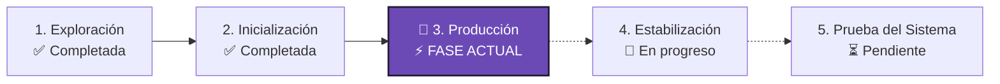

# Metodología Mobile-D aplicada a VENDIX (Contenido para Diapositiva)

> [!NOTE]
> Formato optimizado para diapositiva: Explicación de la metodología, razones de elección, y las **5 fases adaptadas a VENDIX** con la **Fase 3 (Fase Actual) en un solo párrafo continuo**.

---

## 1. ¿Qué es Mobile-D y por qué se eligió para VENDIX?

* **¿Qué es?:** Metodología ágil creada por el centro de investigación finlandés VTT (*Abrahamsson et al.*) diseñada específicamente para el desarrollo de **software móvil**. Fusiona la planificación en ciclos cortos de **Scrum** con las buenas prácticas de programación de **Extreme Programming (XP)**.
* **¿Por qué se decidió usarla en VENDIX?:**
  1. **Enfoque móvil especializado:** Pensada para lidiar con pantallas táctiles, memoria limitada y transcurso de eventos rápidos como un TikTok Live.
  2. **Ciclos rápidos e incrementales:** Permite al equipo avanzar por módulos pequeños y validar cada avance directamente con los prototipos de Figma.
  3. **Verificación continua en hardware:** Facilita probar el software desde etapas tempranas en emulador (**MuMuPlayer**), teléfono físico USB y Web.

---

## 2. Las 5 Fases de Mobile-D adaptadas a VENDIX

* **1️⃣ Fase 1: Exploración *(Completada)*:** Identificación de la problemática de desorganización de pedidos y cobros en los directos de TikTok Live, definición de los 3 roles de usuario (**Administrador, Secretaria y Cliente**) y diseño de las maquetas interactivas en **Figma**.

* **2️⃣ Fase 2: Inicialización *(Completada)*:** Preparación del entorno de desarrollo con **Flutter (Dart)**, configuración del proyecto en la nube de **Firebase**, conexión del emulador **MuMuPlayer vía ADB** y scripts de automatización multiplataforma (`run_web.bat`).

* **3️⃣ Fase 3: Producción *(📍 FASE ACTUAL EN LA QUE ESTAMOS)*:** Corresponde a la etapa de desarrollo iterativo donde se programa la lógica de negocio y las interfaces principales (Panel de Administrador, Secretaria y Clientas); actualmente el proyecto se encuentra en esta fase teniendo integradas exclusivamente las dos APIs esenciales de Firebase, que son **Firebase Authentication** para el control de acceso y enrutamiento inteligente por roles, y **Cloud Firestore** para la persistencia en tiempo real del equipo de secretarios, prendas y cartera de clientes, quedando pendientes para futuras iteraciones las APIs externas secundarias (como pasarelas de pago o logística externa) y los módulos de inventario avanzado.

* **4️⃣ Fase 4: Estabilización *(En curso)*:** Depuración y optimización de la experiencia móvil: envoltorios con `Scaffold` para evitar pantallas rojas, bloqueo estricto en orientación vertical (`portraitUp`), resolución de ciclo de vida de diálogos y barra animada con selector de rol.

* **5️⃣ Fase 5: Prueba del Sistema *(Pendiente)*:** Pruebas integrales de rendimiento simulando un directo real de TikTok Live con alto flujo de pedidos, empaquetado del archivo APK final para instalación y entrega formal.

---

### 🗣️ Resumen hablado para la exposición:
> *"Adoptamos la metodología **Mobile-D** porque está diseñada a la medida de los requerimientos de una aplicación móvil. El proyecto **VENDIX** se encuentra actualmente en la **Fase 3: Producción**, teniendo la interfaz programada en Flutter y conectada a las APIs esenciales de Firebase (Autenticación y Firestore), mientras avanzamos en la estabilización antes de las pruebas de sistema finales."*
